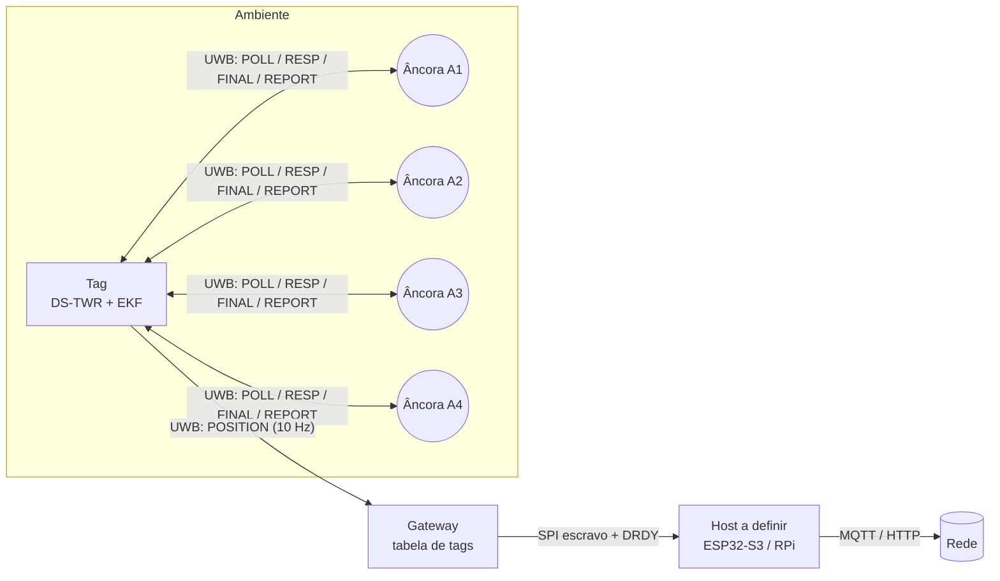
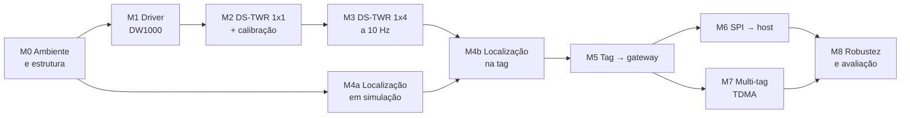

# 01 — Planejamento do desenvolvimento

Documento-mestre do firmware do RTLS (Real-Time Locating System) sobre a
placa **DWM1001-DEV** com **Zephyr RTOS**. Ele define escopo, requisitos,
decisões técnicas, marcos (roadmap), estratégia de validação e riscos. Os
detalhes ficam nos documentos irmãos:

| Documento | Conteúdo |
|-----------|----------|
| [02-arquitetura.md](02-arquitetura.md) | Hardware, camadas de firmware, papéis, threads, configuração |
| [03-protocolo-uwb.md](03-protocolo-uwb.md) | PHY, quadros, sequência DS-TWR, temporização, TDMA |
| [04-algoritmos.md](04-algoritmos.md) | DS-TWR, calibração, multilateração, filtro de Kalman |
| [05-interface-spi-gateway.md](05-interface-spi-gateway.md) | Protocolo SPI gateway → host |
| [06-configuracao-ambiente.md](06-configuracao-ambiente.md) | Setup do ambiente (Windows/Linux), build, gravação |
| [07-bancada.md](07-bancada.md) | Detalhes da bancada do M1 ao M3 |
| [08-etapas-e-testes.md](08-etapas-e-testes.md) | Etapas M0–M8 com roteiro de teste e critério de aceite |

---

## 1. Contexto e objetivo

Trabalho de Conclusão de Curso: um RTLS por UWB com **algoritmo próprio**,
sem o firmware proprietário PANS da Decawave/Qorvo. O sistema usa a
arquitetura **TWR (Two-Way Ranging)**. A **tag** mede sua distância até as
âncoras, calcula a própria posição com um **filtro de Kalman embarcado** e
envia o resultado ao **gateway**. O gateway entrega as posições de todas as
tags a um host externo via **SPI**.

**Foco desta etapa:** gerar a posição e devolvê-la, ou seja, levar a posição
da tag até o host. Recursos fora desse caminho ficam para depois (seção 2.2).

## 2. Escopo

### 2.1 Dentro do escopo

- Driver próprio do DW1000 sobre Zephyr, com timestamps de 40 bits (15,65 ps).
- Ranging DS-TWR entre uma tag e até 4 âncoras, a 10 Hz.
- Estimação de posição na tag: multilateração (inicialização/baseline) +
  filtro de Kalman estendido (EKF) com as distâncias como medidas.
- Envio da posição (com incerteza) da tag ao gateway por UWB.
- Gateway: tabela de tags e interface SPI escravo com sinal *data ready*
  para o host.
- Múltiplas tags por TDMA (marco M7).
- Configuração por nó (ID, posição da âncora, atrasos de antena).
- Testes unitários dos algoritmos (native_sim) e roteiro de validação em
  bancada para o TCC.

### 2.2 Fora do escopo (por enquanto)

- Baixo consumo (sleep do DW1000/nRF52, duty-cycle).
- Atualização OTA / MCUboot.
- Segurança (criptografia, autenticação de quadros).
- BLE, mesh, roteamento por múltiplos saltos.
- TDoA (exige sincronismo de relógio entre âncoras).
- Lógica de rede/nuvem: é responsabilidade do host (ex.: ESP32-S3 com MQTT).

## 3. Requisitos

### 3.1 Funcionais

| ID | Requisito |
|----|-----------|
| RF-01 | A tag mede a distância até no máximo 4 âncoras por DS-TWR a cada ciclo de 100 ms (10 Hz). |
| RF-02 | A tag estima a própria posição (2D com altura fixa ou 3D) com um filtro de Kalman embarcado. |
| RF-03 | A cada ciclo, a tag envia ao gateway a posição estimada com incerteza e indicadores de qualidade. |
| RF-04 | A âncora fica em posição fixa conhecida, responde ao protocolo TWR e informa a própria posição. |
| RF-05 | O gateway recebe as posições de todas as tags e mantém uma tabela atualizada, com expiração. |
| RF-06 | O gateway entrega a tabela via SPI (escravo) a um host externo e sinaliza dado novo por GPIO. |
| RF-07 | Os parâmetros de cada nó podem ser configurados no build (Kconfig) e, a partir do M8, em runtime. |
| RF-08 | Todos os papéis emitem logs de diagnóstico pela UART (VCOM do J-Link, 115200 bps). |

### 3.2 Não funcionais

| ID | Requisito | Meta |
|----|-----------|------|
| RNF-01 | Taxa de atualização por tag | 10 Hz (período 100 ms ± 1 ms) |
| RNF-02 | Precisão (LOS, estático, 2D) | erro RMS ≤ 15 cm |
| RNF-03 | Latência medição → host | ≤ 50 ms |
| RNF-04 | Escalabilidade | ≥ 4 tags a 10 Hz (meta: 8; caminho para ≥ 15 em [03 §5.3](03-protocolo-uwb.md#53-de-onde-vem-o-limite-de-8-tags-e-como-subir)) |
| RNF-05 | Entrega de posições no gateway | ≥ 99 % (1 tag, LOS, 10 min) |
| RNF-06 | Reprodutibilidade | versões fixadas (Zephyr v4.4.0, SDK 1.0.1); build idêntico em Windows e Linux |
| RNF-07 | Testabilidade | algoritmos (TWR, localização, codec) sem dependência de hardware e testáveis em `native_sim` |
| RNF-08 | Recursos | caber no nRF52832 (512 KB flash / 64 KB RAM) com alocação estática |

## 4. Decisões técnicas

| Tema | Decisão | Justificativa |
|------|---------|---------------|
| RTOS | Zephyr **v4.4.0**, fixado no [`west.yml`](../west.yml) | Placa suportada oficialmente (`decawave_dwm1001_dev`); `west sdk install` e `west packages` simplificam o setup. A v4.4 tem suporte até 04/2027, o que cobre o TCC. |
| Topologia west | **T2**: este repositório é o *manifest repository* | Fixa as versões de tudo (Zephyr + módulos) num só arquivo. Só clona os módulos necessários (`cmsis_6`, `hal_nordic`, `segger`). |
| Driver UWB | **Driver próprio** em `drivers/dw1000` | O driver do Zephyr (`ieee802154_dw1000`) converte timestamps para **ns**, um erro de ~30 cm por timestamp que inviabiliza o TWR. Ele também só entrega quadros pela pilha de rede. A API da Decawave tem licença restritiva e não seria "algoritmo próprio". O mapa de registradores do Zephyr (Apache-2.0) e o *DW1000 User Manual* servem de referência. |
| Ranging | **DS-TWR assimétrico** com POLL em broadcast e RESP/REPORT em slots | Cancela o erro de deriva de relógio sem exigir tempos de resposta iguais. Atende 4 âncoras numa única rodada de ~10 ms. |
| Onde calcular | **Na tag** (as âncoras só devolvem intervalos de tempo) | Requisito do sistema. Mantém o algoritmo num único lugar e deixa a âncora simples. |
| Estimador | **EKF** com estado posição+velocidade e atualização sequencial por distância. LS para inicializar e como baseline. | Funciona mesmo com menos de 3 âncoras num ciclo e descarta outliers por gating. A comparação EKF × LS rende material de avaliação para o TCC. |
| Ponto flutuante | `float` (FPU do Cortex-M4F) no EKF; `double` só no cálculo do ToF | Desempenho, com precisão suficiente onde importa. |
| Acesso ao meio | Uma tag com ciclo livre (M3–M6) → **TDMA** com beacon do gateway (M7) | Incremental: valida o caminho completo com uma tag antes de escalar. |
| Retorno da posição | Quadro `POSITION` sem ACK, com número de sequência | Simples e com perdas mensuráveis. ACK/retransmissão fica opcional. |
| Gateway → host | **SPI escravo** (SPIS1 no header RPi) + GPIO *data ready* (P0.26), framing TLV no estilo PANS | Mesmos pinos e mesmo modelo de transação do PANS. Permite reaproveitar o host ESP32-S3 já desenvolvido (`dwm1001-gateway-esp`). |
| Configuração | Kconfig + arquivos `.conf` por nó (M0–M7); shell + NVS (M8) | Começa simples e reprodutível; evolui para um único binário por papel. |
| Logs | Zephyr logging (modo deferred) na UART0 | Não bloqueia o caminho de tempo real. |

## 5. Visão geral da solução

Para os detalhes, veja [02-arquitetura.md](02-arquitetura.md) e
[03-protocolo-uwb.md](03-protocolo-uwb.md).

## 6. Roadmap (marcos)

Cada marco termina num estado **testável**, com critério de aceite binário.
O roteiro de teste de cada marco está em [08-etapas-e-testes.md](08-etapas-e-testes.md).
As estimativas de esforço são em semanas e são relativas, para ajustar ao
cronograma do TCC.

**Situação atual:**

| Marco | Situação |
|-------|----------|
| M0 | concluído |
| M1, M2, M3 | implementados e compilando; falta a validação em hardware ([07-bancada.md](07-bancada.md)) |
| M4 a M8 | pendentes |

### M0 — Ambiente e estrutura base · ~1 semana

- **Tarefas:** manifesto west; módulo Zephyr (`lib/`, `drivers/`, `include/`);
  esqueleto dos três apps; scripts de setup para Windows e Linux;
  documentação; *probe* do DW1000 (reset + leitura do `DEV_ID`); matemática
  do DS-TWR e codec de quadros com testes unitários.
- **Entregáveis:** este repositório e os documentos `docs/01..06`.
- **Aceite:**
  - `west build` dos três apps sem erros, no Windows e no Linux;
  - `west twister -T tests` passa em `native_sim` (Linux/WSL);
  - na placa, o LED verde pisca e o log mostra `DW1000 DEV_ID 0xdeca0130`.

### M1 — Driver DW1000 próprio · ~3 semanas

- **Tarefas:**
  - Reset e inicialização: clocks/PLL, carga do microcódigo LDE, leitura da
    OTP (XTAL trim, atrasos de antena de fábrica).
  - Configuração da PHY: canal 5, PRF 64 MHz, preâmbulo 128, 6,8 Mbps,
    aplicando os ajustes que o *User Manual* manda alterar após o reset
    (`AGC_TUNE1/2`, `DRX_TUNE*`, `LDE_CFG*`, `TX_POWER`, `RF_TXCTRL`,
    `TC_PGDELAY`, `FS_PLLTUNE`).
  - Tratamento de IRQ: a ISR do GPIO libera um semáforo e a thread dona do
    rádio trata o evento.
  - TX imediato e TX atrasado (*delayed TX*), RX com timeout,
    *wait-for-response*.
  - Leitura dos timestamps de TX/RX (40 bits) e dos diagnósticos de RX
    (potência do primeiro caminho e potência total).
  - Filtragem de quadros (PAN ID e endereço curto).
  - App de bancada `samples/uwb_pingpong`.
- **Aceite:** ping-pong entre 2 placas por 10 min com PER < 1 % a 3 m.
  TX atrasado com ≥ 500 µs de antecedência nunca gera `HPDWARN`.

### M2 — DS-TWR 1×1 e calibração · ~2 semanas

- **Tarefas:** máquinas de estado *initiator* (tag) e *responder* (âncora)
  com POLL/RESP/FINAL/REPORT; cálculo do ToF (`lib/twr/twr_math.c`); log CSV
  das distâncias; procedimento de calibração dos atrasos de antena
  ([04-algoritmos.md §3](04-algoritmos.md#3-calibração-do-atraso-de-antena));
  correção do viés dependente do RSL pela tabela 2 do APS011
  ([04-algoritmos.md §3.1](04-algoritmos.md#31-correção-do-viés-dependente-do-rsl-aps011)).
- **Aceite:** a 1, 3 e 5 m (LOS), |viés| ≤ 10 cm e σ ≤ 5 cm em 1000 medidas,
  **com** a correção por RSL ligada.

### M3 — DS-TWR 1×4 a 10 Hz · ~2 semanas

- **Tarefas:** POLL em broadcast com a lista de âncoras; RESP/REPORT em
  slots; timeouts e tratamento de respostas ausentes; temporização do ciclo
  por timer absoluto; estatísticas por âncora (taxa de sucesso, σ).
- **Aceite:** ≥ 95 % dos ciclos com 4 distâncias válidas; período medido de
  100 ms ± 1 ms; rodada completa ≤ 12 ms (medida com GPIO de debug e
  analisador lógico).

### M4 — Localização na tag (núcleo do TCC) · ~3 semanas

- **M4a (paralelo ao M1–M3, sem hardware):**
  - Pequena biblioteca de matrizes.
  - Multilateração LS (linear + refinamento Gauss-Newton).
  - EKF de velocidade constante com atualização sequencial e gating χ².
  - Modos 2D e 3D.
  - Testes ztest com trajetórias sintéticas e um simulador/plotter em
    Python (`tools/`).
- **M4b:** integração na tag com as distâncias reais do M3.
- **Aceite:**
  - Simulação (σrange = 5 cm): RMSE ≤ 5 cm parado e ≤ 10 cm em
    trajetória a 1 m/s.
  - Hardware (2D, LOS, parado): RMSE ≤ 15 cm.
  - O EKF executa em ≤ 1 ms no nRF52832.

### M5 — Retorno da posição (tag → gateway) · ~1 semana

- **Tarefas:** quadro `POSITION`; RX contínuo no gateway; tabela de tags com
  expiração; saída CSV na UART do gateway.
- **Aceite:** ≥ 99 % das posições recebidas (1 tag, 10 Hz, 10 min);
  latência POLL → gateway ≤ 15 ms.

### M6 — Interface SPI gateway → host · ~2 semanas

- **Tarefas:** SPIS1 + DRDY (P0.26); protocolo TLV
  ([05-interface-spi-gateway.md](05-interface-spi-gateway.md)) com paginação
  e CRC; host de referência (script Python com `spidev` num RPi e/ou
  integração no ESP32-S3).
- **Aceite:** o host lê a tabela a 10 Hz por 10 min sem erro de CRC;
  latência tag → host ≤ 50 ms.

### M7 — Múltiplas tags (TDMA) · ~2 semanas

- **Tarefas:** beacon do gateway no início de cada superquadro de 100 ms;
  slot por tag (ID → slot); sincronização e guarda; a tag fora de sincronia
  não transmite.
- **Aceite:** 4 tags a 10 Hz com ≥ 95 % de ciclos completos cada, sem
  colisões observadas no gateway.

### M8 — Robustez, configuração e avaliação · ~3 semanas

- **Tarefas:** shell + `settings` (NVS) para ID, posição da âncora e atrasos
  de antena; watchdog; mitigação de NLOS por diagnósticos de RX; campanha
  experimental e análise de dados (seção 7.3).
- **Aceite:** reconfigurar um nó sem recompilar; 1 h de operação contínua
  sem reset; dataset e gráficos para o texto do TCC.

**Total estimado:** ~19 semanas. O M4a corre em paralelo e reduz o caminho
crítico.

## 7. Verificação e validação

### 7.1 Testes automatizados

- **Unitários (ztest + twister em `native_sim`):** `twr_math` (fórmula,
  *wrap* de 40 bits, deriva de relógio), `proto` (codec, tamanhos de quadro) e
  `loc` (convergência, gating, casos degenerados). Rodam no Linux, no WSL ou
  na CI (o `native_sim` não roda no Windows nativo).
- **Build:** os três apps compilam para `decawave_dwm1001_dev` a cada
  mudança. A CI com GitHub Actions está prevista para o fim do M0/início do M1.

### 7.2 Bancada

| Etapa | Montagem | Instrumentação |
|-------|----------|----------------|
| M1–M2 | 2 placas | logs, contadores de PER, trena laser |
| M3–M6 | 4 âncoras + 1 tag + 1 gateway (+ host) | GPIO de debug + analisador lógico (temporização), CSV via UART |
| M7 | + 3 tags | contadores de colisão e perda no gateway |

### 7.3 Experimentos para o TCC

| Experimento | Métrica |
|-------------|---------|
| Ranging estático em várias distâncias | viés, σ, histograma |
| Posição estática em grade (ex.: 9 pontos) | RMSE, CEP50/CEP95, elipse de covariância × erro real |
| Trajetória dinâmica (carrinho em linha marcada) | erro ao longo do percurso, atraso do filtro |
| EKF × LS × LS+KF linear | RMSE, suavidade, robustez a perdas |
| NLOS (obstáculo/pessoa) | viés, taxa de rejeição pelo gating |
| Escalabilidade (1→4 tags) | taxa efetiva, perdas, latência |

**Referência de verdade (ground truth):** pontos marcados no piso com trena
laser; coordenadas das âncoras medidas no mesmo referencial.

## 8. Riscos e mitigação

| Risco | Impacto | Mitigação |
|-------|---------|-----------|
| Latência IRQ → thread do Zephyr perde o instante do TX atrasado | Rodadas falham | Atraso de resposta folgado (1 ms, ajustável por Kconfig); thread cooperativa; medir com GPIO; só depois reduzir |
| Complexidade da inicialização do DW1000 (LDE, tuning) | Atraso no M1 | Validar passo a passo (DEV_ID → PLL → TX → RX); conferir valores com o *User Manual* e com o driver Apache-2.0 do Zephyr |
| Atraso de antena não calibrado | Viés de dezenas de cm | Procedimento do M2; valores por placa em `settings` (M8) |
| Geometria ruim das âncoras (GDOP; âncoras coplanares em 3D) | Erro alto em z | Modo 2D com altura fixa como padrão; documentar o posicionamento das âncoras |
| NLOS / multipercurso | Outliers | Gating χ² no EKF; diagnósticos de RX; ensaios dedicados |
| Colisões com várias tags | Perdas | TDMA (M7); com 1–2 tags antes do M7, *jitter* aleatório |
| RAM de 64 KB | Falha de build/estouro de pilha | Alocação estática; `west build -t ram_report`; `CONFIG_THREAD_ANALYZER` |
| SPIS do nRF52832 limitado a 255 B por transação | Tabela grande não cabe | Paginação no protocolo (≤ 9 tags por página) |
| Placa marcada "not actively maintained" no Zephyr | Regressões ao atualizar | Versão do Zephyr fixada; arquivos da placa são simples e podem ser copiados para `boards/` se preciso |
| Windows: `jlink.exe` do JDK no PATH, *native_sim* indisponível | Flash/teste falham | O runner usa o registro do J-Link; `scripts/env.ps1` põe o J-Link na frente; testes no WSL/CI |

## 9. Material e convenções

**Hardware mínimo:**
- 6× DWM1001-DEV (4 âncoras, 1 tag, 1 gateway), mais 3 para o M7.
- Suportes/tripés para as âncoras.
- Trena laser.
- Analisador lógico.
- Host SPI (ESP32-S3 ou Raspberry Pi).

**Convenções:**
- Commits no padrão *Conventional Commits* (`feat:`, `fix:`, `docs:`...).
- Branch `main` estável; trabalho em `feat/m<N>-<tema>`.
- Código no estilo Zephyr (tabs, ≤ 100 colunas), identificadores em inglês,
  comentários e documentação em português.
- Unidades: SI em `float` internamente (m, s); no ar, inteiros em **mm**;
  timestamps do DW1000 em *ticks* (`uint64_t` com 40 bits válidos).
- Marcadores `TODO(Mx)` no código indicam onde entra cada marco.
