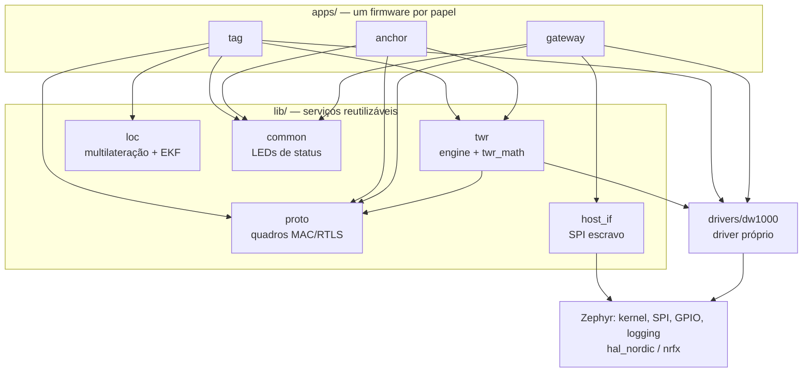
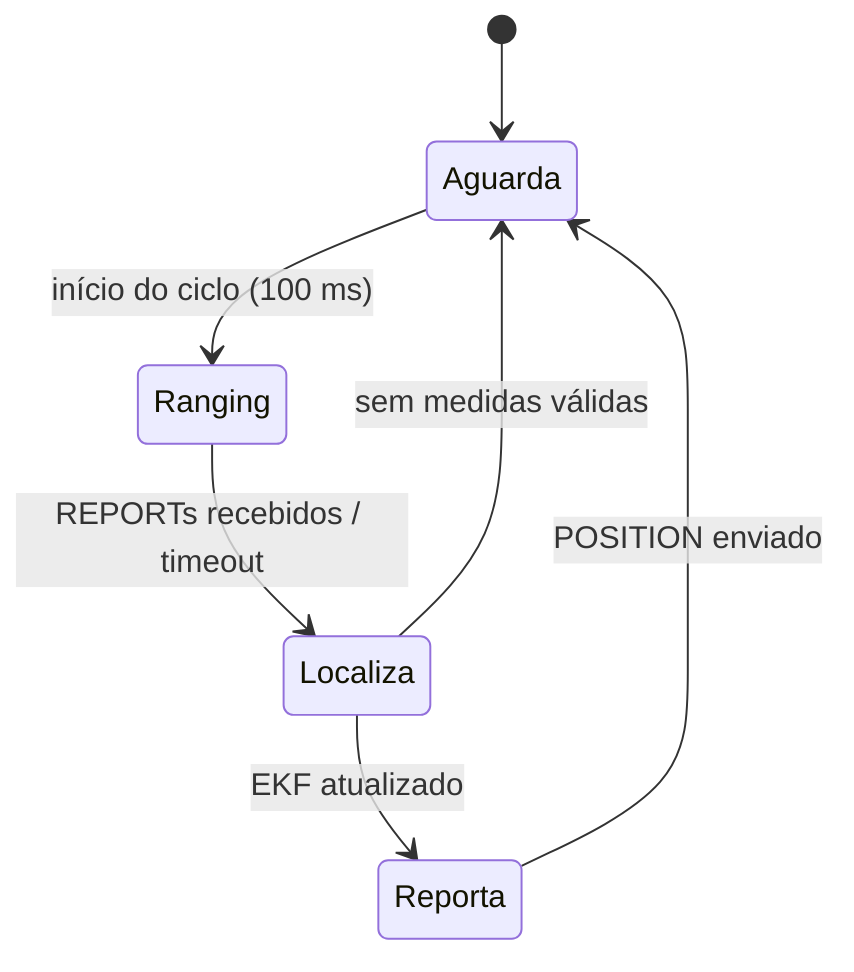

# 02 — Arquitetura

## 1. Hardware: DWM1001-DEV

| Recurso | Detalhe |
|---------|---------|
| MCU | nRF52832: Cortex-M4F @ 64 MHz, 512 KB de flash, 64 KB de RAM, FPU de precisão simples |
| Rádio UWB | DW1000: IEEE 802.15.4-2011 UWB, timestamps de 40 bits a 63,8976 GHz (1 tick ≈ 15,65 ps ≈ 4,69 mm) |
| Depuração | J-Link OB embarcado (SWD) + porta COM virtual (UART0 a 115200 bps) |
| Sensores | Acelerômetro LIS2DH12 (I2C0), ainda sem uso |
| Interface externa | Header compatível com Raspberry Pi (SPI1, UART, GPIO) |

### 1.1 Mapa de pinos usado pelo firmware

Os pinos do rádio vêm do devicetree da placa no Zephyr
(`boards/qorvo/decawave_dwm1001_dev`). Os do host seguem a convenção do PANS.

| Função | Pino nRF52832 | Nó DT / alias | Observação |
|--------|---------------|---------------|------------|
| DW1000 SCK / MOSI / MISO | P0.16 / P0.20 / P0.18 | `spi2` | SPI máx. 8 MHz (≤ 3 MHz antes do PLL travar) |
| DW1000 CS | P0.17 | `spi2` `cs-gpios` | ativo baixo |
| DW1000 IRQ | P0.19 | `ieee802154` `int-gpios` | ativo alto |
| DW1000 RSTn | P0.24 | `ieee802154` `reset-gpios` | dreno aberto: pulsar baixo e soltar |
| UART0 TX / RX (console) | P0.05 / P0.11 | `uart0` | VCOM do J-Link |
| LED vermelho (erro) | P0.14 | `led0` | ativo baixo |
| LED verde (heartbeat) | P0.30 | `led1` | ativo baixo |
| LED vermelho 2 | P0.22 | `led2` | compartilhado com `pwm0` |
| LED azul (atividade UWB) | P0.31 | `led3` | ativo baixo |
| Botão SW2 | P0.02 | `sw0` | pull-up |
| **Gateway** SPIS SCK / MOSI / MISO / CSn | P0.04 / P0.06 / P0.07 / P0.03 | `spi1` → `nordic,nrf-spis` | header RPi; mesmos pinos do SPI do PANS |
| **Gateway** DRDY (dado pronto) | P0.26 | `zephyr,user` `drdy-gpios` | ativo alto; mesmo pino de IRQ do PANS |
| Reset externo | P0.21 | `uicr` `gpio-as-nreset` | o host pode resetar a placa |

> Antes de ligar fios no header, confira a numeração física no esquemático
> da DWM1001-DEV. Se o host já funcionava com o PANS, a mesma fiação serve.

## 2. Camadas de firmware



**Regras de dependência:**

1. `apps/` dependem de `lib/` e `drivers/`, nunca o contrário.
2. `twr_math`, `proto` e `loc` são **puros**: sem acesso a hardware nem
   chamadas de kernel no caminho de cálculo. Por isso compilam e são
   testados em `native_sim`.
3. Só `drivers/dw1000` acessa o rádio. Em cada firmware existe **um único
   dono** do rádio (a thread principal do papel), para evitar disputa no SPI.
4. Configuração de build fica em Kconfig. As bibliotecas recebem IDs e
   parâmetros por argumento, não lendo `CONFIG_RTLS_NODE_ID` diretamente.

## 3. Estrutura do repositório

```
dwm1001-rtls-fw/
├── west.yml                 # manifesto: Zephyr v4.4.0 + módulos mínimos
├── zephyr/module.yml        # torna o repositório um módulo Zephyr
├── CMakeLists.txt, Kconfig  # raiz do módulo (drivers/ + lib/)
├── apps/
│   ├── tag/                 # DS-TWR initiator + EKF + envio de POSITION
│   ├── anchor/              # DS-TWR responder; nodes/a*.conf por âncora
│   └── gateway/             # RX de POSITION + tabela + SPI escravo
├── drivers/dw1000/          # driver próprio do DW1000
├── include/rtls/            # APIs públicas (dw1000, frames, twr, loc, host_if, status_led)
├── lib/
│   ├── common/              # LEDs de status / heartbeat
│   ├── proto/               # montagem e parsing de quadros
│   ├── twr/                 # matemática do DS-TWR + máquinas de estado
│   ├── loc/                 # multilateração + filtro de Kalman
│   └── host_if/             # interface SPI escravo com o host
├── samples/uwb_pingpong/    # bancada do driver (M1)
├── tests/unit/              # ztest (native_sim)
├── tools/rtls_log.py        # captura CSV, estatísticas, calibração de antena
├── scripts/
│   ├── setup/               # setup-windows.ps1, setup-linux.sh
│   ├── env.ps1, env.sh      # ativam o ambiente num terminal novo
│   └── jlink/               # utilitários do J-Link
└── docs/                    # este conjunto de documentos
```

## 4. Papéis

### 4.1 Tag

Ciclo de 100 ms, comandado por um timer absoluto (`K_TIMEOUT_ABS_MS`):



1. **Ranging** (`rtls_twr_initiator_run_round`): POLL → RESP de até 4 âncoras
   → FINAL → REPORTs. Produz um `struct rtls_range_set` com as distâncias e as
   posições das âncoras.
2. **Localiza** (`rtls_loc_update`): predição do EKF com o `dt` real, depois
   uma atualização por distância (com gating). Na primeira vez, inicializa
   por multilateração.
3. **Reporta**: monta o quadro `POSITION` (`rtls_frame_build`) e transmite ao
   gateway.

Tudo roda na thread `main` da tag, em sequência, então o rádio tem um dono
só. A thread de IRQ do driver apenas acorda quem espera um evento.

### 4.2 Âncora

Laço *responder*, sempre em RX:

1. Recebe um POLL que cita seu ID → programa o RESP para
   `poll_rx + T_reply + i·T_slot` (TX atrasado), onde `i` é a posição da
   âncora na lista do POLL.
2. Recebe o FINAL → programa o REPORT no seu slot, com `Db = resp_tx − poll_rx`,
   `Rb = final_rx − resp_tx` e a própria posição.
3. Volta para RX. Se houver timeout ou quadro inesperado, descarta o estado
   da rodada.

### 4.3 Gateway

1. RX contínuo; ao chegar um `POSITION` válido, atualiza a **tabela de
   tags** (`apps/gateway/src/tag_table.c`).
2. Entradas sem atualização por `CONFIG_RTLS_GATEWAY_TAG_TIMEOUT_MS` expiram.
3. Ao mudar a tabela, publica um *snapshot* em `host_if`, que arma o SPIS e
   sobe o DRDY.
4. Do M7 em diante, transmite o **BEACON** no início de cada superquadro.

## 5. Threads e prioridades

| Thread | Papel | Prioridade | Função |
|--------|-------|------------|--------|
| ISR do GPIO P0.19 | todos | ISR | só libera o semáforo do driver DW1000 |
| `main` | tag | preemptiva 0 | ciclo de 10 Hz: TWR → EKF → POSITION |
| `main` | anchor | preemptiva 0 | laço do responder |
| `main` | gateway | preemptiva 0 | RX de POSITION → tabela |
| `host_if` (M6) | gateway | preemptiva 5 | transações SPIS, DRDY |
| `logging` | todos | baixa | processamento de log diferido |
| timer `heartbeat` | todos | ISR | pisca o LED verde (500 ms) |
| workqueue do sistema | anchor | cooperativa | resumo das estatísticas do TWR a cada 10 s |

**Modelo do driver DW1000:** não há thread própria para eventos. A ISR do
pino de IRQ só libera um semáforo. A thread que chamou `dw1000_transmit()` ou
`dw1000_receive()` acorda, lê o `SYS_STATUS` pelo SPI e trata o evento. Isso
mantém um único acesso ao SPI e a latência IRQ → thread na ordem de dezenas
de µs, bem abaixo do `T_reply` de 1 ms.

## 6. Configuração (Kconfig)

| Símbolo | Onde | Padrão | Descrição |
|---------|------|--------|-----------|
| `CONFIG_RTLS_NODE_ID` | apps/* | tag `0x1001`, âncora `0xA001`, gateway `0x0001` | endereço curto do nó |
| `CONFIG_RTLS_TAG_UPDATE_RATE_HZ` | tag | 10 | taxa do ciclo |
| `CONFIG_RTLS_TAG_ANCHOR_BASE_ID` / `_NUM_ANCHORS` | tag | `0xA001` / 4 | âncoras consultadas |
| `CONFIG_RTLS_ANCHOR_POS_{X,Y,Z}_MM` | anchor | 0 | posição fixa da âncora |
| `CONFIG_RTLS_GATEWAY_MAX_TAGS` / `_TAG_TIMEOUT_MS` / `_PUBLISH_MS` | gateway | 16 / 2000 / 100 | tamanho e expiração da tabela; período do snapshot para o host |
| `CONFIG_RTLS_PAN_ID` | lib/proto | `0xDECA` | PAN da rede |
| `CONFIG_RTLS_TWR_REPLY_DELAY_US` / `_SLOT_US` | lib/twr | 1000 / 1000 | temporização do DS-TWR |
| `CONFIG_RTLS_LOC_MODE_2D` / `_3D` | lib/loc | 2D | dimensão do estado |
| `CONFIG_RTLS_LOC_TAG_HEIGHT_MM` | lib/loc | 1000 | altura fixa da tag no modo 2D |
| `CONFIG_RTLS_LOC_RANGE_STD_MM` | lib/loc | 100 | σ da medida de distância (R) |
| `CONFIG_RTLS_LOC_ACCEL_STD_MMS2` | lib/loc | 1000 | σ da aceleração do modelo (Q) |
| `CONFIG_RTLS_LOC_GATE_CHI2_X100` | lib/loc | 663 | limiar do gating (χ² × 100) |
| `CONFIG_RTLS_DW1000_TX_ANT_DLY` / `_RX_ANT_DLY` | drivers/dw1000 | 16436 | atrasos de antena (ticks) |

**Configuração por nó:** cada âncora usa um fragmento em `apps/anchor/nodes/`:

```
west build -b decawave_dwm1001_dev apps/anchor -d build/anchor_a2 -- -DEXTRA_CONF_FILE=nodes/a2.conf
```

## 7. Endereçamento

| Faixa | Uso |
|-------|-----|
| `0x0001` | gateway |
| `0x1001`–`0x1FFF` | tags |
| `0xA001`–`0xAFFF` | âncoras |
| `0xFFFF` | broadcast |

PAN ID padrão: `0xDECA`. Detalhes dos quadros em
[03-protocolo-uwb.md](03-protocolo-uwb.md).

## 8. Orçamento de memória (estimativa)

| Item | RAM |
|------|-----|
| Kernel + drivers + logging | ~12 KB |
| Pilhas (`main` 4 KB, `host_if` 1 KB, workqueue 1 KB, ISR 2 KB, log 1 KB) | ~9 KB |
| Estado do EKF (6×6 `float`) + buffers de quadro | < 1 KB |
| Tabela de tags (gateway, 16 × ~40 B) | < 1 KB |

Há folga de sobra nos 64 KB. Para conferir:
`west build -d build/tag -t ram_report`.
