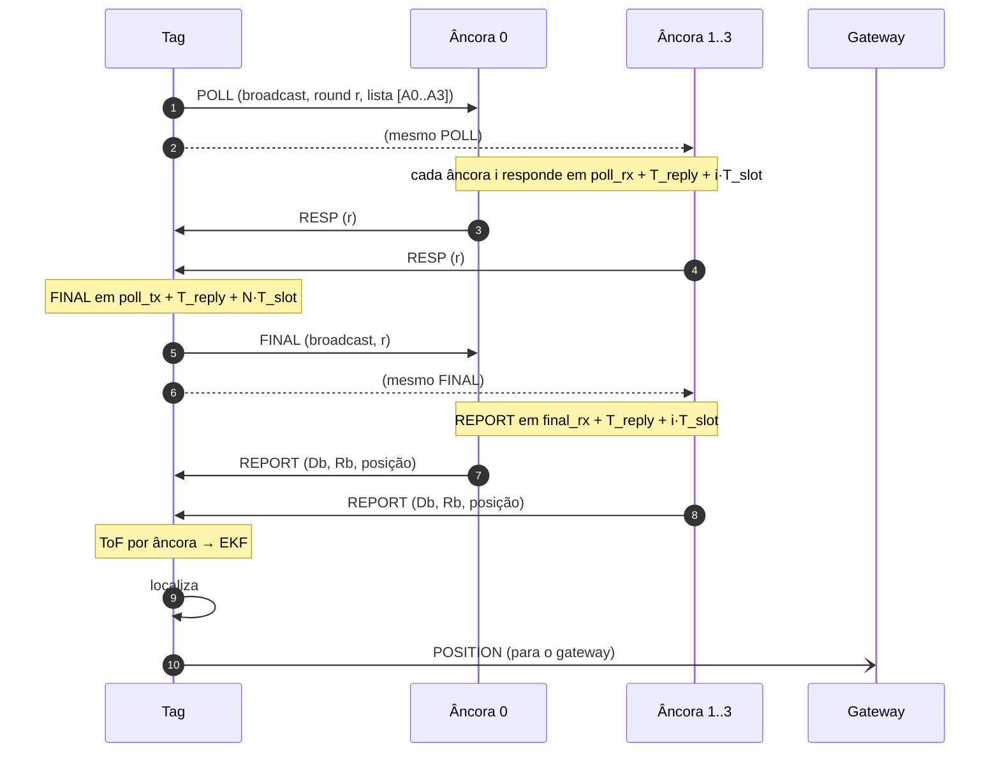
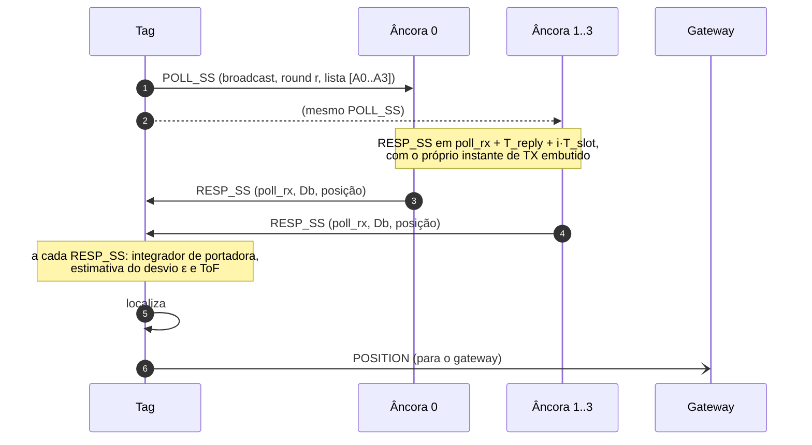
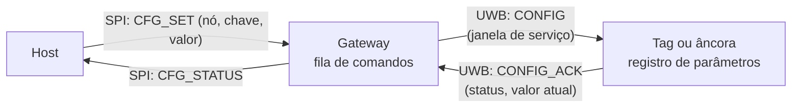
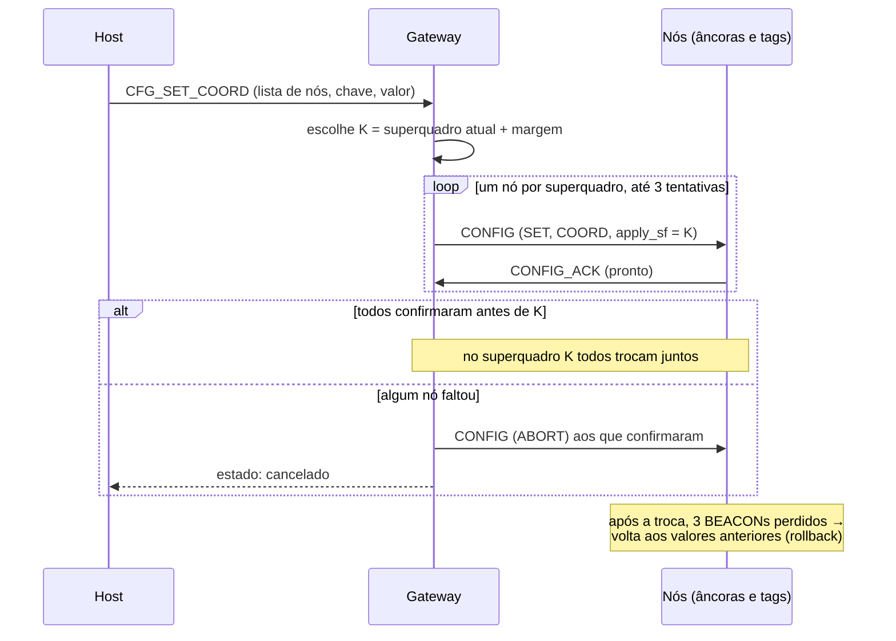

# 03 — Protocolo UWB

Definição no código: [`include/rtls/frames.h`](../include/rtls/frames.h).

## 1. Camada física (DW1000)

| Parâmetro | Valor | Motivo |
|-----------|-------|--------|
| Canal | 5 (6489,6 MHz, BW 499,2 MHz) | Padrão da Decawave; menos sujeito a interferência que o canal 2 |
| PRF | 64 MHz | Melhor precisão de timestamp |
| Código de preâmbulo | 9 | Válido para canal 5 / PRF 64 |
| Comprimento do preâmbulo | 128 símbolos (PAC 8) | Quadro curto; adequado a 6,8 Mbps e alcance indoor |
| Taxa de dados | 6,8 Mbps | Menor tempo no ar → mais tags por superquadro |
| SFD / PHR | padrão IEEE (8 símbolos) / modo padrão (≤ 127 B) | Interoperável e simples |
| Atraso de antena TX/RX | 16436 ticks (calibrar por placa) | Ver [04-algoritmos.md §3](04-algoritmos.md#3-calibração-do-atraso-de-antena) |

**Tempo no ar aproximado:**

`T ≈ preâmbulo 130,3 µs + SFD 8,1 µs + PHR 19,5 µs (19 bits a 850 kbps) + dados (bits + paridade RS) × 0,128 µs`

| Quadro | Tamanho total | Tempo no ar |
|--------|---------------|-------------|
| RESP / FINAL | 13 B | ≈ 177 µs |
| POLL | 22 B | ≈ 187 µs |
| REPORT | 35 B | ≈ 200 µs |
| POSITION | 37 B | ≈ 202 µs |

## 2. Formato dos quadros

Todos os quadros são **quadros de dados IEEE 802.15.4** com endereços curtos
e compressão de PAN ID. Isso permite usar a filtragem de quadros em hardware
do DW1000. Os campos multibyte são **little-endian**.

### 2.1 Cabeçalho MAC (9 bytes) + FCS (2 bytes)

| Offset | Tamanho | Campo | Valor |
|--------|---------|-------|-------|
| 0 | 2 | Frame Control | `0x8841`: dados, PAN ID comprimido, destino e origem curtos |
| 2 | 1 | Sequência MAC | incrementa a cada quadro transmitido pelo nó |
| 3 | 2 | PAN ID | `CONFIG_RTLS_PAN_ID` (padrão `0xDECA`) |
| 5 | 2 | Destino | endereço curto ou `0xFFFF` |
| 7 | 2 | Origem | endereço curto do nó |
| 9 | n | Payload RTLS | começa pelo byte de tipo |
| 9+n | 2 | FCS (CRC-16) | gerado e verificado pelo DW1000 |

### 2.2 Mensagens RTLS (payload)

| Tipo | Nome | Origem → destino | Tamanho | Conteúdo |
|------|------|------------------|---------|----------|
| `0x10` | BEACON | gateway → broadcast | 6 B | `superframe:u16`, `n_slots:u8`, `slot_us:u16` (M7) |
| `0x20` | POLL | tag → broadcast | 11 B | `round:u8`, `n_anchors:u8`, `anchors:u16[4]` (ordem = slot) |
| `0x21` | RESP | âncora → tag | 2 B | `round:u8` |
| `0x22` | FINAL | tag → broadcast | 2 B | `round:u8` |
| `0x23` | REPORT | âncora → tag | 24 B | `round:u8`, `reply_b:u32`, `round_b:u32`, `pos_mm:i32[3]`, `fp_power_cdbm:i16` |
| `0x30` | POSITION | tag → gateway | 26 B | `round:u8`, `n_ranges:u8`, `flags:u8`, `t_ms:u32`, `pos_mm:i32[3]`, `std_mm:u16[3]` |

- `reply_b` = `Db` = `resp_tx − poll_rx` e `round_b` = `Rb` = `final_rx − resp_tx`,
  em ticks do relógio da **âncora** (32 bits bastam: cobrem até 67 ms).
- `fp_power_cdbm`: potência do primeiro caminho do FINAL na âncora, em
  centésimos de dBm. Serve para detectar NLOS.
- `flags` do POSITION: bit 0 `VALID`, bit 1 `INIT` (só multilateração),
  bit 2 `OUTLIER` (alguma distância foi rejeitada), bit 3 `MODE_3D`.
- `std_mm`: desvio padrão por eixo, √diag(P), saturado em 65535.

## 3. Sequência DS-TWR (uma rodada)



Para cada âncora *i*, a tag combina os próprios intervalos
(`Ra = resp_rx − poll_tx`, `Da = final_tx − resp_rx`) com os da âncora
(`Db`, `Rb`) na fórmula assimétrica
([04-algoritmos.md §2](04-algoritmos.md#2-ds-twr-assimétrico)).

## 4. Temporização

Com `T_reply = 1,0 ms`, `T_slot = 1,0 ms` e N = 4 âncoras:

| t (ms) | Evento |
|--------|--------|
| 0,0 | Tag transmite POLL |
| 1,0 / 2,0 / 3,0 / 4,0 | Âncoras 0..3 transmitem RESP (TX atrasado) |
| 5,0 | Tag transmite FINAL (TX atrasado) |
| 6,0 / 7,0 / 8,0 / 9,0 | Âncoras 0..3 transmitem REPORT |
| ≈ 9,2 | Último REPORT recebido |
| ≈ 9,2–10,2 | EKF (meta ≤ 1 ms) |
| ≈ 10,4 | Tag transmite POSITION |
| 12,0 | Fim do slot da tag (guarda de ~1,4 ms) |

- O `T_reply` de 1 ms é **folgado de propósito**. Ele absorve a latência de
  IRQ → thread → SPI do Zephyr. Depois de medido no M3, pode cair para
  ~0,5 ms (`CONFIG_RTLS_TWR_REPLY_DELAY_US`).
- O TX atrasado do DW1000 ignora os 9 bits menos significativos do instante
  programado (resolução de ~8 ns). Por isso os timestamps usados no cálculo
  são sempre os **reais**, lidos do registrador `TX_STAMP` após o envio.
- O RX da tag liga sozinho (*wait-for-response*) 300 µs antes do primeiro
  slot, a tempo de pegar o preâmbulo.
- A janela de RESPs fecha no **meio do slot do FINAL**, em
  `T_reply + (N−1)·T_slot + T_slot/2`. Se uma âncora faltar, ainda sobra
  tempo para programar o FINAL. A janela de REPORTs vai até
  `T_reply + N·T_slot + CONFIG_RTLS_TWR_RX_MARGIN_US`.

## 5. Acesso ao meio

### 5.1 Uma tag (M3–M6)

A tag inicia uma rodada a cada 100 ms pelo próprio relógio. Com uma ou duas
tags, um *jitter* aleatório de 0–2 ms no início do ciclo basta para evitar
colisões persistentes.

### 5.2 TDMA com beacon (M7)

```
|<------------------------------- superquadro 100 ms ------------------------------->|
| BEACON 4 ms | tag slot 0 (12 ms) | tag slot 1 | ... | tag slot 7 (12 ms)           |
```

- O gateway (`CONFIG_RTLS_GATEWAY_BEACON=y`) transmite o BEACON
  (`superframe`, `n_slots`, `slot_us`) no instante 0, numa grade de 100 ms
  agendada em µs.
- A tag (`CONFIG_RTLS_TAG_TDMA=y`) com slot `k = tag_id − 0x1001` inicia o
  POLL em `beacon + 4 ms + k·slot_us`. O período vem do próprio BEACON:
  `4 ms + n_slots·slot_us`.
- `beacon` é o instante em que o quadro **começou** a chegar, medido pelo
  `RX_TIME` do DW1000 contra o relógio dele no momento da leitura. Assim a
  latência ISR → thread não entra no sincronismo.
- Entre superquadros, a tag abre o RX ± 1 ms em volta do BEACON previsto. Se
  ele não vier, o superquadro segue pela previsão. Com **3 perdidos
  seguidos**, a tag para de transmitir e escuta até sincronizar de novo.
- Capacidade: **8 tags a 10 Hz** (ou 16 tags a 5 Hz com o mesmo superquadro
  dobrado).

| Fonte de erro no início do slot | Ordem |
|---------------------------------|-------|
| resolução do tick do kernel (32 768 Hz) | ~30 µs |
| atraso do BEACON no gateway (RX em andamento, publicação ao host) | dezenas a centenas de µs; medido na linha `GW: ... atraso max` |
| deriva entre cristais (± 20 ppm em 100 ms) | 2 µs |
| **guarda disponível** no fim de cada slot | ~1,4 ms |

Sem gateway (bancadas do M2 ao M6), a tag fica com `CONFIG_RTLS_TAG_TDMA=n`
e roda no próprio ciclo, como na §5.1.

### 5.3 De onde vem o limite de 8 tags e como subir

O slot de 12 ms é a rodada DS-TWR mais o EKF, o POSITION e uma guarda:

```
T_rodada   = 2·T_reply + (2N − 1)·T_slot + T_ar(REPORT)  = 2 + 7 + 0,2 = 9,2 ms
T_slot,tag = T_rodada + T_EKF + T_ar(POSITION) + guarda   ≈ 12 ms
N_tags     = ⌊(100 − 4) / 12⌋ = 8
```

O limite vem dos tempos **conservadores** de 1 ms (`CONFIG_RTLS_TWR_REPLY_DELAY_US`
e `CONFIG_RTLS_TWR_SLOT_US`), escolhidos antes de medir a latência real. As
estimativas abaixo ainda precisam ser confirmadas em bancada:

| Cenário | T_reply = T_slot | Slot por tag | Tags a 10 Hz |
|---------|------------------|--------------|--------------|
| Atual | 1,0 ms | 12 ms | 8 |
| Tempos apertados após medir no M3 | 0,5 ms | ~6,5 ms | 14 |
| + posição no POLL seguinte, EKF fora do slot | 0,5 ms | ~5,5 ms | 17 |

**Decisão (25/10/2026):** o M7 mantém a meta de **8 tags a 10 Hz** com os
tempos atuais. Os cenários acima ficam registrados como evolução futura.

**Referência, PANS da Decawave** (*DWM1001 System Overview* v2.1): 15 slots
TWR por superquadro de 100 ms, ou seja, 15 tags a 10 Hz. O PANS usa SS-TWR
(Group Poll + 4 Responses, com os timestamps da âncora dentro do Response), e
o desvio de relógio é compensado por uma rede de âncoras sincronizadas. Ele
também envia a posição nos campos X, Y, Z do Group Poll seguinte. A análise
completa está na fundamentação do TCC.

**Restrição regulatória:** a potência *smart* do DW1000 vale com no máximo um
quadro por ms por nó (APS017). Os cenários acima respeitam isso.

## 6. Erros e recuperação

| Situação | Comportamento |
|----------|---------------|
| RESP de uma âncora não chega | A tag segue a rodada; essa âncora fica sem distância |
| Âncora não recebe o FINAL | Timeout; descarta o estado da rodada e volta para RX |
| REPORT não chega | Distância descartada para aquela âncora |
| `round` diferente do esperado | Quadro ignorado |
| TX atrasado tarde demais (`HPDWARN`) | Aborta a rodada e incrementa um contador de diagnóstico |
| Quadro com FCS inválido | Descartado pelo hardware (contador de erro de RX) |
| POSITION perdido | Sem retransmissão; o gateway contabiliza a lacuna pela sequência `round` |
| BEACON perdido (TDMA) | O superquadro segue pela previsão; com 3 perdidos seguidos, a tag para de transmitir até ouvir outro |
| Slot da tag fora do superquadro (`k ≥ n_slots`) | A tag não transmite e registra o erro uma vez |

**Filtragem em hardware:** a âncora aceita quadros de dados do PAN para o
próprio endereço ou broadcast. A tag só aceita os endereçados a ela. O
gateway aceita broadcast e os endereçados a `0x0001`.

## 7. Extensões planejadas (M9–M10)

> **Opcionais, no fim do projeto se houver tempo.** Nada desta seção existe
> no código. Roteiro de teste em [08 §12–13](08-etapas-e-testes.md).

### 7.1 Anúncio de âncoras (M9)

| Tipo | Nome | Origem → destino | Conteúdo |
|------|------|------------------|----------|
| `0x11` (proposto) | ANCHOR_INFO | âncora → broadcast | `pos_mm:i32[3]`, `flags:u8` (ativa, em calibração…) |

- Cada âncora envia um ANCHOR_INFO a cada ~1 s, numa **janela de serviço**
  logo após o BEACON do superquadro (M7). O slot de cada uma vem do ID.
- A tag monta a tabela de âncoras a partir desses anúncios. O REPORT
  continua levando a posição, o que mantém a compatibilidade.
- Alternativa: o gateway agrega as âncoras e repete a tabela no BEACON. Isso
  custa menos tempo de canal, mas exige que o gateway ouça todas as âncoras.

### 7.2 Até 8 âncoras por rodada (M10)

| Item | Hoje | M10 |
|------|------|-----|
| `RTLS_MAX_ANCHORS_PER_ROUND` | 4 | 8 |
| POLL | 11 B fixo | 3 + 2N B (até 19 B) |
| Slots de RESP/REPORT | índices 0–3 | índices 0–7 (a regra de slot não muda) |
| FINAL | slot N | slot N |

**Duração da rodada** (tempos de 1 ms): $2T_{reply} + (2N-1)T_{slot} + 0{,}2$ ms.

| N | Rodada | Tags a 10 Hz |
|---|--------|--------------|
| 4 | 9,2 ms | 8 |
| 6 | 13,2 ms | 6 |
| 8 | 17,2 ms | 4 |

O N por rodada fica configurável. O padrão (4) preserva a meta de 8 tags do
M7.

## 8. Extensões planejadas (M11–M12)

> **Opcionais, no fim do projeto se houver tempo.** Nada desta seção existe
> no código. Os tipos e os tamanhos são propostas. Roteiro de teste em
> [08 §14–15](08-etapas-e-testes.md).

### 8.1 SS-TWR (M11)

| Tipo | Nome | Origem → destino | Tamanho | Conteúdo |
|------|------|------------------|---------|----------|
| `0x24` (proposto) | POLL_SS | tag → broadcast | 11 B | igual ao POLL; o **tipo** diz à âncora que a rodada é SS |
| `0x25` (proposto) | RESP_SS | âncora → tag | 25 B | `round:u8`, `poll_rx:u40`, `reply_b:u32`, `pos_mm:i32[3]`, `fp_power_cdbm:i16` |

- `reply_b` = `Db` = `resp_tx − poll_rx`, com `resp_tx` **previsto**: o
  instante programado com os 9 bits menos significativos zerados, mais o
  atraso de antena de TX. É o mesmo valor que o DW1000 grava no `TX_STAMP`,
  e um contador na âncora confere isso a cada envio.
- `poll_rx`: o timestamp completo (40 bits) do POLL na âncora. Alimenta a
  estimativa do desvio por razão de timestamps entre rodadas.
- `fp_power_cdbm`: potência do primeiro caminho do **POLL** na âncora (no DS
  ela vem do FINAL).
- A *flag* `RTLS_TWR_MODE_SS` existe só na tag. A âncora responde
  RESP/REPORT a um POLL e RESP_SS a um POLL_SS.



**Temporização** (tempos de 1 ms, N = 4):

| t (ms) | Evento |
|--------|--------|
| 0,0 | Tag transmite POLL_SS |
| 1,0 / 2,0 / 3,0 / 4,0 | Âncoras 0..3 transmitem RESP_SS (TX atrasado) |
| ≈ 4,2 | Último RESP_SS recebido: fim da rodada |

```
T_rodada,SS = T_reply + (N − 1)·T_slot + T_ar(RESP_SS) = 1 + 3 + 0,2 = 4,2 ms
```

**DS × SS:**

| Item | DS-TWR (padrão) | SS-TWR (M11) |
|------|-----------------|--------------|
| Quadros por rodada (N = 4) | 10 | 5 |
| Rodada | 9,2 ms | 4,2 ms |
| Desvio de relógio | cancelado pelo próprio estimador | estimado e compensado na tag |
| Erro residual do desvio | ~0,2 mm a 10 m | $\tfrac12 T_{reply,i}\,\delta\varepsilon$: ~15 cm por ms e por ppm de erro da estimativa |
| TX da âncora usado no cálculo | real (`TX_STAMP`, enviado no REPORT) | previsto (embutido no RESP_SS) |
| FINAL atrasado na tag | aborta a rodada inteira | não existe FINAL |

- **Capacidade:** com a rodada de 4,2 ms, o slot por tag cairia para ~7 ms
  (~13 tags a 10 Hz). A meta do M7 continua **8 tags** (decisão de
  25/10/2026). O ganho fica registrado como resultado.
- **Potência *smart*:** a tag transmite POLL_SS e POSITION, separados por
  mais de 4 ms, e cada âncora transmite um quadro por rodada. A regra de no
  máximo um quadro por ms por nó (APS017) continua valendo.
- A janela de RESP_SS fecha pela mesma regra do DS. Sem FINAL, ela pode
  fechar em $T_{reply} + (N-1)T_{slot}$ + `RX_MARGIN_US`.

### 8.2 Configuração remota (M12)



**Mensagens:**

| Tipo | Nome | Origem → destino | Tamanho | Conteúdo |
|------|------|------------------|---------|----------|
| `0x10` | BEACON (estendido) | gateway → broadcast | 7 + 2k B | campos atuais + `n_pending:u8`, `pending:u16[k]` (k ≤ 4) |
| `0x40` (proposto) | CONFIG | gateway → nó | 15 + 6n B | `seq:u8`, `op:u8`, `flags:u8`, `apply_sf:u16`, `ctr:u32`, `n:u8`, n × (`key:u16`, `value:i32`), `mic:u32` |
| `0x41` (proposto) | CONFIG_ACK | nó → gateway | 12 + 7n B | `seq:u8`, `status:u8`, `ctr:u32`, `n:u8`, n × (`key:u16`, `status:u8`, `value:i32`), `mic:u32` |

- `op`: `1` SET · `2` GET · `3` REBOOT · `4` ABORT (cancela uma mudança
  coordenada).
- `flags`: bit 0 `PERSIST` (grava em NVS) · bit 1 `COORD` (aplica no
  superquadro `apply_sf`).
- `n ≤ 8` chaves por quadro: CONFIG ≤ 63 B e CONFIG_ACK ≤ 68 B de payload,
  dentro dos 127 B do quadro.
- `ctr`: contador do gateway, sempre crescente. O nó recusa `ctr` ≤ o último
  aceito (anti-*replay*) e guarda o valor em NVS.
- `mic`: AES-128-CMAC truncado a 32 bits sobre o cabeçalho MAC e o payload
  (NIST SP 800-38B). A chave de rede vem do build ou do shell (M8).
- `status` por chave: `0` ok · `1` chave desconhecida · `2` fora da faixa ·
  `3` não se aplica ao papel · `4` só leitura · `5` salvo, vale após
  reinício. `status` global: `6` falha de autenticação · `7` ocupado.
- A IEEE 802.15.4 tem segurança própria (CCM*, com contador de quadro). O
  MIC próprio é mais simples e mantém o filtro de quadros em hardware.
  Migrar para o padrão fica como evolução.

**Entrega na janela de serviço** (logo após o BEACON, nos 4 ms reservados a
ele):

| t (ms, desde o BEACON) | Evento |
|------------------------|--------|
| 0,0 | BEACON, com a lista de pendências |
| 1,0 | CONFIG (gateway → nó), ~0,25 ms no ar |
| ≈ 2,1 | CONFIG_ACK em `config_rx + T_reply` |
| 4,0 | fim da janela; começa o slot da tag 0 |

- **Uma transação por superquadro**, ou seja, até 10 comandos por segundo.
  O ranging não é afetado, porque os slots das tags não mudam.
- **Tag:** só escuta o BEACON e os próprios slots. Se o ID dela estiver na
  lista de pendências, fica em RX na janela de serviço (transmissão
  indireta, como na IEEE 802.15.4).
- **Âncora:** já fica em RX entre as rodadas e recebe o CONFIG direto. No
  M12 ela também acompanha o contador `superframe` dos BEACONs, necessário
  para a mudança coordenada.
- **Janela compartilhada com o M9:** nos superquadros com pendência, o
  ANCHOR_INFO espera o superquadro seguinte.

**Mudança coordenada** (parâmetros que precisam ser iguais em todos os nós):



- Margem proposta: K = superquadro atual + 3·(nº de nós) + 20 (folga de 2 s).
- As comparações de `apply_sf` são módulo 2¹⁶: o contador dá a volta a cada
  ~1,8 h.

**Registro de parâmetros** (proposta inicial; a chave é estável e o nome
segue o `settings` do M8):

| Chave | Nome | Kconfig equivalente | Papéis | Classe |
|-------|------|---------------------|--------|--------|
| `0x0101` | `node/id` | `RTLS_NODE_ID` | todos | com reinício |
| `0x0102` | `node/pan` | `RTLS_PAN_ID` | todos | coordenada |
| `0x0201`–`0x0203` | `anchor/pos_{x,y,z}_mm` | `RTLS_ANCHOR_POS_{X,Y,Z}_MM` | âncora | imediata |
| `0x0301` / `0x0302` | `radio/{tx,rx}_ant_dly` | `RTLS_DW1000_{TX,RX}_ANT_DLY` | todos | imediata |
| `0x0401` / `0x0402` | `twr/reply_us`, `twr/slot_us` | `RTLS_TWR_REPLY_DELAY_US`, `RTLS_TWR_SLOT_US` | todos | coordenada |
| `0x0403` | `twr/rx_margin_us` | `RTLS_TWR_RX_MARGIN_US` | tag, âncora | imediata |
| `0x0404` / `0x0405` | `twr/rsl_corr`, `twr/rsl_gain_db_x10` | `RTLS_TWR_RANGE_BIAS_*` | tag | imediata |
| `0x0406` | `twr/mode` (0 DS, 1 SS) | `RTLS_TWR_MODE_SS` (M11) | tag | imediata |
| `0x0501` / `0x0502` | `tag/anchor_base`, `tag/num_anchors` | `RTLS_TAG_ANCHOR_BASE_ID`, `RTLS_TAG_NUM_ANCHORS` | tag | imediata |
| `0x0601`–`0x0605` | `loc/mode_3d`, `loc/tag_height_mm`, `loc/range_std_mm`, `loc/accel_std_mms2`, `loc/gate_chi2_x100` | `RTLS_LOC_*` | tag | imediata (`mode_3d` reinicia o EKF) |
| `0x0606` | `loc/nlos_weight` | `RTLS_LOC_NLOS_WEIGHTING` (M8) | tag | imediata (reinicia o EKF) |
| `0xF001`–`0xF003` | `info/fw_version`, `info/uptime_s`, `info/late_tx` | — | todos | só leitura |

- **Já implementado no M8** (`lib/config`, shell e NVS): `0x0101`, `0x0102`,
  `0x0201`–`0x0203`, `0x0301`–`0x0302`, `0x0501`–`0x0502` e
  `0x0601`–`0x0606`. Os tempos do DS-TWR, a correção por RSL, o modo SS e as
  chaves `0xF00x` dependem do M11/M12.
- **Fora do registro:**
  - a PHY, porque o driver só aceita canal 5 / PRF 64 / 128 / 6,8 Mbps;
  - a potência de TX, porque o valor *smart* atual está amarrado à regra
    regulatória (APS017);
  - a taxa de atualização, porque no M7 ela vem do superquadro.
- **ID do nó:** quem garante a unicidade é o host. O gateway avisa se o ID
  novo já estiver na tabela de tags.
- **Alcance:** o gateway precisa alcançar cada nó por UWB diretamente
  (um salto). Repetição por âncoras fica fora do escopo.
