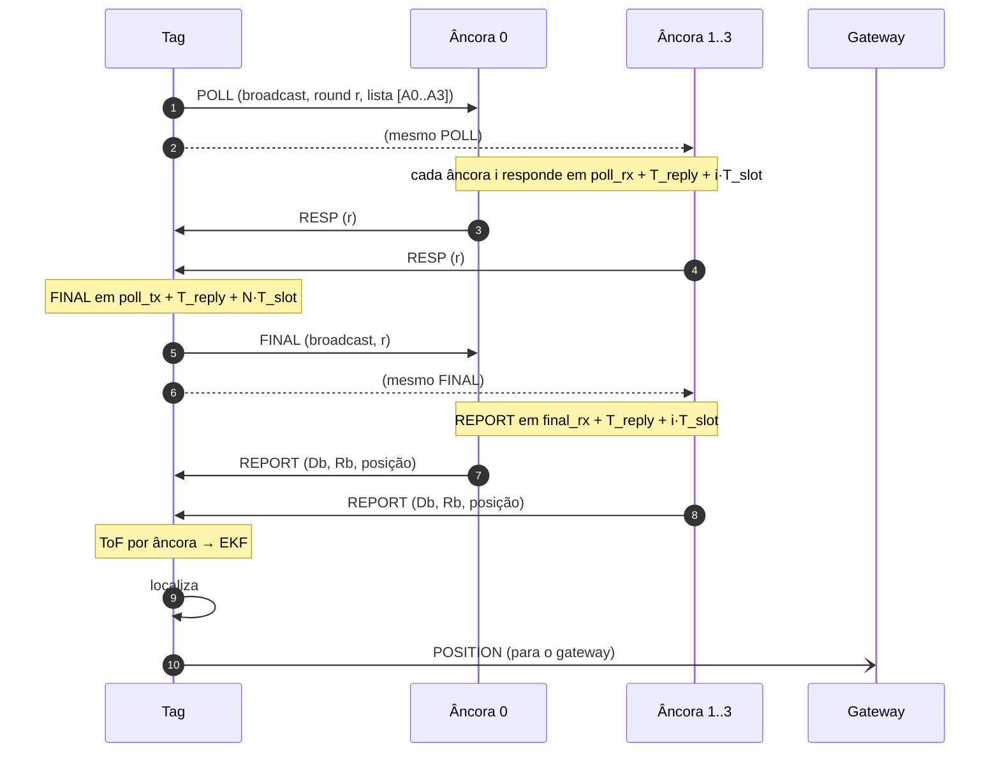

# 03 — Protocolo UWB

Definição no código: [`include/rtls/frames.h`](../include/rtls/frames.h).

## 1. Camada física (DW1000)

| Parâmetro | Valor | Motivo |
|-----------|-------|--------|
| Canal | 5 (6489,6 MHz, BW 499,2 MHz) | Padrão da Decawave; menos sujeito a interferência que o canal 2 |
| PRF | 64 MHz | Melhor precisão de timestamp |
| Código de preâmbulo | 9 | Válido para canal 5 / PRF 64 |
| Comprimento do preâmbulo | 128 símbolos (PAC 8) | Quadro curto; adequado a 6,8 Mbps e alcance indoor |
| Taxa de dados | 6,8 Mbps | Menor tempo no ar → mais tags por superquadro |
| SFD / PHR | padrão IEEE (8 símbolos) / modo padrão (≤ 127 B) | Interoperável e simples |
| Atraso de antena TX/RX | 16436 ticks (calibrar por placa) | Ver [04-algoritmos.md §3](04-algoritmos.md#3-calibração-do-atraso-de-antena) |

**Tempo no ar aproximado:**

`T ≈ preâmbulo 130,3 µs + SFD 8,1 µs + PHR 21,5 µs + dados (bits + paridade RS) × 0,128 µs`

| Quadro | Tamanho total | Tempo no ar |
|--------|---------------|-------------|
| RESP / FINAL | 13 B | ≈ 180 µs |
| POLL | 22 B | ≈ 189 µs |
| REPORT | 35 B | ≈ 202 µs |
| POSITION | 37 B | ≈ 204 µs |

## 2. Formato dos quadros

Todos os quadros são **quadros de dados IEEE 802.15.4** com endereços curtos
e compressão de PAN ID. Isso permite usar a filtragem de quadros em hardware
do DW1000. Os campos multibyte são **little-endian**.

### 2.1 Cabeçalho MAC (9 bytes) + FCS (2 bytes)

| Offset | Tamanho | Campo | Valor |
|--------|---------|-------|-------|
| 0 | 2 | Frame Control | `0x8841`: dados, PAN ID comprimido, destino e origem curtos |
| 2 | 1 | Sequência MAC | incrementa a cada quadro transmitido pelo nó |
| 3 | 2 | PAN ID | `CONFIG_RTLS_PAN_ID` (padrão `0xDECA`) |
| 5 | 2 | Destino | endereço curto ou `0xFFFF` |
| 7 | 2 | Origem | endereço curto do nó |
| 9 | n | Payload RTLS | começa pelo byte de tipo |
| 9+n | 2 | FCS (CRC-16) | gerado e verificado pelo DW1000 |

### 2.2 Mensagens RTLS (payload)

| Tipo | Nome | Origem → destino | Tamanho | Conteúdo |
|------|------|------------------|---------|----------|
| `0x10` | BEACON | gateway → broadcast | 6 B | `superframe:u16`, `n_slots:u8`, `slot_us:u16` (M7) |
| `0x20` | POLL | tag → broadcast | 11 B | `round:u8`, `n_anchors:u8`, `anchors:u16[4]` (ordem = slot) |
| `0x21` | RESP | âncora → tag | 2 B | `round:u8` |
| `0x22` | FINAL | tag → broadcast | 2 B | `round:u8` |
| `0x23` | REPORT | âncora → tag | 24 B | `round:u8`, `reply_b:u32`, `round_b:u32`, `pos_mm:i32[3]`, `fp_power_cdbm:i16` |
| `0x30` | POSITION | tag → gateway | 26 B | `round:u8`, `n_ranges:u8`, `flags:u8`, `t_ms:u32`, `pos_mm:i32[3]`, `std_mm:u16[3]` |

- `reply_b` = `Db` = `resp_tx − poll_rx` e `round_b` = `Rb` = `final_rx − resp_tx`,
  em ticks do relógio da **âncora** (32 bits bastam: cobrem até 67 ms).
- `fp_power_cdbm`: potência do primeiro caminho do FINAL na âncora, em
  centésimos de dBm. Serve para detectar NLOS.
- `flags` do POSITION: bit 0 `VALID`, bit 1 `INIT` (só multilateração),
  bit 2 `OUTLIER` (alguma distância foi rejeitada), bit 3 `MODE_3D`.
- `std_mm`: desvio padrão por eixo, √diag(P), saturado em 65535.

## 3. Sequência DS-TWR (uma rodada)



Para cada âncora *i*, a tag combina os próprios intervalos
(`Ra = resp_rx − poll_tx`, `Da = final_tx − resp_rx`) com os da âncora
(`Db`, `Rb`) na fórmula assimétrica
([04-algoritmos.md §2](04-algoritmos.md#2-ds-twr-assimétrico)).

## 4. Temporização

Com `T_reply = 1,0 ms`, `T_slot = 1,0 ms` e N = 4 âncoras:

| t (ms) | Evento |
|--------|--------|
| 0,0 | Tag transmite POLL |
| 1,0 / 2,0 / 3,0 / 4,0 | Âncoras 0..3 transmitem RESP (TX atrasado) |
| 5,0 | Tag transmite FINAL (TX atrasado) |
| 6,0 / 7,0 / 8,0 / 9,0 | Âncoras 0..3 transmitem REPORT |
| ≈ 9,2 | Último REPORT recebido |
| ≈ 9,2–10,2 | EKF (meta ≤ 1 ms) |
| ≈ 10,4 | Tag transmite POSITION |
| 12,0 | Fim do slot da tag (guarda de ~1,4 ms) |

- O `T_reply` de 1 ms é **folgado de propósito**. Ele absorve a latência de
  IRQ → thread → SPI do Zephyr. Depois de medido no M3, pode cair para
  ~0,5 ms (`CONFIG_RTLS_TWR_REPLY_DELAY_US`).
- O TX atrasado do DW1000 ignora os 9 bits menos significativos do instante
  programado (resolução de ~8 ns). Por isso os timestamps usados no cálculo
  são sempre os **reais**, lidos do registrador `TX_STAMP` após o envio.
- A janela de RX da tag depois do POLL vai até `T_reply + N·T_slot + 0,5 ms`.
  Depois do FINAL, a mesma regra vale para os REPORTs.

## 5. Acesso ao meio

### 5.1 Uma tag (M3–M6)

A tag inicia uma rodada a cada 100 ms pelo próprio relógio. Com uma ou duas
tags, um *jitter* aleatório de 0–2 ms no início do ciclo basta para evitar
colisões persistentes.

### 5.2 TDMA com beacon (M7)

```
|<------------------------------- superquadro 100 ms ------------------------------->|
| BEACON 4 ms | tag slot 0 (12 ms) | tag slot 1 | ... | tag slot 7 (12 ms)           |
```

- O gateway transmite o BEACON (`superframe`, `n_slots`, `slot_us`) no
  instante 0.
- A tag com slot *k* (a princípio, `k = tag_id − 0x1001`) inicia o POLL em
  `beacon_rx + 4 ms + k·12 ms`.
- A tag que perder 3 beacons seguidos para de transmitir e fica em RX até
  sincronizar de novo.
- Capacidade: **8 tags a 10 Hz** (ou 16 tags a 5 Hz com o mesmo superquadro
  dobrado).

## 6. Erros e recuperação

| Situação | Comportamento |
|----------|---------------|
| RESP de uma âncora não chega | A tag segue a rodada; essa âncora fica sem distância |
| Âncora não recebe o FINAL | Timeout; descarta o estado da rodada e volta para RX |
| REPORT não chega | Distância descartada para aquela âncora |
| `round` diferente do esperado | Quadro ignorado |
| TX atrasado tarde demais (`HPDWARN`) | Aborta a rodada e incrementa um contador de diagnóstico |
| Quadro com FCS inválido | Descartado pelo hardware (contador de erro de RX) |
| POSITION perdido | Sem retransmissão; o gateway contabiliza a lacuna pela sequência `round` |

**Filtragem em hardware:** a âncora aceita quadros de dados do PAN para o
próprio endereço ou broadcast. A tag só aceita os endereçados a ela. O
gateway aceita broadcast e os endereçados a `0x0001`.
