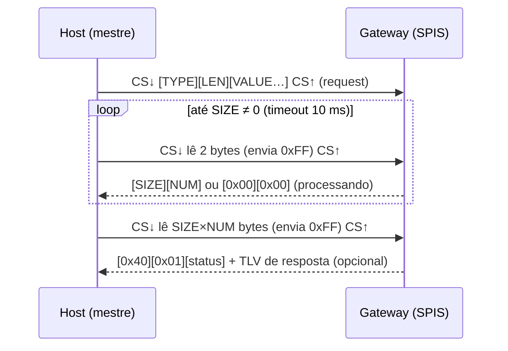
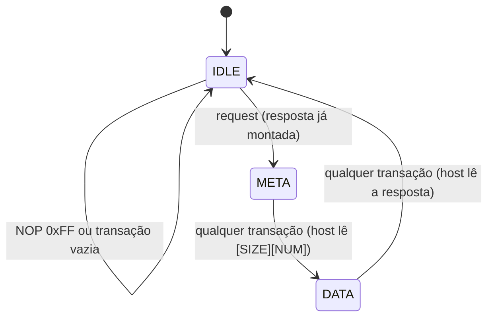
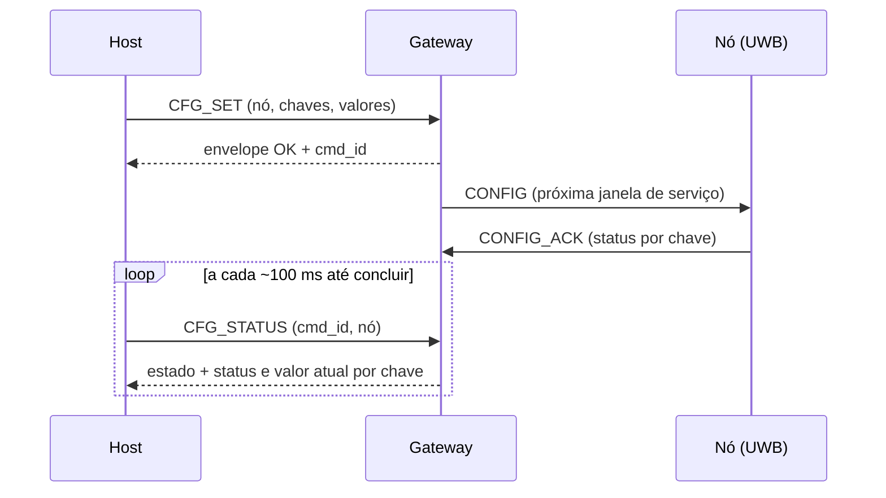

# 05 — Interface SPI gateway → host

O gateway funciona como **SPI escravo**. O host externo ("a definir": ESP32-S3,
Raspberry Pi etc.) é o mestre: lê a tabela de posições e a envia para a rede.

O protocolo copia o modelo de transação **TLV-sobre-SPI do PANS**: request
TLV, *polling* do meta-header `[SIZE][NUM]`, leitura da resposta e
recuperação por `0xFF`. O que muda são os opcodes, próprios do RTLS. Assim o
host ESP32-S3 do repositório `dwm1001-gateway-esp` reaproveita a HAL
(`SpiHal` com CS manual, `GpioController` para IRQ/RESET) e o `TlvCodec`. Só
a camada de comandos é nova.

## 1. Camada física

| Sinal | Pino nRF52832 | Direção | Observação |
|-------|---------------|---------|------------|
| SCK | P0.04 | host → gw | modo 0 (CPOL=0, CPHA=0), ≤ 8 MHz, MSB primeiro |
| MOSI | P0.06 | host → gw | |
| MISO | P0.07 | gw → host | |
| CSn | P0.03 | host → gw | ativo baixo; 1 transação = 1 pulso de CS |
| DRDY | P0.26 | gw → host | ativo alto: há um *snapshot* novo não lido |
| nRESET | P0.21 | host → gw | opcional; pulso baixo ≥ 1 ms reinicia o gateway |
| GND | — | — | referência comum obrigatória |

Restrições do SPIS do nRF52832:

- No máximo **255 bytes por transação** (EasyDMA com `MAXCNT` de 8 bits). Por
  isso a tabela é **paginada**.
- Entre transações o firmware precisa rearmar os buffers. O host deve
  esperar **≥ 50 µs** entre pulsos de CS. Enquanto o gateway não rearma, o
  SPIS devolve o caractere padrão `0x00` (`def-char` no devicetree), que o
  host interpreta como "ainda não pronto".

## 2. Modelo de transação



- **Envelope de resposta:** toda resposta começa com `[0x40][0x01][status]`.
  Se o comando devolve dados, segue um segundo TLV `[tipo][len][valor]`.
- **Status:** `0` OK · `1` comando desconhecido · `2` parâmetro inválido ·
  `3` ocupado.
- **Recuperação:** três transações de 1 byte `0xFF` (NOP) devolvem o gateway
  ao estado IDLE, como no PANS.
- **TLV:** `type:u8`, `len:u8` (≤ 253), `value[len]`. Campos multibyte são
  little-endian.

## 3. Comandos

| Request | Nome | Value | Resposta |
|---------|------|-------|----------|
| `0xA0` | `RTLS_INFO_GET` | — | envelope + `0xB0` (11 B) |
| `0xA1` | `RTLS_TAGS_GET` | `page:u8` | envelope + `0xB1` (4 + 26·n + 2 B) |
| `0xA2` | `RTLS_DRDY_CFG_SET` | `enable:u8` | envelope |
| `0xFF` | NOP | — | — |

### 3.1 `0xB0`: informações do gateway (11 bytes)

| Offset | Tipo | Campo |
|--------|------|-------|
| 0 | u8 | versão do protocolo (`1`) |
| 1 | u8[3] | versão do firmware (major, minor, patch) |
| 4 | u16 | ID do gateway |
| 6 | u8 | capacidade da tabela (`CONFIG_RTLS_GATEWAY_MAX_TAGS`) |
| 7 | u8 | tags ativas |
| 8 | u16 | período do superquadro (ms) |
| 10 | u8 | registros por página (`9`) |

### 3.2 `0xB1`: página da tabela de tags

| Offset | Tipo | Campo |
|--------|------|-------|
| 0 | u8 | `page` (0..n_pages−1) |
| 1 | u8 | `n_pages` |
| 2 | u8 | `count`: registros nesta página (≤ 9) |
| 3 | u8 | `snapshot`: sequência do snapshot; todas as páginas do mesmo snapshot têm o mesmo valor |
| 4 | rec[count] | registros de 26 B (abaixo) |
| 4+26·count | u16 | CRC-16/CCITT-FALSE (poli `0x1021`, init `0xFFFF`) sobre os bytes anteriores do *value* |

Com 9 registros, o *value* tem 240 B e a resposta inteira tem
3 + 2 + 240 = **245 B**, ou seja, uma única transação com `NUM = 1`.

### 3.3 Registro de tag (26 bytes, `struct rtls_tag_record`)

| Offset | Tipo | Campo |
|--------|------|-------|
| 0 | u16 | `tag_id` |
| 2 | u8 | `round`: sequência da última rodada recebida |
| 3 | u8 | `n_ranges`: distâncias usadas na estimativa |
| 4 | u8 | `flags`: os mesmos do quadro POSITION |
| 5 | i8 | `rssi_dbm` do quadro POSITION no gateway |
| 6 | u16 | `age_ms`: idade da posição no instante do snapshot |
| 8 | i32[3] | `pos_mm`: x, y, z |
| 20 | u16[3] | `std_mm`: σx, σy, σz |

## 4. Sinal DRDY

- O gateway gera um *snapshot* da tabela no máximo a cada 100 ms, e só se
  algo mudou.
- O DRDY **sobe** quando há um snapshot novo e **desce** quando o host lê a
  última página dele.
- O host pode trabalhar por interrupção (borda de subida) ou por polling
  periódico com `RTLS_TAGS_GET`.
- `RTLS_DRDY_CFG_SET(0)` desliga o sinal (fica sempre baixo).

## 5. Fluxo típico no host

```text
ao detectar borda de subida no DRDY:
    page = 0
    repete:
        transação: [0xA1][0x01][page]
        (size, num) = poll_meta_header()          # repete enquanto (0,0)
        resp = lê size*num bytes
        valida envelope 0x40 (status 0), TLV 0xB1 e CRC
        se snapshot mudou no meio da leitura: recomeça com page = 0
        publica os registros (ex.: MQTT)
        page += 1
    até page == n_pages
```

## 6. Implementação no gateway (M6)

- O nó `spi1` do devicetree vira `nordic,nrf-spis` em
  [`apps/gateway/boards/decawave_dwm1001_dev.overlay`](../apps/gateway/boards/decawave_dwm1001_dev.overlay).
  O DRDY fica em `zephyr,user/drdy-gpios`.
- Duas camadas em [`lib/host_if/`](../lib/host_if):
  - **codec** (`host_if_codec.c`, puro): `rtls_host_if_handle()` lê o
    request e monta envelope, INFO e páginas com CRC. Testado no T6.0;
  - **transporte** (`host_if.c`): thread `host_if`, SPIS, DRDY e snapshot.
- A thread faz um laço de `spi_transceive()` em modo escravo, que bloqueia
  até o CS subir. Cada chamada é uma transação e avança a máquina de estados:



| Ponto | Como foi feito |
|-------|----------------|
| Request | o TLV vem no início da transação; o resto é ignorado (o host ESP32 preenche com `0xFF` até 16 B) |
| `NUM` | sempre 1: toda resposta cabe numa transação (≤ 245 B) |
| MISO no IDLE | o SPIS está armado só para receber e devolve o ORC `0xFF`; entre transações (sem buffers), o `def-char` `0x00` |
| Recuperação | 3 × 1 B `0xFF`: META e DATA consomem uma transação cada, e no IDLE o NOP não tem resposta |
| Snapshot | `rtls_host_if_publish()` copia a tabela sob mutex a cada 100 ms; a sequência só avança se algo além do `age_ms` mudou |
| DRDY | sobe com sequência nova; desce quando o host lê **inteira** a última página dessa sequência |
| Prioridade | thread cooperativa (−1), acima da `main`: rearma o SPIS logo depois de cada transação, sem esperar a `main` terminar o que estiver fazendo (tabela, CSV, BEACON) |
| Versão do firmware | arquivo [`apps/gateway/VERSION`](../apps/gateway/VERSION) (hoje 0.6.0), lido de `<zephyr/app_version.h>` |
| Teste sem bancada | `CONFIG_RTLS_GATEWAY_SIM_TAGS=N` acrescenta N tags sintéticas (`0x1F00 + i`) ao snapshot, para testar a paginação (T6.3) |

> [!NOTE]
> Entre a transação de META e a de DATA o gateway precisa rearmar o SPIS.
> Um host rápido deve respeitar os ≥ 50 µs da §1; se ler cedo demais, recebe
> `0x00` no lugar do envelope e deve repetir o comando. O host ESP32 já
> espera 30 ms entre transações.

## 7. Extensões planejadas (M12, opcional)

> **Opcional, no fim do projeto se houver tempo.** Nada desta seção existe
> no código. Os opcodes são propostas. Protocolo UWB e registro de
> parâmetros em [03 §8.2](03-protocolo-uwb.md#82-configuração-remota-m12).

O host passa a **configurar** tags e âncoras através do gateway. A entrega
por UWB leva de 100 ms a alguns segundos. Por isso o modelo é assíncrono: o
pedido devolve um `cmd_id` na hora, e o host consulta o resultado depois.



### 7.1 Comandos novos

| Request | Nome | Value | Resposta |
|---------|------|-------|----------|
| `0xA3` | `RTLS_CFG_SET` | `node:u16`, `flags:u8`, `n:u8`, n × (`key:u16`, `value:i32`) | envelope + `0xB3` |
| `0xA4` | `RTLS_CFG_SET_COORD` | `n_nodes:u8`, `nodes:u16[n_nodes]`, `flags:u8`, `n:u8`, n × (`key:u16`, `value:i32`) | envelope + `0xB3` |
| `0xA5` | `RTLS_CFG_GET` | `node:u16`, `n:u8`, n × `key:u16` | envelope + `0xB3` |
| `0xA6` | `RTLS_CFG_STATUS` | `cmd_id:u8`, `node:u16` | envelope + `0xB4` |
| `0xA7` | `RTLS_NODE_REBOOT` | `node:u16` | envelope + `0xB3` |

- `flags`: bit 0 `PERSIST` (grava em NVS no nó).
- `n ≤ 8` chaves por comando e `n_nodes ≤ 16`, para caber num quadro UWB e
  na fila do gateway.
- `node = 0x0001` aplica no próprio gateway, sem UWB.
- Fila cheia: status `3` (ocupado) no envelope, sem `cmd_id`.

### 7.2 Respostas novas

**`0xB3`: comando aceito (1 B):** `cmd_id:u8`.

**`0xB4`: estado de um comando num nó:**

| Offset | Tipo | Campo |
|--------|------|-------|
| 0 | u8 | `cmd_id` |
| 1 | u16 | `node` |
| 3 | u8 | `state`: `0` na fila · `1` em andamento · `2` concluído · `3` erro · `4` timeout · `5` cancelado |
| 4 | u8 | `n` |
| 5 | rec[n] | n × (`key:u16`, `status:u8`, `value:i32`), com os status de [03 §8.2](03-protocolo-uwb.md#82-configuração-remota-m12) |

- `value` é o valor **atual** no nó, lido depois de aplicar. No `CFG_GET`,
  é a resposta.
- O resultado fica guardado até ser lido ou até a fila precisar da vaga.
- O DRDY continua só para os snapshots de posição.
