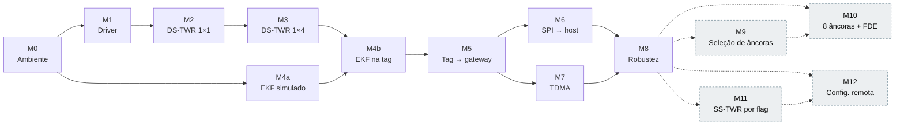
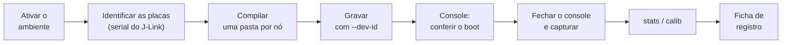

# 08 — Etapas de desenvolvimento e roteiros de teste

Roteiro único do projeto: cada etapa (marcos M0 a M12) traz o que implementar,
os testes automatizados, a preparação da bancada, o passo a passo com os
comandos de build, gravação e captura, e o critério de aceite. Os comandos
comuns a todas as etapas estão na [seção 2](#2-convenções-e-guia-de-bancada).

| Documento | Papel |
|-----------|-------|
| [01-planejamento.md](01-planejamento.md) | o **porquê**: escopo, requisitos, decisões |
| **08 (este)** | o **como verificar**: etapas, testes, aceite |
| [07-bancada.md](07-bancada.md) | detalhes operacionais da bancada do M1 ao M3 (montagem, sintomas) |

---

## 1. Visão geral



| Etapa | Situação | Testes automatizados | Bancada | Placas |
|-------|----------|----------------------|---------|--------|
| M0 Ambiente e estrutura | ✅ (falta T0.4 na placa) | build + unitários (T0.3b na placa) | smoke test | 1 |
| M1 Driver DW1000 | 🧪 | build | ping-pong | 2 |
| M2 DS-TWR 1×1 + calibração | 🧪 | `twr_math`, `frames` | ranging + calibração | 2–3 |
| M3 DS-TWR 1×4 a 10 Hz | 🧪 | — | 4 âncoras + tag | 5 |
| M4 Localização (EKF) | 🧪 (M4a ✅) | `loc`, `loc_mat` (T4.1–T4.7, T4.12–T4.14) | grade de pontos | 5 |
| M5 Tag → gateway | 📐 | — | entrega das posições | 6 |
| M6 SPI → host | 📐 | codec TLV, CRC | host lendo a tabela | 6 + host |
| M7 Multi-tag (TDMA) | 📐 | — | 4 tags simultâneas | 9 |
| M8 Robustez e avaliação | 📐 | — | campanha do TCC | todas |
| M9 Descoberta e seleção de âncoras *(opcional)* | 📐 | seleção e tabela (ztest) | 8 âncoras, movimento entre zonas | 10 |
| M10 Até 8 âncoras + FDE *(opcional)* | 📐 | FDE com falhas sintéticas | NLOS controlado | 10 |
| M11 SS-TWR por *flag* *(opcional)* | 📐 | SS-TWR, desvio, previsão do TX | modo sombra, SS × DS | 5–6 |
| M12 Configuração remota *(opcional)* | 📐 | registro, codec, MIC, fila | host → gateway → nós | 9 + host |

**Legenda:** ✅ concluído · 🧪 implementado, falta a bancada · 📐 a implementar

---

## 2. Convenções e guia de bancada

### 2.1 Formato de cada etapa

| Bloco | Conteúdo |
|-------|----------|
| Objetivo / depende de | uma frase e os pré-requisitos |
| Implementação | checklist de tarefas e arquivos |
| Testes automatizados | o que roda sem hardware |
| Preparação da bancada | placas, builds e gravação daquela etapa |
| Roteiro de bancada | passos numerados `Tx.y`, cada um com resultado esperado, seguidos dos comandos de cada passo |
| Critério de aceite | checklist binária; a etapa só fecha com todos os itens |
| Registrar | arquivos e dados que vão para o TCC |

### 2.2 Fluxo de um teste de bancada



Todos os comandos partem da raiz do repositório. `west` e `python` são
iguais no PowerShell e no bash; o que muda está indicado.

### 2.3 Preparar o terminal

Em **todo terminal novo**:

```powershell
# Windows (PowerShell)
cd C:\Workspace\rtls-ws\dwm1001-rtls-fw
. .\scripts\env.ps1
New-Item -ItemType Directory -Force captures | Out-Null
git log -1 --format=%h          # commit em teste: vai para a ficha
```

```bash
# Linux
cd <workspace>/dwm1001-rtls-fw
source scripts/env.sh
mkdir -p captures
git log -1 --format=%h
```

`captures/` está no `.gitignore`. O `rtls_log.py capture` não cria a pasta.

### 2.4 Identificar as placas

Conecte todas as placas e rode:

```powershell
.\scripts\list-boards.ps1        # Windows
```

```bash
scripts/list-boards.sh           # Linux
```

```
Porta SerialJLink
----- -----------
COM5  760012345
COM7  760012346
```

**Tabela de placas.** Preencha uma vez e cole uma etiqueta em cada placa:

| Etiqueta | Serial J-Link | Papel fixo | `TX_ANT_DLY` / `RX_ANT_DLY` | Calibrado em |
|----------|---------------|------------|-----------------------------|--------------|
| P1 | 760012345 | tag T1 | 16436 / 16436 (padrão) | — |
| P2 | 760012346 | âncora A1 | 16436 / 16436 (padrão) | — |

> [!IMPORTANT]
> A **porta COM muda** quando você troca a placa de USB ou reinicia o PC; o
> **serial do J-Link nunca muda**. Grave sempre pelo serial e confirme a porta
> com o `list-boards` antes de cada captura. Os atrasos de antena são **da
> placa**: mantenha cada placa sempre no mesmo papel.

Para não redigitar os seriais, guarde-os em variáveis (valem até fechar o
terminal):

```powershell
$T1 = '760012345'; $A1 = '760012346'; $A2 = '...'; $A3 = '...'; $A4 = '...'; $GW = '...'
```

```bash
T1=760012345; A1=760012346; A2=...; A3=...; A4=...; GW=...
```

Daí em diante, `--dev-id $T1` funciona nos dois shells.

### 2.5 Compilar

**Regra:** uma pasta de build por nó e configuração. A pasta guarda as
opções `-D...` do primeiro build.

| Nó | Pasta | Comando |
|----|-------|---------|
| Tag, 4 âncoras | `build/tag` | `west build -b decawave_dwm1001_dev apps/tag -d build/tag` |
| Tag, 1 âncora (M2) | `build/tag1` | `west build -b decawave_dwm1001_dev apps/tag -d build/tag1 -- -DCONFIG_RTLS_TAG_NUM_ANCHORS=1` |
| Âncora AN | `build/anchor_aN` | `west build -b decawave_dwm1001_dev apps/anchor -d build/anchor_aN -- "-DEXTRA_CONF_FILE=nodes/aN.conf"` |
| Gateway | `build/gateway` | `west build -b decawave_dwm1001_dev apps/gateway -d build/gateway` |
| Ping (M1) | `build/ping` | `west build -b decawave_dwm1001_dev samples/uwb_pingpong -d build/ping` |
| Pong (M1) | `build/pong` | `west build -b decawave_dwm1001_dev samples/uwb_pingpong -d build/pong -- -DCONFIG_PINGPONG_ROLE_PONG=y` |
| Testes na placa | `build/unit_board` | `west build -b decawave_dwm1001_dev tests/unit -d build/unit_board` |

| Situação | O que fazer |
|----------|-------------|
| Mudou só código ou o conteúdo de um `.conf` | `west build -d build/tag` |
| Mudou ou removeu uma opção `-D...` | build limpo: acrescente `-p always` ao comando completo da tabela |
| Conferir uma opção antes de gravar | `Select-String ANT_DLY build/tag/zephyr/.config` (PowerShell) · `grep ANT_DLY build/tag/zephyr/.config` (bash) |
| Build terminou | a saída mostra a tabela `Memory region` e **nenhuma** linha `warning:` |

> [!IMPORTANT]
> **Aspas nas opções `-D...` com ponto.** O Windows PowerShell 5.1 corta um
> argumento que começa com `-` no primeiro ponto:
> `-DEXTRA_CONF_FILE=nodes/a1.conf` chega ao CMake como `nodes/a1` e `.conf`.
> Escreva `"-DEXTRA_CONF_FILE=nodes/a1.conf"`. As aspas também funcionam no
> bash, e por isso todos os comandos deste guia já as usam.

> [!WARNING]
> `CONFIG_RTLS_TWR_REPLY_DELAY_US` e `CONFIG_RTLS_TWR_SLOT_US` precisam ser
> **iguais na tag e em todas as âncoras**. Se mudar um deles, refaça todos
> os nós com o mesmo `-D...` e `-p always`.

### 2.6 Gravar

```bash
west flash -d build/tag --dev-id $T1
```

| Comando | Para quê |
|---------|----------|
| `west flash -d <pasta> --dev-id <serial>` | grava e reinicia a placa (o runner `jlink` já usa `--reset-after-load`) |
| … `--erase` | apaga a flash inteira antes. Use na **primeira gravação** de cada placa (ela vem com o PANS de fábrica) e, a partir do M8, para zerar a configuração salva em NVS |
| `west reset -d <pasta> --dev-id <serial>` | reinicia sem regravar, por exemplo para ver o boot com o console aberto |

Sem `--dev-id`, com várias placas ligadas, o J-Link abre uma janela para
escolher a placa, e é fácil gravar a errada.

**Várias âncoras de uma vez** (o laço para no primeiro erro):

```powershell
# Windows (PowerShell)
$anchors = [ordered]@{ a1 = $A1; a2 = $A2; a3 = $A3; a4 = $A4 }
foreach ($n in $anchors.Keys) {
    west build -b decawave_dwm1001_dev apps/anchor -d "build/anchor_$n" -- "-DEXTRA_CONF_FILE=nodes/$n.conf"
    if ($LASTEXITCODE) { break }
    west flash -d "build/anchor_$n" --dev-id $anchors[$n]
    if ($LASTEXITCODE) { break }
}
```

```bash
# Linux (bash)
for n in a1 a2 a3 a4; do
    serial_var=${n^^}                      # a1 -> A1
    west build -b decawave_dwm1001_dev apps/anchor -d build/anchor_$n -- "-DEXTRA_CONF_FILE=nodes/$n.conf" || break
    west flash -d build/anchor_$n --dev-id "${!serial_var}" || break
done
```

### 2.7 Console serial

```bash
python -m serial.tools.miniterm COM5 115200            # Windows
python -m serial.tools.miniterm /dev/ttyACM0 115200    # Linux
```

| Regra | Detalhe |
|-------|---------|
| Sair | `Ctrl+]` |
| Ver o boot | abra o console e rode `west reset ...` em outro terminal (ou aperte o botão de reset da placa) |
| **Uma porta, um programa** | feche o console antes do `rtls_log.py capture`, senão dá `PermissionError`. Para ver o log durante a captura, use `capture --echo` |
| Um console por placa | um terminal para cada porta COM |

**Boot esperado** (além das linhas do driver, iguais em todos os nós):

```
<inf> rtls_dw1000: DW1000 DEV_ID 0xdeca0130 part 0x........ xtal 16 ldo 0x.. otp_antdly 0x........
<inf> rtls_dw1000: PHY: canal 5, PRF 64 MHz, preambulo 128 (codigo 9), 6800 kbps, PAN 0xdeca, addr 0x....
```

| Nó | Linha própria do boot | Depois |
|----|-----------------------|--------|
| Tag | `<inf> tag: RTLS tag 0x1001: 10 Hz, 4 ancoras a partir de 0xa001` e `<inf> tag: LOC 2D: sigma_r ...` | linhas `R,...` a 10 Hz e, com ≥ 3 âncoras, `L,...`; resumo `TWR: ...` e `LOC: ...` a cada 10 s |
| Âncora | `<inf> anchor: RTLS ancora 0xa001 em (0, 0, 2500) mm` | resumo `TWR: POLL ...` a cada 10 s |
| Gateway | `<inf> gateway: RTLS gateway 0x0001: ate 16 tags` | — |
| Ping/pong | `<inf> pingpong: UWB ping-pong: ...` | resumo a cada 100 pings |

**LEDs:** verde piscando = firmware vivo · azul alternando = atividade UWB ·
vermelho aceso = erro persistente (DW1000 ausente ou falha de configuração).

### 2.8 Capturar e analisar

```bash
python tools/rtls_log.py capture --port COM5 --out captures/T2.2_5m.csv --seconds 110
python tools/rtls_log.py stats captures/T2.2_5m.csv --true-distance 5.0
```

| Quero | `--seconds` |
|-------|-------------|
| ~1000 distâncias de **uma** âncora a 10 Hz | 110 (folga para falhas) |
| 10 min de rodadas | 600 |
| 1 h de estabilidade | 3600 |

**Nome dos arquivos:** `captures/<ID do teste>_<cenário>.csv`, por exemplo
`captures/T2.4_3m.csv`. O mesmo nome vai para a ficha.

**Saída do `stats`:**

| Campo | Significado |
|-------|-------------|
| 1ª linha | rodadas, duração e taxa em Hz |
| `n` / `sucesso` | distâncias da âncora / `n` ÷ rodadas |
| `média mm` / `bruta mm` | média corrigida pelo viés de RSL / antes da correção |
| `desvio` | desvio-padrão (mm) |
| `mín` / `máx` | extremos; *outliers* aparecem aqui |
| `RX dBm` / `1º cam.` | potência total e do primeiro caminho |
| `viés` | média − distância real (só com `--true-distance`), em mm e em ticks |

**Posições (a partir do M4).** Se a tag imprimir linhas `L,...`, o
`capture` grava também `<arquivo>_pos.csv` ao lado do CSV de distâncias. O
subcomando `pos` resume esse arquivo:

```bash
python tools/rtls_log.py pos captures/T4.10_p1_pos.csv --true-pos 2.0,3.0 --skip 10
```

| Campo | Significado |
|-------|-------------|
| 1ª linha | posições, duração, taxa, modo 2D/3D, quantas com `INIT` e com `OUTLIER`, distâncias usadas por posição |
| `média mm` / `desvio` / `mín` / `máx` | por eixo |
| `sig.EKF` | média do σ que o próprio EKF declarou; perto do `desvio` = filtro consistente |
| `viés` / `RMSE 2D` / `CEP50` / `CEP95` | só com `--true-pos x,y[,z]` (m); CEP é o raio que contém 50 % / 95 % dos erros horizontais |

`--skip N` descarta as N primeiras posições (convergência do filtro).

### 2.9 Condições de medida

| Item | Como |
|------|------|
| Visada | linha de visada (LOS), sem pessoas no caminho |
| Altura | todas as placas na mesma altura, ≥ 1 m do chão, em tripé ou suporte (não na mão) |
| Antenas | mesma orientação em todas as placas |
| Distância | trena laser entre os **centros dos módulos** |
| Temperatura | anote no início; antes de calibrar, deixe as placas ligadas alguns minutos para estabilizar (o atraso varia 2,15 mm/°C, APS014) |

### 2.10 Ficha de registro

Uma linha por teste executado:

| ID | Data | Commit | Cenário | Resultado | Aprovado | Arquivo |
|----|------|--------|---------|-----------|----------|---------|
| T2.4 | 2026-11-03 | `9f9a2dc` | LOS, 1 m, 24 °C | viés −9,8 cm, σ 2,1 cm | ✅ | `captures/T2.4_1m.csv` |

### 2.11 Problemas de gravação e console

| Sintoma | Causa provável | Ação |
|---------|----------------|------|
| `west` não reconhecido | ambiente não ativado | `. .\scripts\env.ps1` ou `source scripts/env.sh` |
| `Could not load J-Link library` | `jlink.exe` do Java no PATH | ative o ambiente ([06 §7](06-configuracao-ambiente.md#7-solução-de-problemas)) |
| Janela do J-Link pedindo para escolher o emulador | várias placas, sem `--dev-id` | use `--dev-id` |
| J-Link oferece atualizar o firmware do depurador | firmware antigo no J-Link OB da placa | pode aceitar; não mexe no firmware do nRF52 |
| `Cannot connect to target` ao gravar | firmware anterior travando o chip | repita com `--erase`; persistindo, `nrfjprog --recover` (nRF Command Line Tools) |
| Console vazio | porta errada ou o boot já passou | confira o `list-boards`; `west reset` com o console aberto |
| `PermissionError` na porta | outro programa com a porta aberta | feche o miniterm/PuTTY |
| Opção nova sem efeito | cache do CMake na pasta de build | `-p always` e confira o `.config` |
| `Ignoring extra path from command line: ".conf"` e `File not found: .../nodes/a1` | PowerShell cortou o `-DEXTRA_CONF_FILE` no ponto | ponha a opção entre aspas ([§2.5](#25-compilar)) e refaça com `-p always` |
| `Could not find a package configuration file provided by "Zephyr-sdk"` | terminal sem o ambiente ativado | `. .\scripts\env.ps1` (define `ZEPHYR_SDK_INSTALL_DIR`) e refaça com `-p always` ([06 §7](06-configuracao-ambiente.md#7-solução-de-problemas)) |
| `Permission denied: /dev/ttyACM0` (Linux) | usuário fora do `dialout` | [06 §7](06-configuracao-ambiente.md#7-solução-de-problemas) |

Sintomas do rádio (PER, `PLL nao travou`, `TX atrasado`) estão em
[07 §1](07-bancada.md#1-m1-driver-dw1000-ping-pong).

---

## 3. M0 — Ambiente e estrutura base ✅

**Objetivo:** ter o ambiente reproduzível e os três firmwares compilando.
**Depende de:** nada.

### Implementação

- [x] `west.yml` com o Zephyr v4.4.0 e módulos mínimos
- [x] scripts `scripts/setup/setup-windows.ps1` e `setup-linux.sh`
- [x] apps `tag`, `anchor` e `gateway`; módulo `lib/` e `drivers/`
- [x] testes unitários em `tests/unit`

### Testes automatizados

| ID | Comando | Esperado |
|----|---------|----------|
| T0.1 | `scripts/setup/setup-windows.ps1` (ou `setup-linux.sh`) | termina com `Ambiente pronto.` |
| T0.2 | `west build -b decawave_dwm1001_dev apps/<app> -d build/<app>` para tag, anchor e gateway | sem erros e **sem warnings** |
| T0.3a | Linux/WSL: `west twister -T tests -p native_sim` | todos os testes `PASSED` |
| T0.3b | Windows: compila `tests/unit` para a placa, grava e lê o console (comandos abaixo) | UART mostra `PROJECT EXECUTION SUCCESSFUL` |

```bash
# T0.2: os três apps (nenhuma linha "warning:" na saída)
west build -b decawave_dwm1001_dev apps/tag -d build/tag
west build -b decawave_dwm1001_dev apps/anchor -d build/anchor_a1 -- "-DEXTRA_CONF_FILE=nodes/a1.conf"
west build -b decawave_dwm1001_dev apps/gateway -d build/gateway

# T0.3a: Linux/WSL; o resumo final do twister deve ter 0 failed
west twister -T tests -p native_sim

# T0.3b: Windows; console aberto ANTES do reset para ver o resultado
west build -b decawave_dwm1001_dev tests/unit -d build/unit_board
west flash -d build/unit_board --dev-id $T1 --erase
python -m serial.tools.miniterm COM5 115200        # terminal 2
west reset -d build/unit_board --dev-id $T1        # terminal 1
```

### Preparação da bancada

| Placas | Firmware | Pasta de build |
|--------|----------|----------------|
| 1 (futura T1) | tag | `build/tag` |

Siga a [seção 2](#2-convenções-e-guia-de-bancada) até o `list-boards`
(2.3–2.4). É a primeira gravação da placa, então use `--erase`.

### Roteiro de bancada

| ID | Passo | Esperado |
|----|-------|----------|
| T0.4 | Grave a tag, abra o console e reinicie a placa | `RTLS tag 0x1001: 10 Hz...`, `DW1000 DEV_ID 0xdeca0130`, linha `PHY: canal 5...` e LED verde piscando |

```bash
# T0.4
west flash -d build/tag --dev-id $T1 --erase
python -m serial.tools.miniterm COM5 115200        # terminal 2
west reset -d build/tag --dev-id $T1               # terminal 1
```

Sem âncoras, a tag não gera linhas `R,...`: o resumo de 10 s mostra as
rodadas sem resposta. Isso é o esperado no T0.4.

### Critério de aceite

- [x] T0.1 e T0.2 no Windows
- [x] T0.3 executado (placa, T0.3b)
- [ ] T0.4 numa placa real

---

## 4. M1 — Driver DW1000 🧪

**Objetivo:** TX imediato, TX atrasado, RX, IRQ e timestamps funcionando entre
duas placas.
**Depende de:** M0.

### Implementação

- [x] `drivers/dw1000/dw1000.c`: init (OTP, LDE, PLL), PHY, IRQ, TX/RX, potência
- [x] `samples/uwb_pingpong`: bancada ping/pong

### Testes automatizados

| ID | Comando | Esperado |
|----|---------|----------|
| T1.0 | builds de `build/ping` e `build/pong` (`-DCONFIG_PINGPONG_ROLE_PONG=y`) | sem warnings |

### Preparação da bancada

| Placas | Firmware | Pasta de build | Variável |
|--------|----------|----------------|----------|
| 1 (futura T1) | ping | `build/ping` | `$T1` |
| 1 (futura A1) | pong | `build/pong` | `$A1` |

```bash
west build -b decawave_dwm1001_dev samples/uwb_pingpong -d build/ping
west build -b decawave_dwm1001_dev samples/uwb_pingpong -d build/pong -- -DCONFIG_PINGPONG_ROLE_PONG=y
west flash -d build/ping --dev-id $T1 --erase
west flash -d build/pong --dev-id $A1 --erase
```

Abra **um console por placa** (dois terminais). Os contadores do resumo são
acumulados desde o boot, então o último resumo vale pelo teste inteiro.
Montagem e sintomas em [07 §1](07-bancada.md#1-m1-driver-dw1000-ping-pong).

### Roteiro de bancada

| ID | Passo | Esperado |
|----|-------|----------|
| T1.1 | Com os dois consoles abertos, reinicie as duas placas e leia o log de init | `DEV_ID 0xdeca0130`, `xtal` ≠ 0, **nenhum** `PLL nao travou` |
| T1.2 | Ping-pong a 1 m por 100 pings (10 s) | PER ≈ 0 %, `TX atrasado perdido 0` |
| T1.3 | Ping-pong a **3 m** por **10 min** (6000 pings) | PER < 1 % |
| T1.4 | Repita 30 s a 1, 3 e 5 m e compare o `RX medio` | a potência cai com a distância (~−6 dB a cada dobro, Friis) |
| T1.5 | Regrave **ping e pong** com `-DCONFIG_PINGPONG_REPLY_US=500` e repita 2 min | `TX atrasado perdido 0` |
| T1.6 | Desligue o pong por 10 s (tire o USB) e religue | o ping volta a receber, sem travar (PER só sobe no intervalo) |

```bash
# T1.1: um reset por placa, com os consoles abertos
west reset -d build/ping --dev-id $T1
west reset -d build/pong --dev-id $A1

# T1.2-T1.4: leia no console do ping, a cada 100 pings:
#   ping: enviados N, pongs M, PER x.xx%, RX medio -XXXX cdBm, erros de TX 0
# e no do pong:
#   pong: respondidos N, TX atrasado perdido 0, RX ultimo ... cdBm (1o caminho ...)
# Entre distâncias, reinicie as duas placas para zerar os contadores.

# T1.5: o ping também usa REPLY_US (janela de RX e timeout), então os dois mudam
west build -p always -b decawave_dwm1001_dev samples/uwb_pingpong -d build/ping -- -DCONFIG_PINGPONG_REPLY_US=500
west build -p always -b decawave_dwm1001_dev samples/uwb_pingpong -d build/pong -- -DCONFIG_PINGPONG_ROLE_PONG=y -DCONFIG_PINGPONG_REPLY_US=500
west flash -d build/ping --dev-id $T1
west flash -d build/pong --dev-id $A1
```

Depois do T1.5, refaça os builds sem `REPLY_US` (com `-p always`) para
voltar ao padrão de 1000 µs.

### Critério de aceite

- [ ] T1.3: PER < 1 % a 3 m em 10 min
- [ ] T1.5: nenhum TX atrasado perdido com 500 µs de antecedência
- [ ] T1.1 e T1.6 sem anomalias

### Registrar

PER × distância (T1.3–T1.4), potência média × distância e temperatura ambiente.

---

## 5. M2 — DS-TWR 1×1 e calibração de antena 🧪

**Objetivo:** distância correta entre uma tag e uma âncora, depois de calibrar.
**Depende de:** M1.

### Implementação

- [x] `lib/twr/`: initiator, responder, `twr_math`
- [x] CSV `R,...` na tag com distância corrigida e bruta; `tools/rtls_log.py` (`capture`, `stats`, `calib`, `calib3`)
- [x] correção do viés por RSL, tabela 2 do APS011 (`CONFIG_RTLS_TWR_RANGE_BIAS_CORRECTION=y`)

### Testes automatizados

| ID | Comando | Esperado |
|----|---------|----------|
| T2.0 | `tests/unit` (ver T0.3) | `twr_math`: fórmula, wrap de 40 bits, ±20 ppm, RSL por Friis, tabela de viés e distância corrigida; `frames`: codec |

### Preparação da bancada

| Placas | Firmware | Pasta de build | Variável |
|--------|----------|----------------|----------|
| T1 | tag com 1 âncora | `build/tag1` | `$T1` |
| A1 | âncora A1 | `build/anchor_a1` | `$A1` |
| A2 (só no T2.3) | ver T2.3 | — | `$A2` |

```bash
west build -b decawave_dwm1001_dev apps/tag -d build/tag1 -- -DCONFIG_RTLS_TAG_NUM_ANCHORS=1
west build -b decawave_dwm1001_dev apps/anchor -d build/anchor_a1 -- "-DEXTRA_CONF_FILE=nodes/a1.conf"
west flash -d build/tag1 --dev-id $T1
west flash -d build/anchor_a1 --dev-id $A1
```

Monte as placas como na [seção 2.9](#29-condições-de-medida). Detalhes e
teoria da calibração em [07 §2](07-bancada.md#2-m2-ds-twr-11-e-calibração-de-antena).

### Roteiro de bancada

| ID | Passo | Esperado |
|----|-------|----------|
| T2.1 | Tag e âncora A1 a ~3 m; console da tag por 20 s | linhas `R,...` a 10 Hz; resumo com 100 % de sucesso |
| T2.2 | **Antes de calibrar:** 1000 medidas a **5,0 m** + `stats --true-distance 5.0` | viés registrado (tipicamente dezenas de cm) |
| T2.3 | Calibração com 3 placas a **5,0 m** (`calib3`), anotando a temperatura | valores `TX/RX_ANT_DLY` por placa |
| T2.4 | Grave os valores (`nodes/aN.conf` e fragmento da tag) e meça 1000 vezes a 1, 3 e 5 m | ver critério |
| T2.5 | Desligue e religue tudo; repita 5 m | viés muda menos de ~1 cm (repetibilidade) |
| T2.6 | No T2.4 a 1 m, compare as colunas `média` e `bruta` do `stats` | bruta ~10 cm abaixo da real; média (corrigida) dentro de ±10 cm |

```bash
# T2.1: feche o console (Ctrl+]) antes de seguir
python -m serial.tools.miniterm COM5 115200

# T2.2: placas a 5,0 m, ainda com os atrasos padrão (16436)
python tools/rtls_log.py capture --port COM5 --out captures/T2.2_5m.csv --seconds 110
python tools/rtls_log.py stats captures/T2.2_5m.csv --true-distance 5.0
```

**T2.3: calibração com três placas A, B e C.** O `calib3` precisa de um CSV
por par, cada um com **uma** âncora. A tag é sempre `build/tag1` e a âncora
é sempre `build/anchor_a1`; só as placas mudam. Use `A = $T1`, `B = $A1` e
`C = $A2`.

| Captura | Tag (`build/tag1`) | Âncora (`build/anchor_a1`) | Desligada | Arquivo |
|---------|--------------------|----------------------------|-----------|---------|
| 1 | A | B | C | `captures/T2.3_ab.csv` |
| 2 | A | C | B | `captures/T2.3_ac.csv` |
| 3 | B | C | A | `captures/T2.3_bc.csv` |

```bash
# captura 1: A = tag, B = âncora (já gravadas na preparação)
python tools/rtls_log.py capture --port <COM de A> --out captures/T2.3_ab.csv --seconds 110

# captura 2: tire o USB de B, grave C como âncora A1
west flash -d build/anchor_a1 --dev-id $A2
python tools/rtls_log.py capture --port <COM de A> --out captures/T2.3_ac.csv --seconds 110

# captura 3: ligue B, tire o USB de A, grave B como tag
west flash -d build/tag1 --dev-id $A1
python tools/rtls_log.py capture --port <COM de B> --out captures/T2.3_bc.csv --seconds 110

# cálculo: uma linha por placa, com os dois valores do Kconfig
python tools/rtls_log.py calib3 --true-distance 5.0 --ab captures/T2.3_ab.csv --ac captures/T2.3_ac.csv --bc captures/T2.3_bc.csv
#   placa A: delta +12.0 ticks -> CONFIG_RTLS_DW1000_TX_ANT_DLY=16442  CONFIG_RTLS_DW1000_RX_ANT_DLY=16442
```

Atalho com só duas placas: `calib` sobre o T2.2 (supõe as duas iguais).
Se as placas já tiverem atrasos diferentes do padrão, passe os atuais em
`--current-tx` e `--current-rx`.

**T2.4: gravar os atrasos e verificar.** Copie os valores para a tabela de
placas ([2.4](#24-identificar-as-placas)) e para os fragmentos:

| Placa | Arquivo | O que acrescentar |
|-------|---------|-------------------|
| âncora AN | `apps/anchor/nodes/aN.conf` (já existe) | as duas linhas `CONFIG_RTLS_DW1000_*_ANT_DLY` |
| tag T1 | `apps/tag/nodes/t1.conf` (crie) | as mesmas duas linhas, com um comentário com o serial, a data e a temperatura |

```bash
# depois de devolver cada placa ao seu papel (A = T1, B = A1)
west build -p always -b decawave_dwm1001_dev apps/tag -d build/tag1 -- -DCONFIG_RTLS_TAG_NUM_ANCHORS=1 "-DEXTRA_CONF_FILE=nodes/t1.conf"
west build -d build/anchor_a1
west flash -d build/tag1 --dev-id $T1
west flash -d build/anchor_a1 --dev-id $A1
Select-String ANT_DLY build/tag1/zephyr/.config     # bash: grep ANT_DLY build/tag1/zephyr/.config

# uma captura por distância (1,0 / 3,0 / 5,0 m)
python tools/rtls_log.py capture --port COM5 --out captures/T2.4_1m.csv --seconds 110
python tools/rtls_log.py stats captures/T2.4_1m.csv --true-distance 1.0
python tools/rtls_log.py capture --port COM5 --out captures/T2.4_3m.csv --seconds 110
python tools/rtls_log.py stats captures/T2.4_3m.csv --true-distance 3.0
python tools/rtls_log.py capture --port COM5 --out captures/T2.4_5m.csv --seconds 110
python tools/rtls_log.py stats captures/T2.4_5m.csv --true-distance 5.0

# T2.5: tire o USB das duas placas, espere 1 min, religue e repita os 5 m
python tools/rtls_log.py capture --port COM5 --out captures/T2.5_5m.csv --seconds 110
python tools/rtls_log.py stats captures/T2.5_5m.csv --true-distance 5.0

# T2.6: no stats do T2.4_1m, compare "média mm" (corrigida) com "bruta mm"
```

> [!TIP]
> **Calibrando as 5 placas do M3:** rode o `calib3` duas vezes **antes** de
> gravar qualquer valor, com todas ainda nos atrasos padrão: (A = T1, B = A1,
> C = A2) e (A = T1, B = A3, C = A4), arquivos `T2.3b_*.csv`. A T1 aparece
> nas duas e serve de checagem: os dois valores dela devem coincidir em 1–2
> ticks. Na tag, use a média dos dois.

> [!NOTE]
> **Correção por RSL ligada no M2** (decisão de 25/10/2026). Sem ela, o viés
> dependente da potência a 1 m (~−10,5 cm, APS011) estouraria o critério de
> ±10 cm mesmo com o hardware correto. O critério continua ±10 cm a 1, 3 e
> 5 m. Algoritmo em [04-algoritmos.md §3.1](04-algoritmos.md#31-correção-do-viés-dependente-do-rsl-aps011).

### Critério de aceite

- [ ] |viés| ≤ 10 cm e desvio ≤ 5 cm a 1, 3 e 5 m (1000 medidas cada), com a correção por RSL ligada
- [ ] atrasos de antena gravados para todas as placas do M3

### Registrar

Viés e desvio antes/depois (T2.2 × T2.4), histogramas, temperatura e os
atrasos calibrados por placa (serial do J-Link → valores).

---

## 6. M3 — DS-TWR 1×4 a 10 Hz 🧪

**Objetivo:** uma tag medindo 4 âncoras a cada 100 ms, de forma estável.
**Depende de:** M2 (placas calibradas).

### Implementação

- [x] slots de RESP/REPORT; janela de RESP fechando no meio do slot do FINAL
- [x] estatísticas a cada 10 s na tag e nas âncoras

### Preparação da bancada

| Placas | Firmware | Pasta de build | Variável |
|--------|----------|----------------|----------|
| T1 | tag com 4 âncoras + atrasos | `build/tag` | `$T1` |
| A1–A4 | âncoras | `build/anchor_a1` … `build/anchor_a4` | `$A1` … `$A4` |

1. **Referencial:** origem num canto da área, X e Y no plano do chão, Z para
   cima, tudo em mm. Meça o **centro do módulo** de cada âncora com a trena
   laser.
2. Em cada `apps/anchor/nodes/aN.conf`, ajuste
   `CONFIG_RTLS_ANCHOR_POS_X_MM`, `_Y_MM` e `_Z_MM` (os atrasos de antena já
   estão lá desde o M2).
3. Grave as quatro âncoras com o laço da [seção 2.6](#26-gravar) e a tag:

```bash
west build -b decawave_dwm1001_dev apps/tag -d build/tag -- "-DEXTRA_CONF_FILE=nodes/t1.conf"
west flash -d build/tag --dev-id $T1
```

Detalhes em [07 §3](07-bancada.md#3-m3-ds-twr-14-a-10-hz).

### Roteiro de bancada

| ID | Passo | Esperado |
|----|-------|----------|
| T3.1 | Com o console de cada âncora aberto, reinicie-a e confira o boot | log `RTLS ancora 0xa00N em (x, y, z) mm` com os valores medidos |
| T3.2 | Tag no centro da área; captura de **10 min** + `stats` | `10.00 Hz`; sucesso ≥ 95 % em cada âncora |
| T3.3 | Leia os resumos de 10 s da tag e das âncoras durante o T3.2 | `max` ≤ 12 000 µs; `TX atrasado 0` em todos os nós |
| T3.4 | Desligue a âncora A4 (tire o USB) por 1 min | rodadas seguem com 3 distâncias; `TX atrasado 0` (valida a janela de RESP) |
| T3.5 | Tag num canto da área, 2 min | registrar o sucesso por âncora (geometria desfavorável) |

```bash
# T3.1: uma âncora por vez (ou quatro terminais)
python -m serial.tools.miniterm <COM de A1> 115200
west reset -d build/anchor_a1 --dev-id $A1

# T3.2 + T3.3: --echo mostra os resumos da tag durante a captura;
# os consoles das âncoras ficam abertos em outros terminais
python tools/rtls_log.py capture --port <COM de T1> --out captures/T3.2_centro.csv --seconds 600 --echo
python tools/rtls_log.py stats captures/T3.2_centro.csv
#   tag:    TWR: 100 rodadas, 98% completas, ultima 9460 us, max 9512 us, TX atrasado 0
#   âncora: TWR: POLL 100, RESP 100, FINAL 99 (timeout 1), REPORT 99, TX atrasado 0

# T3.4: tire o USB de A4 no meio da captura e religue depois de 1 min
python tools/rtls_log.py capture --port <COM de T1> --out captures/T3.4_semA4.csv --seconds 120 --echo

# T3.5
python tools/rtls_log.py capture --port <COM de T1> --out captures/T3.5_canto.csv --seconds 120
python tools/rtls_log.py stats captures/T3.5_canto.csv
```

> [!NOTE]
> A meta de capacidade é **8 tags a 10 Hz**, com `REPLY_DELAY_US` e
> `SLOT_US` de 1 ms (decisão de 25/10/2026). Não reduza esses tempos nesta
> etapa.

### Critério de aceite

- [ ] T3.2: ≥ 95 % de sucesso por âncora a 10,00 Hz
- [ ] T3.3: rodada ≤ 12 ms e nenhum TX atrasado
- [ ] T3.4: degradação controlada sem uma âncora

### Registrar

CSV de 10 min (base para testar o EKF offline no M4), sucesso por âncora e
tempo de rodada.

---

## 7. M4 — Localização: multilateração + EKF 🧪

**Objetivo:** posição estimada na tag, com incerteza, a cada ciclo.
**Depende de:** M0 (M4a, simulação) e M3 (M4b, hardware).

> [!IMPORTANT]
> Núcleo acadêmico do TCC: a autoria da implementação é decidida pelo
> usuário. Especificação em [04-algoritmos.md](04-algoritmos.md).

### Implementação

- [x] matrizes pequenas em `float` em `lib/loc/` (`loc_mat.c`)
- [x] `rtls_loc_multilaterate()`: LS linear + Gauss-Newton, modo 2D, GDOP
- [x] `rtls_loc_update()`: predição CV, atualização sequencial, Joseph, gating χ², reinicialização
- [x] CSV de posição na tag (`L,round,t_ms,x,y,z,sx,sy,sz,n,flags`) e `rtls_log.py pos`
- [x] tempo do EKF no resumo de 10 s da tag (linha `LOC:`)
- [ ] reprocessamento offline do CSV de distâncias (T4.8)

### Testes automatizados (`native_sim`, novos em `tests/unit`)

| ID | Caso | Esperado |
|----|------|----------|
| T4.1 | multilateração sem ruído, 2D e 3D | erro < 1 mm |
| T4.2 | geometria degenerada (âncoras colineares) | `-EINVAL` |
| T4.3 | EKF parado, σ_r = 5 cm | RMSE ≤ 5 cm após convergir |
| T4.4 | trajetória reta a 1 m/s | RMSE ≤ 10 cm |
| T4.5 | +1 m numa âncora em 10 % das rodadas | medidas rejeitadas (`OUTLIER`), RMSE sem degradação |
| T4.6 | só 2 distâncias por várias rodadas | o filtro segue sem divergir |
| T4.7 | NEES médio em 100 execuções | ≈ dimensão do estado |
| T4.8 | reprocessar o CSV real do T3.2 offline (host) | trajetória coerente com a posição parada |
| T4.12 | 1,5 s sem rodadas; depois só 2 distâncias com o filtro zerado | reinicia com `INIT`; `-EAGAIN` |
| T4.13 | salto de 2,8 m da tag (solução espelhada) | reinicia em até 7 rodadas; erro final < 10 cm |
| T4.14 | matrizes: produto, Cholesky, inversa, matriz singular | resultados exatos; `-EDOM` na singular |

Resultados na placa (T0.3b, 01/11/2026): T4.1–T4.7 e T4.12–T4.14
aprovados. Os números estão em [04 §5.7](04-algoritmos.md#57-testes-em-simulação).

```bash
# T4.1-T4.7: Linux/WSL (-v mostra cada caso)
west twister -T tests/unit -p native_sim -v

# Windows: mesmos testes rodando na placa (ver T0.3b); o console mostra o
# RMSE de T4.3-T4.5 e o NEES de T4.7
west build -p always -b decawave_dwm1001_dev tests/unit -d build/unit_board
west flash -d build/unit_board --dev-id $T1

# T4.8: reprocessamento offline do captures/T3.2_centro.csv (ferramenta a implementar)
```

### Preparação da bancada

Mesma montagem do M3 (âncoras já gravadas). Meça a altura da tag e passe-a
ao modo 2D:

```bash
west build -p always -b decawave_dwm1001_dev apps/tag -d build/tag -- "-DEXTRA_CONF_FILE=nodes/t1.conf" -DCONFIG_RTLS_LOC_TAG_HEIGHT_MM=1000
west flash -d build/tag --dev-id $T1
```

No boot, a tag confirma a configuração do filtro:
`LOC 2D: sigma_r 100 mm, sigma_a 1000 mm/s2, gating 663/100, z fixo (2D) 1000 mm`.

| Parâmetro de sintonia | Kconfig | Padrão |
|-----------------------|---------|--------|
| altura fixa da tag (2D) | `CONFIG_RTLS_LOC_TAG_HEIGHT_MM` | 1000 |
| $\sigma_r$ (mm) | `CONFIG_RTLS_LOC_RANGE_STD_MM` | 100 |
| $\sigma_a$ (mm/s²) | `CONFIG_RTLS_LOC_ACCEL_STD_MMS2` | 1000 |
| limiar do gating (χ² × 100) | `CONFIG_RTLS_LOC_GATE_CHI2_X100` | 663 |

Marque os 9 pontos da grade no chão (fita) e meça as coordenadas de cada um
no mesmo referencial das âncoras.

### Roteiro de bancada

| ID | Passo | Esperado |
|----|-------|----------|
| T4.9 | Tempo de execução do EKF na placa (`k_cycle_get_32`) | ≤ 1 ms |
| T4.10 | Grade de 9 pontos marcados; 2 min parado em cada | RMSE ≤ 15 cm (2D, LOS) |
| T4.11 | Percurso numa linha marcada a passo lento | erro ao longo do percurso registrado (E6) |

```bash
# T4.9: no resumo de 10 s, a linha
#   LOC: <n> posicoes, <a> aceitas, <r> rejeitadas, <k> reinicios, EKF ultimo <u> us, max <m> us
# traz o tempo de rtls_loc_update(); critério: max <= 1000 us
python -m serial.tools.miniterm <COM de T1> 115200

# T4.10: uma captura por ponto (P1 a P9); o capture grava também T4.10_p1_pos.csv
python tools/rtls_log.py capture --port <COM de T1> --out captures/T4.10_p1.csv --seconds 120
python tools/rtls_log.py pos captures/T4.10_p1_pos.csv --true-pos <x>,<y> --skip 10

# T4.11
python tools/rtls_log.py capture --port <COM de T1> --out captures/T4.11_linha.csv --seconds 60
python tools/rtls_log.py pos captures/T4.11_linha_pos.csv
```

### Critério de aceite

- [x] T4.3 e T4.4 em simulação (na placa, 01/11/2026)
- [ ] T4.9 ≤ 1 ms e T4.10 RMSE ≤ 15 cm

### Registrar

Erro por ponto da grade, CEP50/95, NEES e comparação EKF × LS (E7).

---

## 8. M5 — Retorno da posição (tag → gateway) 📐

**Objetivo:** todas as posições da tag chegando ao gateway.
**Depende de:** M4.

### Implementação

- [x] quadro `POSITION`, `send_position()` na tag, tabela de tags no gateway
- [ ] CSV de posições no gateway (`P,tag,round,x,y,z,...`) e contagem de lacunas por `round` *(a implementar)*

### Preparação da bancada

| Placas | Firmware | Pasta de build | Variável |
|--------|----------|----------------|----------|
| montagem do M4 | tag + 4 âncoras | como no M4 | `$T1`, `$A1`…`$A4` |
| GW | gateway | `build/gateway` | `$GW` |
| T2 (só no T5.4) | 2ª tag, ID 0x1002 | `build/tag_t2` | `$T2` |

```bash
west build -b decawave_dwm1001_dev apps/gateway -d build/gateway
west flash -d build/gateway --dev-id $GW --erase
```

### Roteiro de bancada

| ID | Passo | Esperado |
|----|-------|----------|
| T5.1 | 1 tag + gateway, 10 min a 10 Hz | ≥ 99 % das posições recebidas (lacunas de `round`) |
| T5.2 | Latência POLL → gateway | ≤ 15 ms; método a definir (GPIO de debug + analisador, *a implementar*) |
| T5.3 | Desligue a tag | entrada expira em 2 s (`CONFIG_RTLS_GATEWAY_TAG_TIMEOUT_MS`) |
| T5.4 | 2 tags sem TDMA | ambas aparecem; perdas registradas como referência para o M7 |

```bash
# T5.1: CSV P,... no console do gateway; a captura e a contagem de lacunas
# entram no rtls_log.py no M5 (a implementar)
python -m serial.tools.miniterm <COM do GW> 115200

# T5.3: tire o USB da tag e cronometre até a entrada sumir do log do gateway

# T5.4: segunda tag com outro ID (crie apps/tag/nodes/t2.conf com os atrasos dela)
west build -b decawave_dwm1001_dev apps/tag -d build/tag_t2 -- -DCONFIG_RTLS_NODE_ID=0x1002 "-DEXTRA_CONF_FILE=nodes/t2.conf"
west flash -d build/tag_t2 --dev-id $T2
```

### Critério de aceite

- [ ] T5.1 ≥ 99 % e T5.2 ≤ 15 ms

---

## 9. M6 — Interface SPI gateway → host 📐

**Objetivo:** host externo lendo a tabela de posições a 10 Hz.
**Depende de:** M5. Especificação em [05-interface-spi-gateway.md](05-interface-spi-gateway.md).

### Implementação

- [ ] thread `host_if` com a máquina de estados IDLE → REQ → META → DATA
- [ ] snapshot sob mutex, paginação de 9 registros, CRC-16/CCITT-FALSE, DRDY
- [ ] host de referência: ESP32-S3 (`dwm1001-gateway-esp`) ou script Python com `spidev` *(a implementar)*

### Testes automatizados

| ID | Caso | Esperado |
|----|------|----------|
| T6.0 | codec das páginas e CRC (ztest) | vetores conhecidos batem |

### Preparação da bancada

1. Montagem do M5 funcionando (tag + 4 âncoras + gateway).
2. **Ligação do host** ao gateway (níveis de 3,3 V e GND comum), pinos da
   [05 §1](05-interface-spi-gateway.md#1-camada-física):

   | Sinal | Pino do gateway | Sentido |
   |-------|-----------------|---------|
   | SCK | P0.04 | host → gw |
   | MOSI | P0.06 | host → gw |
   | MISO | P0.07 | gw → host |
   | CSn | P0.03 | host → gw |
   | DRDY | P0.26 | gw → host |

3. Host: ESP32-S3 com o repositório `dwm1001-gateway-esp` (build e gravação
   no README dele) ou um script Python com `spidev` (*a implementar*).
4. Analisador lógico no SCK, CSn, MISO e DRDY para os passos T6.5 e T6.6.

```bash
west build -d build/gateway
west flash -d build/gateway --dev-id $GW
python -m serial.tools.miniterm <COM do GW> 115200
```

### Roteiro de bancada

| ID | Passo | Esperado |
|----|-------|----------|
| T6.1 | Host envia `RTLS_INFO_GET` | resposta com versão, ID e capacidade corretos |
| T6.2 | Host interrompe uma transação e envia 3 × `0xFF` | o gateway volta ao IDLE |
| T6.3 | Tabela com > 9 tags (modo de teste com registros simulados, *a implementar*) | paginação correta; `snapshot` igual em todas as páginas |
| T6.4 | 10 min a 10 Hz | **zero** erros de CRC |
| T6.5 | Analisador lógico no DRDY | sobe a cada snapshot novo; desce após a última página |
| T6.6 | Latência tag → host | ≤ 50 ms |
| T6.7 | Gateway sem host conectado | continua recebendo e logando, sem travar |

### Critério de aceite

- [ ] T6.4 sem erros de CRC e T6.6 ≤ 50 ms

---

## 10. M7 — Múltiplas tags (TDMA) 📐

**Objetivo:** várias tags a 10 Hz sem colisão. Meta de capacidade: 8 tags.
**Depende de:** M5.

### Implementação

- [ ] BEACON do gateway a cada 100 ms; slot `k = tag_id − 0x1001`
- [ ] sincronismo da tag no beacon; parar de transmitir após 3 beacons perdidos

### Preparação da bancada

O slot de cada tag sai do ID (`k = tag_id − 0x1001`), então os IDs precisam
ser **consecutivos a partir de 0x1001**. Cada tag tem o próprio fragmento
com os atrasos de antena (`apps/tag/nodes/tN.conf`).

```powershell
# Windows (PowerShell): T1..T4 com IDs 0x1001..0x1004
$tags = [ordered]@{ t1 = $T1; t2 = $T2; t3 = $T3; t4 = $T4 }
$i = 0
foreach ($n in $tags.Keys) {
    $id = '0x{0:X4}' -f (0x1001 + $i); $i++
    west build -b decawave_dwm1001_dev apps/tag -d "build/tag_$n" -- "-DCONFIG_RTLS_NODE_ID=$id" "-DEXTRA_CONF_FILE=nodes/$n.conf"
    if ($LASTEXITCODE) { break }
    west flash -d "build/tag_$n" --dev-id $tags[$n]
    if ($LASTEXITCODE) { break }
}
```

```bash
# Linux (bash)
for i in 1 2 3 4; do
    serial_var=T$i
    west build -b decawave_dwm1001_dev apps/tag -d build/tag_t$i -- -DCONFIG_RTLS_NODE_ID=$(printf '0x%04X' $((0x1000 + i))) "-DEXTRA_CONF_FILE=nodes/t$i.conf" || break
    west flash -d build/tag_t$i --dev-id "${!serial_var}" || break
done
```

Gateway e âncoras como no M5. Um console por tag para acompanhar os
resumos.

### Roteiro de bancada

| ID | Passo | Esperado |
|----|-------|----------|
| T7.1 | Gateway transmitindo beacons; tag capturando os instantes | período de 100 ms estável |
| T7.2 | 2 tags | cada uma no próprio slot, sem sobreposição |
| T7.3 | **4 tags**, 10 min | ≥ 95 % de rodadas completas em cada; sem colisões no gateway |
| T7.4 | Desligue o gateway | as tags param de transmitir após 3 beacons; voltam quando ele religa |
| T7.5 | 8 tags (se houver placas) | capacidade-alvo confirmada |

### Critério de aceite

- [ ] T7.3 e T7.4

---

## 11. M8 — Robustez, configuração e avaliação 📐

**Objetivo:** sistema configurável sem recompilar, estável por horas e
avaliado para o TCC.
**Depende de:** M6 e M7.

### Implementação

- [ ] `settings` + NVS + shell: ID, posição da âncora, atrasos de antena
- [ ] watchdog
- [ ] indicador de NLOS ($P_{RX} - P_{FP}$)

### Preparação da bancada

Sistema completo (âncoras, tags, gateway e host). Com a configuração em NVS,
a **primeira** gravação de cada placa no M8 usa `--erase`. Daí em diante,
grave sem `--erase` para não perder a configuração salva.

```bash
west flash -d build/anchor_a1 --dev-id $A1 --erase   # só na 1ª vez do M8
python -m serial.tools.miniterm <COM de A1> 115200   # o shell abre no mesmo console
```

Os comandos do shell (ID, posição, atrasos) serão definidos no M8 e
documentados aqui.

### Roteiro de bancada

| ID | Passo | Esperado |
|----|-------|----------|
| T8.1 | Mude a posição de uma âncora pelo shell e reinicie | o valor persiste após o reset |
| T8.2 | Force um travamento (comando de teste) | o watchdog reinicia e o nó volta à rede |
| T8.3 | 1 h de operação contínua com todos os nós | nenhum reset; estatísticas estáveis |
| T8.4 | Obstáculo/pessoa entre tag e uma âncora | viés e taxa de rejeição registrados (E8) |
| T8.5 | Campanha experimental E5–E8 | dataset completo e gráficos |

```bash
# T8.1: depois do comando de shell, reinicie e confira o boot
west reset -d build/anchor_a1 --dev-id $A1

# T8.3: 1 h de captura na tag, com os resumos na tela
python tools/rtls_log.py capture --port <COM de T1> --out captures/T8.3_1h.csv --seconds 3600 --echo
python tools/rtls_log.py stats captures/T8.3_1h.csv
```

### Critério de aceite

- [ ] T8.1, T8.2 e T8.3
- [ ] dataset e análise prontos para a monografia

---

## 12. M9 — Descoberta e seleção dinâmica de âncoras 📐 *(opcional)*

**Objetivo:** a tag escolhe, a cada rodada, as 4 melhores âncoras entre todas
as que ouve.
**Depende de:** M4 e M7. Entra no fim do projeto, se houver tempo.

### Implementação

- [ ] mensagem `ANCHOR_INFO` (ID, posição, flags) na janela de serviço do superquadro
- [ ] tabela de âncoras na tag: posição, sucesso, potência, rejeições pelo gating, expiração
- [ ] seleção: potência (sem posição) → quadrante + proximidade → gulosa por $\operatorname{tr}(P^+)$; histerese
- [ ] vaga rotativa (3 fixas + 1 alternada) e política fixa/dinâmica por Kconfig
- [ ] CSV de seleção por ciclo (`S,round,ids...`) e suporte no `tools/rtls_log.py`

### Testes automatizados

| ID | Caso | Esperado |
|----|------|----------|
| T9.1 | 8 âncoras sintéticas em volta da tag | uma por quadrante, as mais próximas |
| T9.2 | pequenas variações de posição/potência | a seleção **não** troca (histerese) |
| T9.3 | seleção gulosa por $\operatorname{tr}(P^+)$ | GDOP menor que a seleção por proximidade pura |
| T9.4 | âncora sem anúncio / rejeitada repetidamente | expira / perde prioridade |

### Preparação da bancada

Crie `apps/anchor/nodes/a5.conf` a `a8.conf` a partir do `a1.conf`
(`CONFIG_RTLS_NODE_ID=0xA005` … `0xA008`, posição e atrasos de cada placa) e
grave as 8 âncoras com o laço da [seção 2.6](#26-gravar), trocando a lista
por `a1`…`a8`. As âncoras novas são calibradas como no T2.3.

### Roteiro de bancada

| ID | Passo | Esperado |
|----|-------|----------|
| T9.5 | 8 âncoras instaladas; ligue a tag | tabela com as 8 em ≤ 2 s |
| T9.6 | Tag parada no centro, 2 min | as 4 escolhidas cercam a tag em ≥ 90 % dos ciclos |
| T9.7 | Caminhe entre duas zonas | trocas de âncora sem reiniciar o EKF e sem salto > 3σ |
| T9.8 | Bloqueie uma âncora selecionada por 10 s | sai da seleção em ≤ 5 s e volta depois de liberada |
| T9.9 | Mesmo ponto: seleção dinâmica × 4 âncoras fixas | RMSE não pior |

### Critério de aceite

- [ ] T9.5, T9.6, T9.7 e T9.8
- [ ] T9.9 sem piora de RMSE

---

## 13. M10 — Até 8 âncoras por rodada e detecção de NLOS por redundância 📐 *(opcional)*

**Objetivo:** usar até 8 distâncias por rodada para detectar e excluir as
contaminadas por NLOS/multipercurso (FDE, no estilo do RAIM).
**Depende de:** M4; integra com o M9. Entra no fim do projeto, se houver tempo.

### Implementação

- [ ] `RTLS_MAX_ANCHORS_PER_ROUND` = 8; POLL de 3 + 2N B; `RTLS_TAG_NUM_ANCHORS` 1–8
- [ ] FDE: LS com N distâncias → $\text{SSE}/\sigma_r^2$ contra $\chi^2_{N-n}$ → "deixa-um-de-fora" → até k exclusões
- [ ] distâncias excluídas marcadas `OUTLIER` e fora da atualização do EKF
- [ ] N por rodada configurável (padrão 4, que preserva a meta de 8 tags do M7)

### Testes automatizados

| ID | Caso | Esperado |
|----|------|----------|
| T10.1 | POLL com 8 âncoras | 19 B; o responder calcula o slot certo para os índices 0–7 |
| T10.2 | 8 distâncias LOS sintéticas (σ = 5 cm), 10 000 rodadas | falsos alarmes ≈ probabilidade configurada (ex.: ≤ 1 %) |
| T10.3 | uma distância com +50 cm | detectada e a âncora certa excluída em ≥ 99 % |
| T10.4 | duas distâncias contaminadas, N = 8 | as duas excluídas |
| T10.5 | redundância insuficiente (N = 3 em 2D) | detecta, mas não exclui (flag) |
| T10.6 | tempo do FDE na placa | ≤ 1 ms |

### Preparação da bancada

Montagem de 8 âncoras do M9. A tag passa a consultar 8 âncoras (opção
válida só depois da mudança de protocolo do M10):

```bash
west build -p always -b decawave_dwm1001_dev apps/tag -d build/tag8 -- -DCONFIG_RTLS_TAG_NUM_ANCHORS=8 "-DEXTRA_CONF_FILE=nodes/t1.conf"
west flash -d build/tag8 --dev-id $T1
```

Para o NLOS controlado (T10.9), use sempre o mesmo obstáculo e a mesma
posição, anotados na ficha (material, espessura, distância à âncora).

### Roteiro de bancada

| ID | Passo | Esperado |
|----|-------|----------|
| T10.7 | Rodada com 8 âncoras, 10 min | rodada ≤ 18 ms; `TX atrasado 0`; sucesso ≥ 95 % por âncora |
| T10.8 | LOS, 10 min, FDE ligado | exclusões indevidas em ≤ 1 % das rodadas |
| T10.9 | Obstáculo bloqueando 1 e depois 2 âncoras | detecção ≥ 90 %; RMSE com FDE < sem FDE (IC 95 %) |
| T10.10 | Mesmo cenário com 4 e com 8 âncoras | comparação de RMSE e de capacidade (experimento para o TCC) |

### Critério de aceite

- [ ] T10.7, T10.8 e T10.9
- [ ] T10.2–T10.5 em simulação

---

## 14. M11 — Modo SS-TWR selecionável por *flag* 📐 *(opcional)*

**Objetivo:** o sistema inteiro funcionar também com SS-TWR (POLL_SS +
RESP_SS), com o modo escolhido por uma *flag* na tag e o desvio de relógio
compensado. O DS continua o padrão.
**Depende de:** M3 (e do M4 só para o T11.17). Entra no fim do projeto, se
houver tempo. Algoritmo em
[04 §2.1](04-algoritmos.md#21-ss-twr-com-compensação-do-desvio-m11-opcional);
protocolo em [03 §8.1](03-protocolo-uwb.md#81-ss-twr-m11).

### Implementação

- [ ] Kconfig: `RTLS_TWR_SS` (suporte, padrão `y`), escolha `RTLS_TWR_MODE_DS` / `RTLS_TWR_MODE_SS` (tag), `RTLS_TWR_SS_OFS_SRC_*`, `RTLS_TWR_SS_OFS_MAX_PPB`, `RTLS_TWR_SS_OFS_ALPHA_X100`, `RTLS_TWR_SS_SHADOW`
- [ ] quadros `POLL_SS` e `RESP_SS` com `BUILD_ASSERT`; testes de codec; `docs/03`
- [ ] driver: `dw1000_predict_tx_ts()` e leitura do `DRX_CAR_INT` em `dw1000_rx_info`
- [ ] responder: atende POLL e POLL_SS; contador `TX previsto != real`
- [ ] `twr_math`: ToF SS compensado, conversão do integrador, razão de timestamps, política `BOTH`
- [ ] initiator SS; modo sombra no DS
- [ ] CSV: colunas opcionais `ofs_ppb` e `ss_mm`; `tools/rtls_log.py stats` com o desvio e a diferença SS − DS
- [ ] modo no boot (`RTLS tag 0x1001: ..., TWR SS`) e no resumo de 10 s

### Testes automatizados

| ID | Caso | Esperado |
|----|------|----------|
| T11.1 | SS com ε exato (±20 ppm, $D_b$ de 1 a 4 ms) | erro < 1 mm |
| T11.2 | SS sem compensação, mesmos casos | erro = $\tfrac12 D_b(e_A - e_B)\,c$, com tolerância de 1 % |
| T11.3 | ToF SS e razão de timestamps atravessando a volta de 2⁴⁰ | mesmo resultado que longe da volta |
| T11.4 | previsão do TX (9 LSBs zerados + atraso de antena), inclusive na volta | igual ao valor de referência |
| T11.5 | conversão do `DRX_CAR_INT`: sinal dos 21 bits e escala | valores de referência; ±2²⁰ sem estouro |
| T11.6 | razão de timestamps com rodadas perdidas e tag a 1 m/s | \|δε\| ≤ 5 ppb |
| T11.7 | política `BOTH` com salto de 0,5 ppm na frequência | troca para a portadora na mesma rodada |
| T11.8 | codec: POLL_SS 11 B e RESP_SS 25 B; despacho pelo tipo na âncora | tamanhos e despacho corretos |

```bash
# T11.1-T11.8: Linux/WSL
west twister -T tests -p native_sim -v
```

### Preparação da bancada

Montagem do M3 (4 âncoras + tag), com as âncoras **regravadas** com o
firmware do M11, que atende os dois modos. Use o laço da
[seção 2.6](#26-gravar). A tag ganha uma pasta de build por modo:

| Build | Pasta | Comando |
|-------|-------|---------|
| DS + modo sombra | `build/tag_shadow` | `west build -p always -b decawave_dwm1001_dev apps/tag -d build/tag_shadow -- "-DEXTRA_CONF_FILE=nodes/t1.conf" -DCONFIG_RTLS_TWR_SS_SHADOW=y` |
| DS + sombra, 1 âncora | `build/tag_shadow1` | idem, com `-DCONFIG_RTLS_TAG_NUM_ANCHORS=1` |
| SS | `build/tag_ss` | `west build -p always -b decawave_dwm1001_dev apps/tag -d build/tag_ss -- "-DEXTRA_CONF_FILE=nodes/t1.conf" -DCONFIG_RTLS_TWR_MODE_SS=y` |
| SS, 1 âncora | `build/tag_ss1` | idem, com `-DCONFIG_RTLS_TAG_NUM_ANCHORS=1` |
| SS, só portadora | `build/tag_ss_car` | `tag_ss` + `-DCONFIG_RTLS_TWR_SS_OFS_SRC_CARRIER=y` |
| SS, só timestamps | `build/tag_ss_ts` | `tag_ss` + `-DCONFIG_RTLS_TWR_SS_OFS_SRC_TIMESTAMPS=y` |
| A1 respondendo no slot 3 | `build/anchor_a1_s3` | `west build -p always -b decawave_dwm1001_dev apps/anchor -d build/anchor_a1_s3 -- "-DEXTRA_CONF_FILE=nodes/a1.conf" -DCONFIG_RTLS_NODE_ID=0xA004` |

- Trocar de modo é regravar **só a tag**: `west flash -d build/tag_ss --dev-id $T1`.
- O `anchor_a1_s3` mantém a posição e os atrasos da placa A1, mas responde
  como A4 (slot 3). Use com a A4 verdadeira desligada.
- **Aquecimento:** deixe todas as placas ligadas por 10 min antes de medir,
  exceto no T11.11.

### Roteiro de bancada

| ID | Passo | Esperado |
|----|-------|----------|
| T11.9 | Âncoras com o firmware do M11, tag em `tag_ss`, 10 min | `TX previsto != real` = 0 em todas as âncoras |
| T11.10 | Modo sombra, 1 âncora a 5,0 m, 10 min | com a compensação, \|média(SS − DS)\| ≤ 2 cm; sem ela, a diferença acompanha $\tfrac12 D_b\,\varepsilon_{ref}$ (confirma sinal e escala) |
| T11.11 | Modo sombra; ligue a tag e capture os 10 primeiros minutos | σ de ε̂ por fonte e curva de aquecimento registradas |
| T11.12 | Modo sombra, 4 âncoras, 10 min | \|média(SS − DS)\| ≤ 2 cm em cada slot (0 a 3) |
| T11.13 | SS real, 1 âncora, a 1,0 / 3,0 / 5,0 m | \|viés\| ≤ 10 cm e σ ≤ 5 cm (critério do M2) |
| T11.14 | SS real: a mesma placa no mesmo ponto, no slot 0 (A1) e no slot 3 (`anchor_a1_s3`) | diferença de viés ≤ 3 cm |
| T11.15 | SS real, 4 âncoras, 10 min | rodada ≤ 5 ms; ≥ 95 % de rodadas completas; `TX atrasado 0` |
| T11.16 | Mesmo ponto com `tag_ss_car`, `tag_ss_ts` e `tag_ss` | viés e σ por slot de cada fonte (E9) |
| T11.17 | *(com o M4)* SS × DS no mesmo ponto da grade | RMSE de posição dos dois modos (E9) |
| T11.18 | Regressão: T2.4 e T3.2 em DS com as âncoras do M11 | aprovam como antes |

```bash
# T11.9: o contador aparece no resumo de 10 s da âncora (a implementar no M11)
python -m serial.tools.miniterm <COM de A1> 115200
#   âncora: TWR: POLL 100, RESP 0, RESP_SS 100, ..., TX previsto != real 0

# T11.10 e T11.11: tag em modo sombra com 1 âncora
west flash -d build/tag_shadow1 --dev-id $T1
python tools/rtls_log.py capture --port <COM de T1> --out captures/T11.10_5m.csv --seconds 600 --echo
python tools/rtls_log.py stats captures/T11.10_5m.csv --true-distance 5.0
# com as colunas novas, o stats mostra também: ofs ppb (média, σ) e ss-ds mm (média, σ)

# T11.12: 4 âncoras
west flash -d build/tag_shadow --dev-id $T1
python tools/rtls_log.py capture --port <COM de T1> --out captures/T11.12_centro.csv --seconds 600 --echo

# T11.13: SS real, uma captura por distância
west flash -d build/tag_ss1 --dev-id $T1
python tools/rtls_log.py capture --port <COM de T1> --out captures/T11.13_5m.csv --seconds 110
python tools/rtls_log.py stats captures/T11.13_5m.csv --true-distance 5.0

# T11.14: A1 no slot 3 (desligue a A4 verdadeira); a tag consulta 4 âncoras
west flash -d build/tag_ss --dev-id $T1
west flash -d build/anchor_a1_s3 --dev-id $A1
python tools/rtls_log.py capture --port <COM de T1> --out captures/T11.14_slot3.csv --seconds 110
# depois regrave a A1 normal (build/anchor_a1) e repita como T11.14_slot0

# T11.15: rodada SS; o resumo da tag mostra a duração
python tools/rtls_log.py capture --port <COM de T1> --out captures/T11.15_centro.csv --seconds 600 --echo
#   tag: TWR SS: 100 rodadas, 98% completas, ultima 4250 us, max 4300 us, TX atrasado 0
```

### Critério de aceite

- [ ] T11.9 (zero divergências), T11.10 e T11.12
- [ ] T11.13 e T11.14
- [ ] T11.15 e T11.18
- [ ] T11.1–T11.8 em `native_sim`

### Registrar

- `captures/T11.*.csv` e o `stats` de cada um.
- Temperatura ambiente e tempo desde que as placas foram ligadas.
- Para o TCC (E9): tabela SS × DS por slot e por fonte de desvio, curva de
  aquecimento (T11.11) e tempo de rodada.

---

## 15. M12 — Configuração remota pelo gateway 📐 *(opcional)*

**Objetivo:** o host altera parâmetros de qualquer tag ou âncora pela SPI,
e o gateway entrega por UWB, com confirmação, persistência e autenticação.
**Depende de:** M6, M7 e M8 (integra com o M11). Entra no fim do projeto, se
houver tempo. Protocolo em [03 §8.2](03-protocolo-uwb.md#82-configuração-remota-m12);
SPI em [05 §7](05-interface-spi-gateway.md#7-extensões-planejadas-m12-opcional).

### Implementação

- [ ] registro de parâmetros único (shell do M8 e UWB): chave, faixa, papéis, classe
- [ ] quadros `CONFIG` e `CONFIG_ACK`; BEACON com lista de pendências
- [ ] nó: valida, aplica (imediata, coordenada, com reinício), `PERSIST` em NVS, responde com o valor atual
- [ ] gateway: fila estática de comandos, tentativas, janela de serviço; comandos locais para `0x0001`
- [ ] SPI: `CFG_SET`, `CFG_SET_COORD`, `CFG_GET`, `CFG_STATUS`, `NODE_REBOOT`
- [ ] mudança coordenada em duas fases (`apply_sf`, `ABORT`) e *rollback* após 3 BEACONs perdidos
- [ ] MIC AES-128-CMAC de 4 B e contador anti-*replay* (`RTLS_CFG_AUTH`)
- [ ] host de referência: `cfg-set`, `cfg-get` e `cfg-status` no script de host do M6 (`tools/rtls_host.py`, nome provisório)
- [ ] logs `CFG: ...` no nó e CSV `C,cmd_id,node,state,key,status,value` no gateway

### Testes automatizados

| ID | Caso | Esperado |
|----|------|----------|
| T12.1 | registro: valor fora da faixa, chave desconhecida, papel errado, só leitura | status 2 / 1 / 3 / 4; valor antigo mantido |
| T12.2 | codec: CONFIG e CONFIG_ACK com n = 1 e n = 8; BEACON com 0 e 4 pendências | tamanhos de [03 §8.2](03-protocolo-uwb.md#82-configuração-remota-m12); quadro ≤ 127 B |
| T12.3 | AES-CMAC com os vetores de teste do NIST SP 800-38B | MIC igual ao de referência |
| T12.4 | MIC errado; `ctr` repetido ou menor que o último aceito | recusado (status 6) |
| T12.5 | `apply_sf` perto da volta de 2¹⁶ | troca no superquadro certo |
| T12.6 | fila do gateway: cheia, timeout, 3 tentativas, `ABORT` | estados e status de [05 §7](05-interface-spi-gateway.md#7-extensões-planejadas-m12-opcional) |
| T12.7 | TLV SPI malformado (`n` > 8, `len` incoerente) | envelope com status 2, sem travar |

### Preparação da bancada

Sistema do M7 completo (4 âncoras, 4 tags, gateway) com o host do M6 ligado
ao gateway. Todos os nós com o firmware do M12. Na primeira gravação,
`--erase` zera o NVS e o contador anti-*replay*:

```bash
west flash -d build/anchor_a1 --dev-id $A1 --erase   # repita em todos os nós
```

- A chave de rede de bancada vai num fragmento comum a todos os nós (ex.:
  `nodes/cfg_key.conf`, **fora do git**) ou é provisionada pelo shell (M8).
- O host roda o script de referência; os comandos abaixo são a interface
  prevista.

### Roteiro de bancada

| ID | Passo | Esperado |
|----|-------|----------|
| T12.8 | `cfg-get` de `info/fw_version` numa âncora e numa tag | resposta em ≤ 1 s |
| T12.9 | `cfg-set` de `anchor/pos_x_mm` da A1 sem `PERSIST`, com a tag rodando | ACK ok em ≤ 1 s; o REPORT seguinte já traz a posição nova; após reset, volta ao valor antigo |
| T12.10 | Mesmo `cfg-set`, com `PERSIST`; reinicie a A1 | o valor novo aparece no boot |
| T12.11 | `cfg-set` de `loc/gate_chi2_x100` numa tag (e de `twr/mode`, se houver M11) | vale na rodada seguinte, sem rodada perdida |
| T12.12 | Valor fora da faixa, chave de outro papel, chave desconhecida | recusados com o status certo; nada muda no nó |
| T12.13 | Gateway em modo de teste: MIC errado e um CONFIG antigo repetido | 100 % recusados; contador de falhas sobe no nó |
| T12.14 | `cfg-set-coord` de `twr/reply_us` 1000 → 1200 em todos os nós e depois de volta para 1000 | todos trocam no mesmo superquadro; no máximo 1 rodada perdida por tag |
| T12.15 | Repita o T12.14 com uma âncora desligada | `ABORT`: nenhum nó troca; estado "cancelado" no host |
| T12.16 | Gateway em modo de teste: força uma âncora a trocar sozinha | ela perde a rede e volta ao valor anterior em ≤ 3 s |
| T12.17 | Comando para um nó inexistente | timeout após 3 tentativas; os outros comandos da fila seguem |
| T12.18 | 1 comando por superquadro durante 10 min, com 4 tags | critérios do M7 (T7.3) mantidos |

```bash
# T12.8-T12.10: host de referência (a implementar no M6/M12)
python tools/rtls_host.py cfg-get --node 0xA001 --key info/fw_version
python tools/rtls_host.py cfg-set --node 0xA001 --key anchor/pos_x_mm --value 1500
python tools/rtls_host.py cfg-set --node 0xA001 --key anchor/pos_x_mm --value 1500 --persist
west reset -d build/anchor_a1 --dev-id $A1           # com o console da A1 aberto
#   <inf> anchor: RTLS ancora 0xa001 em (1500, 0, 2500) mm

# T12.14: mudança coordenada; o host acompanha o estado de cada nó
python tools/rtls_host.py cfg-set-coord --nodes 0xA001-0xA004,0x1001-0x1004 --key twr/reply_us --value 1200
python tools/rtls_host.py cfg-status --cmd <cmd_id> --all
python tools/rtls_host.py cfg-set-coord --nodes 0xA001-0xA004,0x1001-0x1004 --key twr/reply_us --value 1000
```

> [!WARNING]
> No T12.14 o valor de 1200 µs é temporário e serve só para exercitar o
> mecanismo. Ao final, todos os nós precisam voltar a 1000 µs: a meta do M7
> continua com os tempos de 1 ms (decisão de 25/10/2026).

### Critério de aceite

- [ ] T12.8, T12.9 e T12.10 (ida e volta ≤ 1 s; persistência)
- [ ] T12.12 e T12.13 (100 % recusados)
- [ ] T12.14 e T12.15 em 10/10 tentativas; T12.16 em ≤ 3 s
- [ ] T12.18 sem degradar o M7
- [ ] T12.1–T12.7 em `native_sim`

### Registrar

- Latência host → nó → host de cada comando (média e máximo) e taxa de
  sucesso.
- Para o TCC (E10): latência de reconfiguração e impacto no ranging.

---

## 16. Outras etapas opcionais (ainda não planejadas)

Dependem de decisão do usuário antes de entrar no plano.

| Proposta | Esforço | Valor para o TCC |
|----------|---------|------------------|
| `tools/rtls_log.py --reference` (Δ = 2b contra placa calibrada) | baixo | calibração em série das demais placas |
| CI no GitHub Actions (build + `native_sim`) | baixo | testes unitários executados a cada push |
| GPIO de debug para o analisador lógico | baixo | mede latências (T5.2, T6.6) com instrumento |
