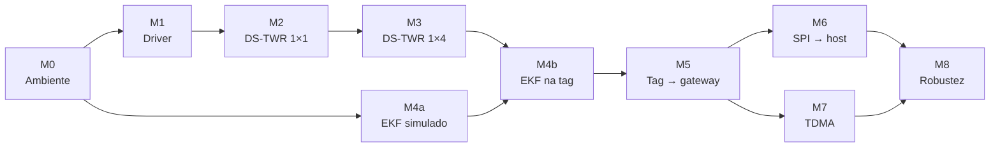

# 08 — Etapas de desenvolvimento e roteiros de teste

Roteiro único do projeto: cada etapa (marco M0 a M8) traz o que implementar, os
testes automatizados, o passo a passo de bancada e o critério de aceite.

| Documento | Papel |
|-----------|-------|
| [01-planejamento.md](01-planejamento.md) | o **porquê**: escopo, requisitos, decisões |
| **08 (este)** | o **como verificar**: etapas, testes, aceite |
| [07-bancada.md](07-bancada.md) | detalhes operacionais da bancada do M1 ao M3 (montagem, sintomas) |

---

## 1. Visão geral

| Etapa | Situação | Testes automatizados | Bancada | Placas |
|-------|----------|----------------------|---------|--------|
| M0 Ambiente e estrutura | ✅ (falta T0.4 na placa) | build + unitários | smoke test | 1 |
| M1 Driver DW1000 | 🧪 | build | ping-pong | 2 |
| M2 DS-TWR 1×1 + calibração | 🧪 | `twr_math`, `frames` | ranging + calibração | 2–3 |
| M3 DS-TWR 1×4 a 10 Hz | 🧪 | — | 4 âncoras + tag | 5 |
| M4 Localização (EKF) | 📐 | simulação em `native_sim` | grade de pontos | 5 |
| M5 Tag → gateway | 📐 | — | entrega das posições | 6 |
| M6 SPI → host | 📐 | codec TLV, CRC | host lendo a tabela | 6 + host |
| M7 Multi-tag (TDMA) | 📐 | — | 4 tags simultâneas | 9 |
| M8 Robustez e avaliação | 📐 | — | campanha do TCC | todas |

**Legenda:** ✅ concluído · 🧪 implementado, falta a bancada · 📐 a implementar

---

## 2. Convenções

**Formato de cada etapa:**

| Bloco | Conteúdo |
|-------|----------|
| Objetivo / depende de | uma frase e os pré-requisitos |
| Implementação | checklist de tarefas e arquivos |
| Testes automatizados | o que roda sem hardware |
| Roteiro de bancada | passos numerados `Tx.y`, cada um com resultado esperado |
| Critério de aceite | checklist binária; a etapa só fecha com todos os itens |
| Registrar | arquivos e dados que vão para o TCC |

**Antes de qualquer teste de bancada:**

1. Ative o ambiente: `. .\scripts\env.ps1` ou `source scripts/env.sh`.
2. Identifique as placas com `scripts\list-boards.ps1` (ou `.sh`) e grave
   sempre com `--dev-id`.
3. Anote o commit em teste: `git log -1 --format=%h`.
4. Guarde as capturas em `captures/`, que fica fora do Git.

**Ficha de registro** (uma linha por teste executado):

| ID | Data | Commit | Cenário | Resultado | Aprovado | Arquivo |
|----|------|--------|---------|-----------|----------|---------|
| T2.4 | 2026-11-03 | `9f9a2dc` | LOS, 1 m, 24 °C | viés −9,8 cm, σ 2,1 cm | ✅ | `captures/t24_1m.csv` |

---

## 3. M0 — Ambiente e estrutura base ✅

**Objetivo:** ter o ambiente reproduzível e os três firmwares compilando.
**Depende de:** nada.

### Implementação

- [x] `west.yml` com o Zephyr v4.4.0 e módulos mínimos
- [x] scripts `scripts/setup/setup-windows.ps1` e `setup-linux.sh`
- [x] apps `tag`, `anchor` e `gateway`; módulo `lib/` e `drivers/`
- [x] testes unitários em `tests/unit`

### Testes automatizados

| ID | Comando | Esperado |
|----|---------|----------|
| T0.1 | `scripts/setup/setup-windows.ps1` (ou `setup-linux.sh`) | termina com `Ambiente pronto.` |
| T0.2 | `west build -b decawave_dwm1001_dev apps/<app> -d build/<app>` para tag, anchor e gateway | sem erros e **sem warnings** |
| T0.3a | Linux/WSL: `west twister -T tests -p native_sim` | todos os testes `PASSED` |
| T0.3b | Windows: `west build -b decawave_dwm1001_dev tests/unit -d build/unit_board` + `west flash -d build/unit_board` | UART mostra `PROJECT EXECUTION SUCCESSFUL` |

### Roteiro de bancada

| ID | Passo | Esperado |
|----|-------|----------|
| T0.4 | Grave a tag e abra o console (`python -m serial.tools.miniterm COMx 115200`) | `RTLS tag 0x1001: 10 Hz...`, `DW1000 DEV_ID 0xdeca0130`, linha `PHY: canal 5...` e LED verde piscando |

### Critério de aceite

- [x] T0.1 e T0.2 no Windows
- [ ] T0.3 executado (native_sim ou placa)
- [ ] T0.4 numa placa real

---

## 4. M1 — Driver DW1000 🧪

**Objetivo:** TX imediato, TX atrasado, RX, IRQ e timestamps funcionando entre
duas placas.
**Depende de:** M0.

### Implementação

- [x] `drivers/dw1000/dw1000.c`: init (OTP, LDE, PLL), PHY, IRQ, TX/RX, potência
- [x] `samples/uwb_pingpong`: bancada ping/pong

### Testes automatizados

| ID | Comando | Esperado |
|----|---------|----------|
| T1.0 | builds de `build/ping` e `build/pong` (`-DCONFIG_PINGPONG_ROLE_PONG=y`) | sem warnings |

### Roteiro de bancada

Montagem e sintomas em [07 §1](07-bancada.md#1-m1-driver-dw1000-ping-pong).

| ID | Passo | Esperado |
|----|-------|----------|
| T1.1 | Ligue as duas placas e leia o log de init | `DEV_ID 0xdeca0130`, `xtal` ≠ 0, **nenhum** `PLL nao travou` |
| T1.2 | Ping-pong a 1 m por 100 pings (10 s) | PER ≈ 0 %, `TX atrasado perdido 0` |
| T1.3 | Ping-pong a **3 m** por **10 min** (6000 pings) | PER < 1 % |
| T1.4 | Repita 30 s a 1, 3 e 5 m e compare o `RX medio` | a potência cai com a distância (~−6 dB a cada dobro, Friis) |
| T1.5 | Regrave o pong com `-DCONFIG_PINGPONG_REPLY_US=500` e repita 2 min | `TX atrasado perdido 0` |
| T1.6 | Desligue o pong por 10 s e religue | o ping volta a receber, sem travar (PER só sobe no intervalo) |

### Critério de aceite

- [ ] T1.3: PER < 1 % a 3 m em 10 min
- [ ] T1.5: nenhum TX atrasado perdido com 500 µs de antecedência
- [ ] T1.1 e T1.6 sem anomalias

### Registrar

PER × distância (T1.3–T1.4), potência média × distância e temperatura ambiente.

---

## 5. M2 — DS-TWR 1×1 e calibração de antena 🧪

**Objetivo:** distância correta entre uma tag e uma âncora, depois de calibrar.
**Depende de:** M1.

### Implementação

- [x] `lib/twr/`: initiator, responder, `twr_math`
- [x] CSV `R,...` na tag; `tools/rtls_log.py` (`capture`, `stats`, `calib`, `calib3`)

### Testes automatizados

| ID | Comando | Esperado |
|----|---------|----------|
| T2.0 | `tests/unit` (ver T0.3) | `twr_math`: fórmula, wrap de 40 bits, ±20 ppm; `frames`: codec |

### Roteiro de bancada

Detalhes em [07 §2](07-bancada.md#2-m2-ds-twr-11-e-calibração-de-antena).

| ID | Passo | Esperado |
|----|-------|----------|
| T2.1 | Tag com `-DCONFIG_RTLS_TAG_NUM_ANCHORS=1` + âncora `nodes/a1.conf` a ~3 m | linhas `R,...` a 10 Hz; resumo com 100 % de sucesso |
| T2.2 | **Antes de calibrar:** 1000 medidas a **5,0 m** + `stats --true-distance 5.0` | viés registrado (tipicamente dezenas de cm) |
| T2.3 | Calibração com 3 placas a **5,0 m** (`calib3`), anotando a temperatura | valores `TX/RX_ANT_DLY` por placa |
| T2.4 | Grave os valores (`nodes/aN.conf` e fragmento da tag) e meça 1000 vezes a 1, 3 e 5 m | ver critério |
| T2.5 | Desligue e religue tudo; repita 5 m | viés muda menos de ~1 cm (repetibilidade) |

> [!WARNING]
> **Ponto em aberto a 1 m:** pelo APS011, o viés dependente da potência a 1 m
> no canal 5 é ~−10,5 cm. Ele pode estourar o critério de ±10 cm mesmo com o
> hardware correto. As opções são aplicar a correção por RSL já no M2 ou
> ajustar o critério a 1 m. Decisão pendente; ver a fundamentação do TCC,
> calibração §5.

### Critério de aceite

- [ ] |viés| ≤ 10 cm e desvio ≤ 5 cm a 1, 3 e 5 m (1000 medidas cada)
- [ ] atrasos de antena gravados para todas as placas do M3

### Registrar

Viés e desvio antes/depois (T2.2 × T2.4), histogramas, temperatura e os
atrasos calibrados por placa (serial do J-Link → valores).

---

## 6. M3 — DS-TWR 1×4 a 10 Hz 🧪

**Objetivo:** uma tag medindo 4 âncoras a cada 100 ms, de forma estável.
**Depende de:** M2 (placas calibradas).

### Implementação

- [x] slots de RESP/REPORT; janela de RESP fechando no meio do slot do FINAL
- [x] estatísticas a cada 10 s na tag e nas âncoras

### Roteiro de bancada

Detalhes em [07 §3](07-bancada.md#3-m3-ds-twr-14-a-10-hz).

| ID | Passo | Esperado |
|----|-------|----------|
| T3.1 | Meça as coordenadas das 4 âncoras; atualize `nodes/a1..a4.conf`; grave cada uma | log `RTLS ancora 0xa00N em (x, y, z) mm` com os valores certos |
| T3.2 | Tag no centro da área; captura de **10 min** + `stats` | `10.00 Hz`; sucesso ≥ 95 % em cada âncora |
| T3.3 | Leia os resumos de 10 s da tag e das âncoras durante o T3.2 | `max` ≤ 12 000 µs; `TX atrasado 0` em todos os nós |
| T3.4 | Desligue a âncora A4 por 1 min | rodadas seguem com 3 distâncias; `TX atrasado 0` (valida a janela de RESP) |
| T3.5 | Tag num canto da área, 2 min | registrar o sucesso por âncora (geometria desfavorável) |

> [!NOTE]
> A meta de capacidade é **8 tags a 10 Hz**, com `REPLY_DELAY_US` e
> `SLOT_US` de 1 ms (decisão de 25/10/2026). Não reduza esses tempos nesta
> etapa.

### Critério de aceite

- [ ] T3.2: ≥ 95 % de sucesso por âncora a 10,00 Hz
- [ ] T3.3: rodada ≤ 12 ms e nenhum TX atrasado
- [ ] T3.4: degradação controlada sem uma âncora

### Registrar

CSV de 10 min (base para testar o EKF offline no M4), sucesso por âncora e
tempo de rodada.

---

## 7. M4 — Localização: multilateração + EKF 📐

**Objetivo:** posição estimada na tag, com incerteza, a cada ciclo.
**Depende de:** M0 (M4a, simulação) e M3 (M4b, hardware).

> [!IMPORTANT]
> Núcleo acadêmico do TCC: a autoria da implementação é decidida pelo
> usuário. Especificação em [04-algoritmos.md](04-algoritmos.md).

### Implementação

- [ ] matrizes pequenas em `float` em `lib/loc/`
- [ ] `rtls_loc_multilaterate()`: LS linear + Gauss-Newton, modo 2D, GDOP
- [ ] `rtls_loc_update()`: predição CV, atualização sequencial, Joseph, gating χ², reinicialização
- [ ] CSV de posição na tag (`L,round,t_ms,x,y,z,sx,sy,sz,n,flags`) e suporte no `tools/rtls_log.py` *(a implementar)*

### Testes automatizados (`native_sim`, novos em `tests/unit`)

| ID | Caso | Esperado |
|----|------|----------|
| T4.1 | multilateração sem ruído, 2D e 3D | erro < 1 mm |
| T4.2 | geometria degenerada (âncoras colineares) | `-EINVAL` |
| T4.3 | EKF parado, σ_r = 5 cm | RMSE ≤ 5 cm após convergir |
| T4.4 | trajetória reta a 1 m/s | RMSE ≤ 10 cm |
| T4.5 | +1 m numa âncora em 10 % das rodadas | medidas rejeitadas (`OUTLIER`), RMSE sem degradação |
| T4.6 | só 2 distâncias por várias rodadas | o filtro segue sem divergir |
| T4.7 | NEES médio em 100 execuções | ≈ dimensão do estado |
| T4.8 | reprocessar o CSV real do T3.2 offline (host) | trajetória coerente com a posição parada |

### Roteiro de bancada

| ID | Passo | Esperado |
|----|-------|----------|
| T4.9 | Tempo de execução do EKF na placa (`k_cycle_get_32`) | ≤ 1 ms |
| T4.10 | Grade de 9 pontos marcados; 2 min parado em cada | RMSE ≤ 15 cm (2D, LOS) |
| T4.11 | Percurso numa linha marcada a passo lento | erro ao longo do percurso registrado (E6) |

### Critério de aceite

- [ ] T4.3 e T4.4 em simulação
- [ ] T4.9 ≤ 1 ms e T4.10 RMSE ≤ 15 cm

### Registrar

Erro por ponto da grade, CEP50/95, NEES e comparação EKF × LS (E7).

---

## 8. M5 — Retorno da posição (tag → gateway) 📐

**Objetivo:** todas as posições da tag chegando ao gateway.
**Depende de:** M4.

### Implementação

- [x] quadro `POSITION`, `send_position()` na tag, tabela de tags no gateway
- [ ] CSV de posições no gateway (`P,tag,round,x,y,z,...`) e contagem de lacunas por `round` *(a implementar)*

### Roteiro de bancada

| ID | Passo | Esperado |
|----|-------|----------|
| T5.1 | 1 tag + gateway, 10 min a 10 Hz | ≥ 99 % das posições recebidas (lacunas de `round`) |
| T5.2 | Latência POLL → gateway | ≤ 15 ms; método a definir (GPIO de debug + analisador, *a implementar*) |
| T5.3 | Desligue a tag | entrada expira em 2 s (`CONFIG_RTLS_GATEWAY_TAG_TIMEOUT_MS`) |
| T5.4 | 2 tags sem TDMA | ambas aparecem; perdas registradas como referência para o M7 |

### Critério de aceite

- [ ] T5.1 ≥ 99 % e T5.2 ≤ 15 ms

---

## 9. M6 — Interface SPI gateway → host 📐

**Objetivo:** host externo lendo a tabela de posições a 10 Hz.
**Depende de:** M5. Especificação em [05-interface-spi-gateway.md](05-interface-spi-gateway.md).

### Implementação

- [ ] thread `host_if` com a máquina de estados IDLE → REQ → META → DATA
- [ ] snapshot sob mutex, paginação de 9 registros, CRC-16/CCITT-FALSE, DRDY
- [ ] host de referência: ESP32-S3 (`dwm1001-gateway-esp`) ou script Python com `spidev` *(a implementar)*

### Testes automatizados

| ID | Caso | Esperado |
|----|------|----------|
| T6.0 | codec das páginas e CRC (ztest) | vetores conhecidos batem |

### Roteiro de bancada

| ID | Passo | Esperado |
|----|-------|----------|
| T6.1 | Host envia `RTLS_INFO_GET` | resposta com versão, ID e capacidade corretos |
| T6.2 | Host interrompe uma transação e envia 3 × `0xFF` | o gateway volta ao IDLE |
| T6.3 | Tabela com > 9 tags (modo de teste com registros simulados, *a implementar*) | paginação correta; `snapshot` igual em todas as páginas |
| T6.4 | 10 min a 10 Hz | **zero** erros de CRC |
| T6.5 | Analisador lógico no DRDY | sobe a cada snapshot novo; desce após a última página |
| T6.6 | Latência tag → host | ≤ 50 ms |
| T6.7 | Gateway sem host conectado | continua recebendo e logando, sem travar |

### Critério de aceite

- [ ] T6.4 sem erros de CRC e T6.6 ≤ 50 ms

---

## 10. M7 — Múltiplas tags (TDMA) 📐

**Objetivo:** várias tags a 10 Hz sem colisão. Meta de capacidade: 8 tags.
**Depende de:** M5.

### Implementação

- [ ] BEACON do gateway a cada 100 ms; slot `k = tag_id − 0x1001`
- [ ] sincronismo da tag no beacon; parar de transmitir após 3 beacons perdidos

### Roteiro de bancada

| ID | Passo | Esperado |
|----|-------|----------|
| T7.1 | Gateway transmitindo beacons; tag capturando os instantes | período de 100 ms estável |
| T7.2 | 2 tags | cada uma no próprio slot, sem sobreposição |
| T7.3 | **4 tags**, 10 min | ≥ 95 % de rodadas completas em cada; sem colisões no gateway |
| T7.4 | Desligue o gateway | as tags param de transmitir após 3 beacons; voltam quando ele religa |
| T7.5 | 8 tags (se houver placas) | capacidade-alvo confirmada |

### Critério de aceite

- [ ] T7.3 e T7.4

---

## 11. M8 — Robustez, configuração e avaliação 📐

**Objetivo:** sistema configurável sem recompilar, estável por horas e
avaliado para o TCC.
**Depende de:** M6 e M7.

### Implementação

- [ ] `settings` + NVS + shell: ID, posição da âncora, atrasos de antena
- [ ] watchdog
- [ ] indicador de NLOS ($P_{RX} - P_{FP}$) e correção do viés por RSL (opcional)

### Roteiro de bancada

| ID | Passo | Esperado |
|----|-------|----------|
| T8.1 | Mude a posição de uma âncora pelo shell e reinicie | o valor persiste após o reset |
| T8.2 | Force um travamento (comando de teste) | o watchdog reinicia e o nó volta à rede |
| T8.3 | 1 h de operação contínua com todos os nós | nenhum reset; estatísticas estáveis |
| T8.4 | Obstáculo/pessoa entre tag e uma âncora | viés e taxa de rejeição registrados (E8) |
| T8.5 | Campanha experimental E5–E8 | dataset completo e gráficos |

### Critério de aceite

- [ ] T8.1, T8.2 e T8.3
- [ ] dataset e análise prontos para a monografia

---

## 12. Etapas opcionais (ainda não planejadas)

Dependem de decisão do usuário antes de entrar no plano.

| Proposta | Esforço | Valor para o TCC |
|----------|---------|------------------|
| SS-TWR nível 1: calcular SS (bruto e corrigido pelo integrador de portadora) na mesma rodada do DS | baixo | comparação pareada de precisão SS × DS |
| SS-TWR nível 2: modo SS real, comutável em tempo real pelo POLL | médio | comparação de tempo de rodada e capacidade |
| Correção do viés por RSL já no M2 | baixo | resolve o ponto em aberto a 1 m |
| `tools/rtls_log.py --reference` (Δ = 2b contra placa calibrada) | baixo | calibração em série das demais placas |
| CI no GitHub Actions (build + `native_sim`) | baixo | testes unitários executados a cada push |
| GPIO de debug para o analisador lógico | baixo | mede latências (T5.2, T6.6) com instrumento |
