# 09 — Guia do código implementado

> **Documento vivo.** Mapa de tudo que existe no código hoje: onde está, o
> que faz, para que serve e quem usa. Ele é atualizado a cada implementação
> (regra no `CLAUDE.md`). O porquê das decisões está em
> [01-planejamento.md](01-planejamento.md) e o desenho de alto nível em
> [02-arquitetura.md](02-arquitetura.md).

**Legenda** (texto e cores dos diagramas):

| Marca | Cor | Significado |
|-------|-----|-------------|
| ✅ | verde | implementado e coberto por testes unitários |
| 🧪 | amarelo | implementado e compilando; depende de validação em bancada |
| 📐 | cinza tracejado | API pronta, implementação pendente (retorna `-ENOSYS`) |
| — | azul | externo ao projeto (Zephyr, hardware) |

Os diagramas usam **Mermaid**. Eles renderizam no GitHub, no VS Code, no
Obsidian e no CLion (com a extensão Mermaid ativada nas configurações de
Markdown), e ficam versionados como texto junto com o código.

**Seções:**
[1 Arquitetura geral](#1-arquitetura-geral) ·
[2 Componentes](#2-componentes) ·
[3 Zephyr no projeto](#3-zephyr-no-projeto) ·
[4 Parâmetros editáveis](#4-parâmetros-editáveis) ·
[5 Manutenção deste documento](#5-manutenção-deste-documento)

---

## 1. Arquitetura geral

### 1.1 O sistema em funcionamento

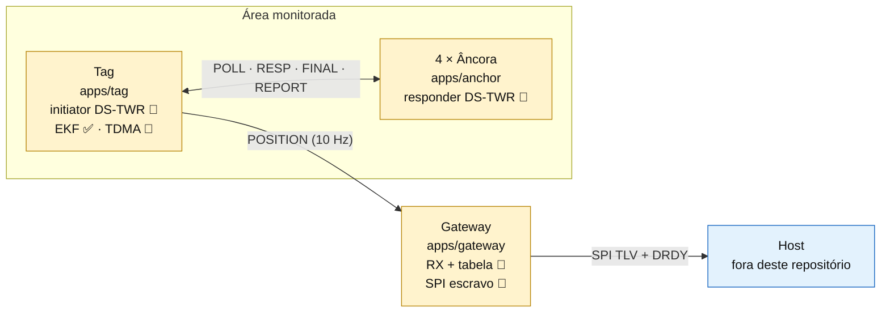

**Hoje, de ponta a ponta:**
1. A tag mede a distância até as 4 âncoras a 10 Hz e corrige o viés por RSL.
   Com TDMA ligado (M7), o gateway abre cada superquadro com um BEACON e cada
   tag só transmite no próprio slot.
2. O EKF estima a posição; a tag imprime distâncias e posições em CSV e envia
   o POSITION ao gateway.
3. O gateway mantém a tabela de tags, imprime cada POSITION em CSV e conta as
   lacunas de `round` por tag.
4. O host lê a tabela pelo SPI escravo, paginada e com CRC, avisado pelo
   DRDY. Falta validar com um host real.

### 1.2 Camadas do firmware

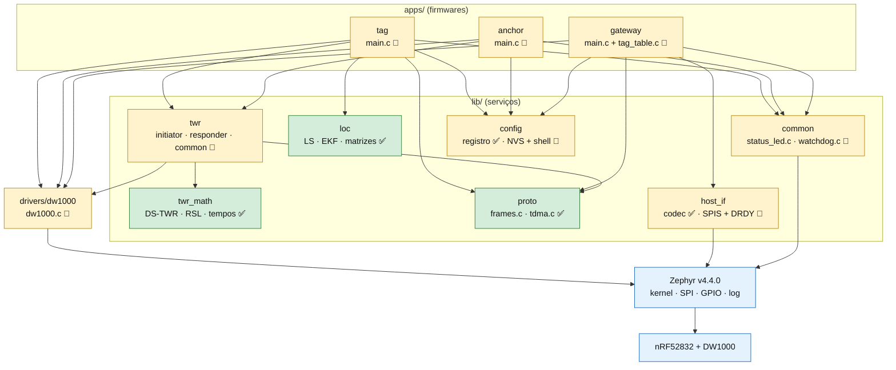

**Regras que o código segue:**

| Regra | Onde se vê |
|-------|-----------|
| `twr_math`, `proto` e `loc` não tocam hardware | compilam em `native_sim` (`tests/unit`) |
| Só `drivers/dw1000` acessa o rádio | as outras camadas chamam `dw1000_transmit()` / `dw1000_receive()` |
| Um único dono do rádio por firmware | a thread `main` de cada app |
| As bibliotecas recebem IDs e parâmetros por argumento | `struct rtls_twr_*_cfg` montada pelo app |

### 1.3 Onde está cada parte

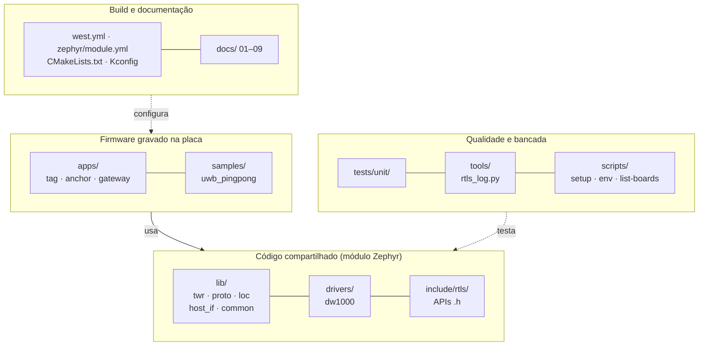

| Caminho | Conteúdo | Situação |
|---------|----------|----------|
| [`apps/tag`](../apps/tag) | laço de 10 Hz: DS-TWR → CSV → EKF → POSITION | 🧪 |
| [`apps/anchor`](../apps/anchor) | responder DS-TWR; `nodes/a1..a4.conf` por âncora | 🧪 |
| [`apps/gateway`](../apps/gateway) | RX de POSITION, tabela de tags, CSV e lacunas por tag, publicação ao host | 🧪 |
| [`drivers/dw1000`](../drivers/dw1000) | driver próprio do DW1000 + mapa de registradores | 🧪 |
| [`lib/twr`](../lib/twr) | motor DS-TWR e matemática | 🧪 / ✅ |
| [`lib/proto`](../lib/proto) | montagem e validação de quadros | ✅ |
| [`lib/loc`](../lib/loc) | multilateração LS + Gauss-Newton, EKF, matrizes pequenas | ✅ |
| [`lib/host_if`](../lib/host_if) | codec do protocolo SPI (páginas, CRC) e thread SPIS + DRDY | ✅ / 🧪 |
| [`lib/common`](../lib/common) | LEDs de status e watchdog | 🧪 |
| [`lib/config`](../lib/config) | registro de parâmetros, NVS (`settings`) e comandos `rtls` do shell | ✅ / 🧪 |
| [`include/rtls`](../include/rtls) | headers públicos de todas as bibliotecas | — |
| [`samples/uwb_pingpong`](../samples/uwb_pingpong) | bancada do driver (M1) | 🧪 |
| [`tests/unit`](../tests/unit) | 45 testes ztest | ✅ |
| [`tools/rtls_log.py`](../tools/rtls_log.py) | captura CSV, estatística de distâncias e posições, calibração de antena | ✅ |
| [`scripts/`](../scripts) | setup Windows/Linux, ativação, lista de placas | ✅ |

### 1.4 O que entra em cada firmware

| Módulo | tag | anchor | gateway | ping-pong | testes |
|--------|:---:|:------:|:-------:|:---------:|:------:|
| `drivers/dw1000` | ● | ● | ● | ● | |
| `lib/twr` (motor) | ● | ● | | | |
| `lib/twr` (`twr_math`) | ● | ● | | ● | ● |
| `lib/proto` | ● | ● | ● | ● | ● |
| `lib/loc` | ● | | | | ● |
| `lib/host_if` | | | ● | | ● (codec) |
| `lib/common` (LEDs) | ● | ● | ● | ● | |
| `lib/common` (watchdog) | ● | ● | ● | | |
| `lib/config` | ● | ● | ● | | ● (tabela) |

A seleção vem do `prj.conf` de cada app (seção [3.5](#35-kconfig-ligando-e-configurando-módulos)).

---

## 2. Componentes

### 2.1 Driver DW1000 · `drivers/dw1000/` 🧪

**O que faz:** inicializa o transceptor, configura a PHY, envia e recebe
quadros e entrega timestamps de 40 bits (15,65 ps).
**Por que existe:** o driver do Zephyr entrega timestamps em ns (≈ 30 cm de
erro), inviável para TWR.

#### Inicialização (`dw1000_init()` + `dw1000_configure()`)

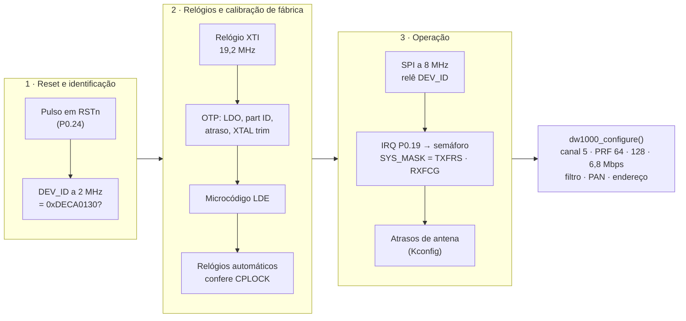

#### Modelo de eventos

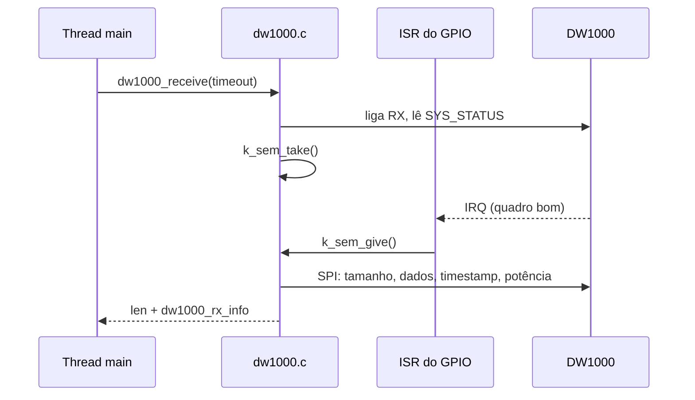

#### API

| Função | O que faz | Quem usa |
|--------|-----------|----------|
| `dw1000_init()` | reset, OTP, LDE, PLL, IRQ, atrasos de antena | `main()` de todos os apps e do ping-pong |
| `dw1000_configure()` | registradores de ajuste da PHY, filtro, PAN e endereço | idem |
| `dw1000_transmit()` | TX imediato ou atrasado, com RX automático opcional; `-ETIME` se tarde demais | `twr_send()`, `send_position()` (tag), ping-pong |
| `dw1000_receive()` | liga o RX e espera um quadro bom ou o prazo; preenche timestamp e potência | `twr_recv()`, laço do gateway, ping-pong |
| `dw1000_idle()` | TRXOFF e limpeza de eventos | fim de cada rodada (tag e âncora), ping |
| `dw1000_set_antenna_delay()` | grava `TX_ANTD` / `RX_ANTD` | `dw1000_init()` |
| `dw1000_get_stats()` | contadores (TX ok/tarde, RX ok/timeout) | pong (ping-pong) |
| `dw1000_sys_time()`, `dw1000_read_dev_id()` | relógio de 40 bits; diagnóstico | reservado / init |

**Estruturas:** `dw1000_phy_config` (só `DW1000_PHY_CONFIG_DEFAULT` é aceita),
`dw1000_tx_opts` (`delayed_ts`, `rx_after_tx`, `rx_delay_uus`),
`dw1000_rx_info` (`rx_ts`, `rx_power_cdbm`, `fp_power_cdbm`).
Registradores em [`dw1000_regs.h`](../drivers/dw1000/dw1000_regs.h).

---

### 2.2 Quadros do protocolo · `lib/proto/` + `include/rtls/frames.h` ✅

**O que faz:** define o formato no ar (cabeçalho IEEE 802.15.4 + mensagens
RTLS), monta e valida quadros.
**Por que existe:** um único lugar para o protocolo, testável sem hardware.

| Cabeçalho MAC (9 B) | Carga RTLS | FCS (2 B) |
|---------------------|------------|-----------|
| FC `0x8841` · seq · PAN · destino · origem | tipo (1 B) + campos | gerado pelo DW1000 |

| Mensagem | Tipo | Bytes | Quem envia → quem recebe | Código |
|----------|------|-------|--------------------------|--------|
| POLL | `0x20` | 11 | tag → âncoras | `twr_initiator.c` → `twr_responder.c` |
| RESP | `0x21` | 2 | âncora → tag | `twr_responder.c` → `twr_initiator.c` |
| FINAL | `0x22` | 2 | tag → âncoras | idem POLL |
| REPORT | `0x23` | 24 | âncora → tag | idem RESP |
| POSITION | `0x30` | 26 | tag → gateway | `send_position()` → `handle_frame()` |
| BEACON | `0x10` | 6 | gateway → todos | `send_beacon()` do gateway → `wait_beacon()` da tag (M7) |
| PING | `0xF0` | 5 | ping ↔ pong | `samples/uwb_pingpong` |

| Função | O que faz | Quem usa |
|--------|-----------|----------|
| `rtls_mac_hdr_init()` | preenche o cabeçalho MAC | `twr_send()`, tag, ping-pong |
| `rtls_frame_build()` | cabeçalho + carga → buffer | idem |
| `rtls_frame_parse()` | valida FC, PAN e tamanho; retorna o tipo | `twr_recv()`, gateway, ping-pong |
| `rtls_msg_size()` | tamanho da carga por tipo | `rtls_frame_parse()` |
| `rtls_round_tracker_update()` | conta as rodadas sem POSITION pela sequência de `round` (volta em 256); `t_ms` repetido = duplicado, `t_ms` menor = tag reiniciou | `tag_table.c` do gateway |
| `rtls_tdma_*` (`tdma.c`) | superquadro TDMA: slot pelo ID, período (4 ms + n × slot), início do slot, próximo BEACON, 3 BEACONs perdidos = sem sincronismo | `tdma_loop()` da tag |

---

### 2.3 Matemática do DS-TWR e correção de viés · `lib/twr/twr_math.c` ✅

**O que faz:** transforma timestamps em distância corrigida.
**Por que existe:** isolar a física e a matemática para testá-las em PC.

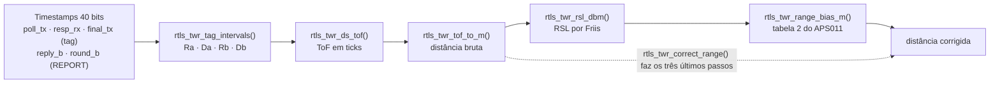

| Função | O que faz | Quem usa |
|--------|-----------|----------|
| `rtls_dw_ts_diff()` | diferença módulo 2⁴⁰ | initiator, responder |
| `rtls_twr_tag_intervals()` | monta Ra, Da, Rb, Db | initiator |
| `rtls_twr_ds_tof()` | estimador assimétrico $(R_aR_b - D_aD_b)/(R_a+R_b+D_a+D_b)$ | initiator |
| `rtls_twr_tof_to_m()` | ticks → metros ($c_{ar}$) | initiator |
| `rtls_us_to_dw_ticks()`, `rtls_us_to_uus()` | conversões de tempo | initiator, responder, ping-pong |
| `rtls_twr_slot_ts()` | instante de TX de um slot | responder (RESP/REPORT), initiator (FINAL), pong |
| `rtls_twr_rsl_dbm()` | RSL por Friis, canal 5 | `rtls_twr_correct_range()` |
| `rtls_twr_range_bias_m()` | interpolação da tabela do APS011 | idem |
| `rtls_twr_correct_range()` | distância corrigida | `correct_bias()` no initiator |

Teoria: [04-algoritmos.md](04-algoritmos.md) §2 e §3.1.

---

### 2.4 Motor DS-TWR · `lib/twr/twr_{initiator,responder,common}.c` 🧪

**O que faz:** executa a troca POLL → RESP → FINAL → REPORT e produz um
`rtls_range_set` por rodada.
**Por que existe:** separar o protocolo de ranging do laço de cada app.

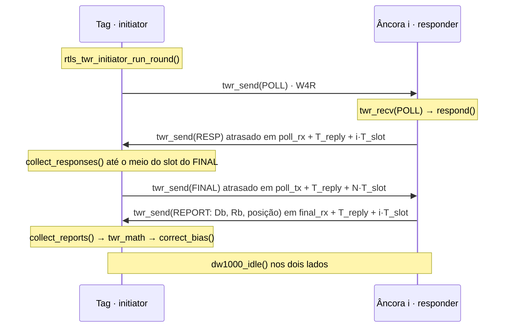

| Arquivo / função | O que faz | Quem usa |
|------------------|-----------|----------|
| `twr_common.c`: `twr_send()` | monta o quadro e chama `dw1000_transmit()` | initiator, responder |
| `twr_common.c`: `twr_recv()` | recebe até chegar o tipo esperado ou vencer o prazo | initiator, responder |
| `rtls_twr_initiator_init()` / `_run_round()` | configuração e rodada completa da tag | `apps/tag` |
| `rtls_twr_initiator_get_stats()` | rodadas, % completas, tempo da rodada, TX atrasado, por âncora | resumo de 10 s da tag |
| `rtls_twr_responder_init()` / `_run()` | laço infinito da âncora; sem POLL, volta a cada 500 ms para o `idle_hook` | `apps/anchor` |
| `rtls_twr_responder_set_position()` | troca a posição do REPORT (chamada no `idle_hook`) | `apps/anchor` |
| `rtls_twr_responder_get_stats()` | POLL, RESP, FINAL, REPORT, timeouts | trabalho de 10 s da âncora |

**Saída por rodada** (`struct rtls_range_set`): número da rodada, instante,
e para cada âncora o ID, a posição, `distance_m` (corrigida),
`distance_raw_m` (bruta) e as potências.

---

### 2.5 Localização · `lib/loc/` ✅

Núcleo do M4. Recebe as distâncias de uma rodada e devolve a posição, a
velocidade e a incerteza. É pura: só `float` e `<math.h>`, sem kernel nem
hardware. Especificação: [04-algoritmos.md](04-algoritmos.md) §4–5.

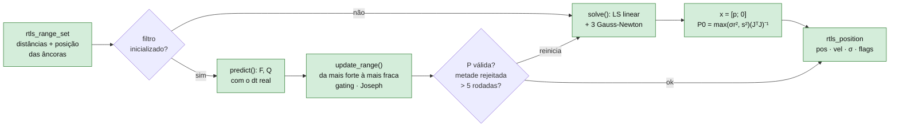

| Função | O que faz | Uso |
|--------|-----------|-----|
| `rtls_loc_default_cfg()` | lê σ_r, σ_a, gating, altura e o modo 2D/3D do Kconfig | `apps/tag` |
| `rtls_loc_init()` / `_reset()` | valida a configuração e zera o estado | `apps/tag`, testes |
| `rtls_loc_multilaterate()` | LS relativo à âncora 0 + Gauss-Newton; devolve a posição e o GDOP; `-EINVAL` com poucas distâncias ou geometria degenerada | testes, baseline |
| `rtls_loc_update()` | um ciclo do EKF; `-EAGAIN` enquanto não houver distâncias para inicializar | `apps/tag` |
| `rtls_loc_get_stats()` | posições, distâncias aceitas e rejeitadas, reinicializações | resumo de 10 s da tag |
| `rtls_mat_*` (`loc_mat.c`) | produto, produto por transposta, Cholesky, inversa SPD, traço; até 6×6 | `loc.c`, testes (NEES) |

**Quando reinicializa** (a próxima posição vem da multilateração, com o flag
`INIT`):

| Condição | Por quê |
|----------|---------|
| 1 s sem nenhuma distância aceita | o estado envelheceu demais |
| > 5 rodadas seguidas com **metade ou mais** rejeitadas **e** a rodada coerente entre si ($s^2 \le \gamma\,\sigma_r^2$) | o filtro está preso numa solução espelhada, que concorda só com parte das âncoras (T4.13) |
| soma das variâncias de posição > 100 m² ou estado não finito | proteção numérica |

### 2.6 Interface com o host · `lib/host_if/` 🧪

**O que faz:** entrega a tabela de tags a um host externo pelo SPI escravo,
paginada (9 registros), com CRC por página e o pino DRDY.
**Por que existe:** o gateway não tem rede; quem publica (MQTT etc.) é o host.
Protocolo: [05-interface-spi-gateway.md](05-interface-spi-gateway.md).

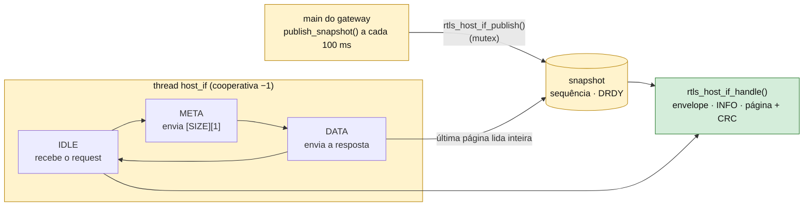

| Função | Camada | O que faz | Uso |
|--------|--------|-----------|-----|
| `rtls_host_if_handle()` | codec ✅ | lê o TLV do request (ignora o preenchimento) e monta a resposta; devolve 0 para NOP; informa DRDY on/off e se é a última página | `host_if.c`, testes |
| `rtls_host_if_crc()` | codec ✅ | CRC-16/CCITT-FALSE: `crc16_itu_t(0xFFFF, ...)` | idem |
| `rtls_host_if_n_pages()` | codec ✅ | páginas de um snapshot (mínimo 1) | idem |
| `rtls_host_if_init()` | transporte 🧪 | confere SPIS e DRDY, guarda os dados do `INFO` e cria a thread `host_if` | `apps/gateway` |
| `rtls_host_if_publish()` | transporte 🧪 | copia o snapshot sob mutex; avança a sequência e sobe o DRDY só se algo além do `age_ms` mudou | `publish_snapshot()` do gateway |

### 2.7 LEDs de status e watchdog · `lib/common/` 🧪

| LED (alias) | Função | Disparo |
|-------------|--------|---------|
| verde (`led1`) | heartbeat: firmware vivo | `k_timer` a cada 500 ms |
| azul (`led3`) | atividade UWB | `rtls_status_led_activity()`: rodada ok, POSITION, resumo da âncora, ping/pong |
| vermelho (`led0`) | erro persistente | `rtls_status_led_error(true)`: falha de init |

**Watchdog** (`watchdog.c`, M8): só a thread `main` alimenta. Se o laço do
rádio travar, o nó reinicia em `CONFIG_RTLS_WATCHDOG_TIMEOUT_MS`.

| Função | O que faz | Quem chama |
|--------|-----------|------------|
| `rtls_watchdog_init()` | registra a causa do reset anterior (`hwinfo`) e liga o WDT do nRF52 (pausado pelo depurador) | os três apps, no fim do boot |
| `rtls_watchdog_feed()` | alimenta | a cada volta: `housekeeping()` da tag, `idle_hook()` da âncora, laço do gateway |
| `rtls_watchdog_hang()` | teste do T8.2: a próxima alimentação trava a `main` | `rtls hang` no shell |

**GPIO de debug** (`debug_gpio.c`, `CONFIG_RTLS_DEBUG_GPIO`): pino
`zephyr,user/debug-gpios` (P0.15, pino 3 do conector RPi) para o analisador
lógico. Desligado, as funções viram *stubs* vazios no header.

| Função | Tag | Gateway |
|--------|-----|---------|
| `rtls_debug_gpio_set()` | alto do POLL ao POSITION (`run_cycle()`): tempo de rodada (M3) | — |
| `rtls_debug_gpio_pulse()` | — | pulso a cada POSITION recebido: latência POLL → gateway (T5.2) |

### 2.7.1 Registro de parâmetros · `lib/config/` (tabela ✅, NVS e shell 🧪)

**O que faz:** dá a cada parâmetro do nó uma chave estável (as do M12), um
nome, uma faixa e uma classe; guarda na NVS o que for alterado pelo shell.
**Por que existe:** reconfigurar um nó sem recompilar (M8) e, depois, pelo
host (M12), com a mesma tabela.

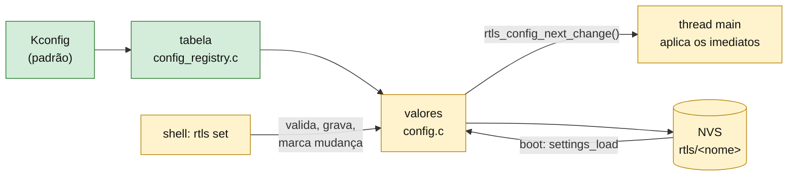

| Função | O que faz |
|--------|-----------|
| `rtls_config_find()` / `_validate()` | parâmetro pelo nome (`loc/range_std_mm`) ou pela chave (`0x0603`); faixa e só leitura |
| `rtls_config_init()` | padrões do Kconfig + `settings_load_subtree("rtls")` |
| `rtls_config_get()` / `_is_saved()` | valor atual e se veio da NVS |
| `rtls_config_set()` | valida, grava `rtls/<nome>` na NVS, marca a mudança |
| `rtls_config_reset()` | apaga da NVS (um ou todos) e volta ao padrão |
| `rtls_config_next_change()` | a `main` pega uma chave alterada por vez e aplica |

**Comandos do shell** (mesma UART do console, `uart:~$`):

| Comando | O que faz |
|---------|-----------|
| `rtls show` | todos os parâmetros: chave, nome, valor, origem (NVS ou padrão) e classe |
| `rtls get <nome\|0xchave>` | um parâmetro |
| `rtls set <nome\|0xchave> <valor>` | grava (decimal ou `0x...`); avisa quando só vale depois de reiniciar |
| `rtls reset <nome\|0xchave\|all>` | apaga da NVS |
| `rtls reboot` | reinicia o nó |
| `rtls hang` | trava a `main` para testar o watchdog (T8.2) |

A tabela de cada firmware só tem os parâmetros do papel dele (seção
[4.13](#413-registro-de-parâmetros-shell-e-nvs)).

---

### 2.8 Firmware da tag · `apps/tag/src/main.c` 🧪

O ciclo (`run_cycle()`) é o mesmo nos dois modos; muda quem decide quando
ele roda:

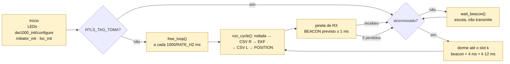

| Função local | O que faz |
|--------------|-----------|
| `print_ranges()` | uma linha `R,round,t_ms,ancora,dist_mm,rx_cdbm,fp_cdbm,raw_mm` por distância |
| `timed_loc_update()` | chama `rtls_loc_update()` e mede o tempo com a API de *timing* (T4.9) |
| `print_position()` | uma linha `L,round,t_ms,x,y,z,sx,sy,sz,n,flags` por posição (mm) |
| `log_stats()` | resumo de 10 s: rodadas, % completas, tempo de rodada, por âncora; linha `LOC:` com posições, aceitas, rejeitadas, reinícios e tempo do EKF |
| `send_position()` | monta e envia o POSITION ao gateway |
| `run_cycle()` | rodada DS-TWR, CSV `R`, EKF, CSV `L` e POSITION |
| `free_loop()` | ciclo próprio a `RTLS_TAG_UPDATE_RATE_HZ` (sem gateway, M2–M6) |
| `tdma_loop()` | TDMA (M7): espera o BEACON, roda no slot `k = id − 0x1001`, abre a janela do próximo BEACON; sem 3 BEACONs seguidos, para de transmitir |
| `wait_beacon()` | escuta até um prazo; ignora POLL/FINAL de outras tags; sincroniza no BEACON do gateway |
| `frame_start_us()` | instante local em que o quadro começou: `RX_TIME` × relógio atual do DW1000, sem a latência ISR → thread |
| `housekeeping()` | a cada volta dos dois laços: watchdog, `apply_config_changes()` e resumo |
| `apply_config_changes()` | atrasos de antena na hora; parâmetros do EKF reconstroem a configuração e reiniciam o filtro |
| `loc_cfg_from_registry()` | configuração do EKF a partir do registro (inclui a ponderação de NLOS) |

### 2.9 Firmware da âncora · `apps/anchor/src/main.c` 🧪

- **Inicialização:** carrega o registro (NVS sobre o Kconfig), monta
  `rtls_twr_responder_cfg` com o ID, o PAN e a posição, aplica os atrasos de
  antena e chama `rtls_twr_responder_run()`, que não retorna.
- **`idle_hook()`:** chamado pelo responder a cada rodada e, sem POLL, a cada
  500 ms. Alimenta o watchdog e aplica posição e atrasos de antena alterados
  pelo shell, na própria thread `main`.
- **Resumo de 10 s:** feito por `stats_work` (`k_work_delayable`) na
  workqueue do sistema, sem parar o responder.
- **Uma imagem por âncora:** `-DEXTRA_CONF_FILE=nodes/aN.conf` define ID e
  posição.

### 2.10 Firmware do gateway · `apps/gateway/src/` 🧪

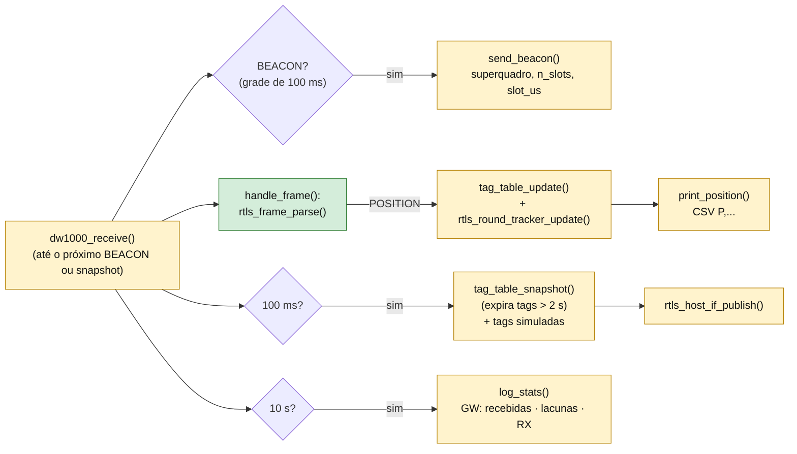

| Função | O que faz |
|--------|-----------|
| `tag_table_update()` | insere ou atualiza a tag (posição, σ, RSSI, rodada) e conta as lacunas de `round`; ignora POSITION repetido |
| `tag_table_snapshot()` | copia as entradas ativas com a idade e remove as expiradas (a sequência de `round` recomeça se a tag voltar) |
| `tag_table_get_stats()` | recebidas, lacunas e soma da potência por tag desde o último resumo |
| `print_position()` | uma linha `P,tag,round,t_ms,x,y,z,sx,sy,sz,n,flags,rx_cdbm,fp_cdbm,gw_ms` por POSITION |
| `log_stats()` | resumo de 10 s: `GW: tag 0x1001: N posicoes, M lacunas (x% recebidas), RX d dBm` |
| `add_sim_tags()` | com `CONFIG_RTLS_GATEWAY_SIM_TAGS` > 0, acrescenta tags sintéticas ao snapshot para testar a paginação do SPI |
| `send_beacon()` | com `CONFIG_RTLS_GATEWAY_BEACON`, abre cada superquadro; o laço agenda em µs e mede o maior atraso em relação à grade (linha `GW: N BEACONs ... atraso max`) |

> [!NOTE]
> Lacuna de `round` não é sempre quadro perdido: o `round` da tag avança
> também nas rodadas sem posição (sem distâncias ou com o filtro
> inicializando). A entrega exata sai de `rtls_log.py gw --sent`, que cruza o
> CSV do gateway com as linhas `L,...` da tag pelo `t_ms`.

### 2.11 Bancada do driver · `samples/uwb_pingpong` 🧪

Ping a cada 100 ms com RX automático. O pong responde com TX atrasado de
1 ms. A cada 100 pings imprime PER, potência média e TX atrasados perdidos.
Valida o driver isoladamente (M1).

### 2.12 Testes unitários · `tests/unit` ✅

| Suíte | Testes | Cobre |
|-------|--------|-------|
| `twr_math` | 11 | wrap de 40 bits, DS-TWR ideal e com ±20 ppm, intervalos, conversões de tempo, slots, RSL por Friis, tabela de viés, distância corrigida |
| `frames` | 5 | montagem/parse, rejeição de PAN e tamanho, quadro grande demais, tamanhos, lacunas de `round` |
| `tdma` | 4 | slot pelo ID, período, início dos slots, BEACONs perdidos e ressincronismo, BEACON inválido (T7.0) |
| `loc_mat` | 3 | produto, Cholesky e inversa, rejeição de matriz singular (T4.14) |
| `host_if` | 7 | CRC com o vetor "123456789", contagem de páginas, INFO, 20 tags em 3 páginas, tabela vazia, DRDY on/off, NOP e erros (T6.0) |
| `loc` | 12 | multilateração exata 2D/3D e degenerada; EKF parado, em reta, com *outliers*, com 2 distâncias, NEES, reinício por tempo e por salto (T4.1–T4.7, T4.12–T4.13); fator de NLOS e viés de NLOS com e sem ponderação (T8.6) |
| `config` | 3 | busca por nome e chave, faixas, consistência da tabela (T8.0) |

A suíte `frames` também cobre o rastreador de `round` do gateway (T5.0):
lacunas, volta em 256, repetido e reinício da tag.

Os testes do EKF usam trajetórias sintéticas com um gerador determinístico
(xorshift32 + Box-Muller) e imprimem o RMSE e o NEES obtidos.

Execução: `native_sim` (Linux/WSL) ou gravados na placa (`build/unit_board`,
com FPU ligada por `boards/decawave_dwm1001_dev.conf`).

### 2.13 Ferramentas e scripts

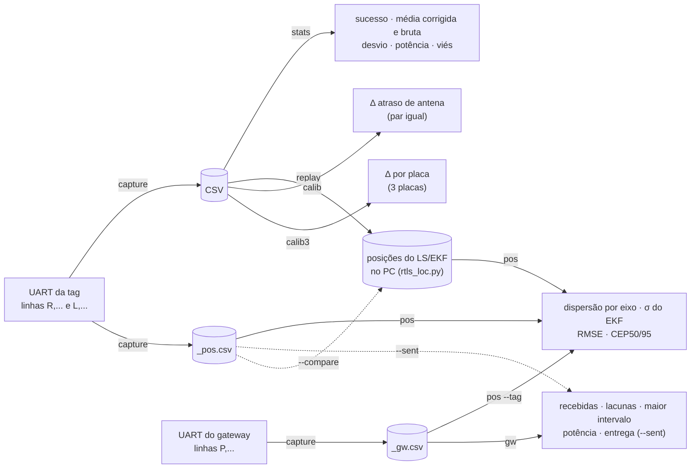

| Arquivo | Para quê |
|---------|----------|
| `scripts/setup/setup-windows.ps1`, `setup-linux.sh` | instalam o ambiente completo (west, Zephyr, SDK) |
| `scripts/env.ps1`, `env.sh` | ativam o venv e o J-Link num terminal novo e definem `ZEPHYR_SDK_INSTALL_DIR` (o CMake acha o SDK sem o registro de pacotes) |
| `scripts/list-boards.ps1`, `.sh` | porta serial × serial do J-Link de cada placa |
| `tools/rtls_loc.py` | *port* em Python de `lib/loc` (LS, Gauss-Newton, EKF, reinício, NLOS) usado pelo `rtls_log.py replay` (T4.8, E7) |
| `.github/workflows/ci.yml` | CI no GitHub Actions: compila os 14 firmwares e variantes com warnings como erro e roda os testes em `native_sim/native/64` |

---

## 3. Zephyr no projeto

### 3.1 Por que Zephyr

| Necessidade | O que o Zephyr dá |
|-------------|-------------------|
| Suporte à placa | `decawave_dwm1001_dev` oficial: devicetree com pinos, SPI, LEDs |
| Prazos de ~1 ms | escalonador com prioridades e timeouts precisos (32 768 Hz) |
| Concorrência sem afetar o rádio | log diferido, timers e workqueue |
| Portabilidade e reprodutibilidade | drivers SPI/GPIO genéricos; versão fixada no `west.yml` |
| Testes sem hardware | `native_sim` + ztest + twister |

### 3.2 Do código ao binário

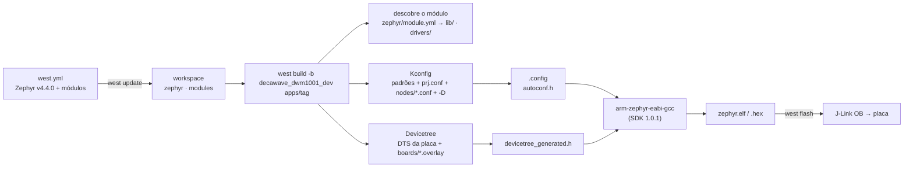

### 3.3 Recursos usados e onde

| Recurso do Zephyr | API | Onde no projeto | Para quê |
|-------------------|-----|-----------------|----------|
| SPI | `spi_transceive_dt()`, `spi_write_dt()` | `dw1000.c` | registradores do DW1000 (2 MHz no init, 8 MHz depois) |
| GPIO | `gpio_pin_configure_dt()`, callbacks | `dw1000.c`, `status_led.c`, `host_if.c` | RESET, IRQ, LEDs, DRDY |
| SPI escravo | `spi_transceive()` com `SPI_OP_MODE_SLAVE` | `host_if.c` | uma transação do host por chamada; devolve os bytes recebidos |
| Thread própria | `K_THREAD_STACK_DEFINE`, `k_thread_create()` | `host_if.c` | a thread `host_if` do gateway |
| Mutex | `K_MUTEX_DEFINE`, `k_mutex_lock/unlock` | `host_if.c` | snapshot compartilhado entre a `main` e a `host_if` |
| CRC | `crc16_itu_t()` (`CONFIG_CRC`) | `host_if_codec.c` | CRC-16/CCITT-FALSE das páginas |
| Versão do app | arquivo `VERSION` + `<zephyr/app_version.h>` | gateway | versão anunciada no `RTLS_INFO_GET` e no boot |
| Semáforo | `K_SEM_DEFINE`, `k_sem_take/give` | `dw1000.c` | a ISR acorda a thread dona do rádio |
| Timeouts / tempo | `sys_timepoint_*`, `K_USEC`, `K_TIMEOUT_ABS_MS` | `dw1000.c`, `twr_*.c`, tag | janelas de RX; ciclo de 100 ms sem deriva |
| Tempo em ticks | `k_uptime_ticks()`, `K_TIMEOUT_ABS_TICKS`, `k_us_to_ticks_ceil64()` | tag e gateway (TDMA) | grade do BEACON e slots em µs, sem arredondar para ms (resolução do tick: ~30 µs) |
| Timer | `K_TIMER_DEFINE` | `status_led.c` | heartbeat |
| Workqueue | `K_WORK_DELAYABLE_DEFINE` | âncora | resumo sem parar o responder |
| Ciclos de CPU | `k_cycle_get_32()` | initiator | tempo da rodada |
| *Timing* | `timing_init()`, `timing_counter_get()`, `timing_cycles_to_ns()` | tag | tempo do EKF (TIMER2 a 16 MHz ou DWT; o `k_cycle_get_32()` do nRF52 conta o RTC, ~30 µs) |
| Log | `LOG_MODULE_REGISTER`, `LOG_INF` | todos | logs por módulo, em modo diferido |
| `printk` | `printk()` + `CONFIG_LOG_PRINTK` | tag, gateway | CSV na UART; formatado no buffer do log diferido, sem bloquear o rádio |
| Devicetree | `SPI_DT_SPEC_GET`, `GPIO_DT_SPEC_GET`, `DT_CHOSEN` | `dw1000.c`, `host_if.c`, LEDs | pinos e barramentos sem número fixo no código |
| ztest / twister | `ZTEST`, `zassert_*` | `tests/unit` | testes das bibliotecas puras |
| Settings + NVS | `settings_load_subtree()`, `settings_save_one()`, `SETTINGS_STATIC_HANDLER_DEFINE` | `config.c` | parâmetros persistentes na partição `storage_partition` (24 KB) |
| Shell | `SHELL_CMD_REGISTER`, `SHELL_STATIC_SUBCMD_SET_CREATE`, `shell_print()` | `config_shell.c` | comandos `rtls` na UART; o log passa pelo backend do shell |
| Watchdog | `wdt_install_timeout()`, `wdt_setup()`, `wdt_feed()` | `watchdog.c` | reinicia o nó se a `main` travar |
| Causa do reset | `hwinfo_get_reset_cause()` | `watchdog.c` | registra no boot se o último reset foi do watchdog (T8.2, T8.3) |
| Reinício | `sys_reboot()` | `config_shell.c` | `rtls reboot` |
| Atômicos | `atomic_set_bit()`, `atomic_test_and_clear_bit()` | `config.c` | máscaras de "salvo" e "mudou" entre o shell e a `main` |
| Módulo externo | `zephyr/module.yml` | raiz | `lib/` e `drivers/` entram em qualquer app do workspace |

### 3.4 Devicetree: o hardware visto pelo código

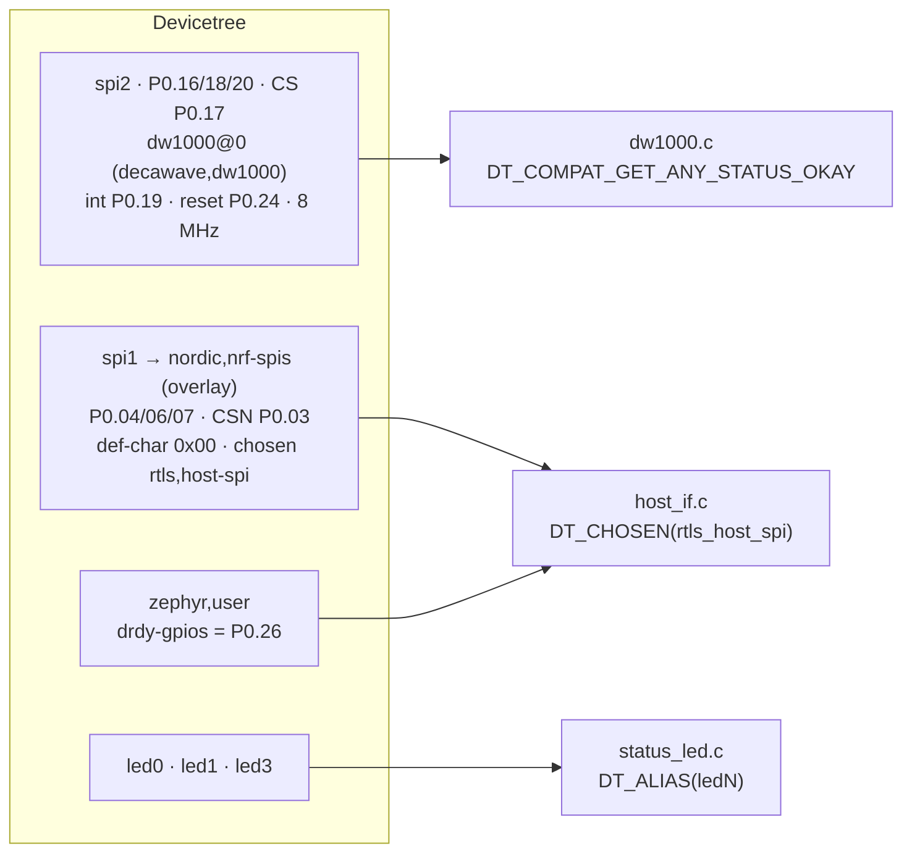

| Arquivo | O que define |
|---------|--------------|
| DTS da placa (Zephyr) | DW1000 no SPI2, LEDs, botão, UART0 (console) |
| `apps/tag/boards/*.overlay`, `apps/anchor/boards/*.overlay` | garante o SPI2 habilitado |
| `apps/gateway/boards/*.overlay` | SPI1 como escravo, pinos, DRDY, `chosen` |

### 3.5 Kconfig: ligando e configurando módulos

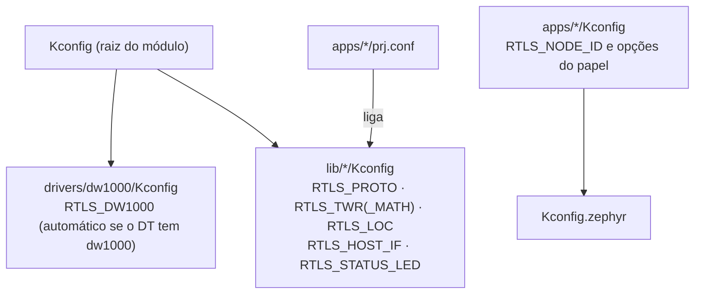

- `RTLS_TWR` seleciona sozinho `RTLS_TWR_MATH` e `RTLS_PROTO`.
- `RTLS_DW1000` depende do nó `decawave,dw1000` existir e do driver
  IEEE 802.15.4 do Zephyr estar **desligado**.
- O `prj.conf` decide o que cada firmware inclui (tabela da [seção 1.4](#14-o-que-entra-em-cada-firmware)).

### 3.6 Execução: threads, ISRs e prioridades

| Contexto | Prioridade | O que roda | Arquivo |
|----------|-----------|------------|---------|
| ISR GPIOTE (P0.19) | interrupção | `k_sem_give()` | `dw1000.c` |
| ISR do timer | interrupção | alterna o LED verde | `status_led.c` |
| workqueue do sistema | cooperativa (−1) | resumo de 10 s da âncora | `apps/anchor` |
| `host_if` | cooperativa (−1) | transações do SPIS e DRDY (gateway) | `host_if.c` |
| `main` | preemptiva 0 | rádio: ciclo da tag / responder / RX do gateway; aplica a configuração alterada | `apps/*` |
| `shell` | preemptiva (padrão do Zephyr) | comandos `rtls` e saída do log (inclusive o CSV) | Zephyr + `config_shell.c` |
| thread de log | baixa | formata e envia os logs | Zephyr |
| idle | mínima | — | Zephyr |

### 3.7 Impacto do Zephyr em cada tópico

| Tópico | Impacto | Cuidado adotado |
|--------|---------|-----------------|
| Driver / tempo de resposta | ISR → thread em dezenas de µs; o SPI não pode ser usado na ISR | modelo ISR + semáforo; `T_reply` de 1 ms |
| DS-TWR | os prazos do RX usam o tick do kernel (~30 µs) | janelas com folga (`RX_MARGIN_US`) |
| Âncora | a workqueue (prioridade −1) pode interromper o responder por algumas dezenas de µs a cada 10 s | trabalho curto (log diferido + LED); dentro da folga de 1 ms |
| Logs | modo diferido: `LOG_*` só enfileira e não atrasa o rádio | `CONFIG_LOG_MODE_DEFERRED=y` nos apps |
| CSV | com `CONFIG_LOG_PRINTK=y` (padrão), o `printk` só formata no buffer do log diferido; a UART (~20 ms por ciclo com 4 âncoras) fica com a thread de log. O risco é o buffer encher e descartar as linhas mais antigas | buffer de 4 KB (`CONFIG_LOG_BUFFER_SIZE`); o `rtls_log.py capture` avisa se houve descarte |
| Configuração | Kconfig não tem ponto flutuante | grandezas inteiras com unidade no nome (`_MM`, `_US`, `_X10`) |
| Testes | `native_sim` não roda no Windows | testes gravados na placa ou em Linux/WSL |
| Reprodutibilidade | versão do Zephyr e dos módulos fixada | `west.yml` com `revision: v4.4.0` |
| Memória | alocação estática; uso visível no build | tag: 98,4 KB flash / 23,6 KB RAM; âncora: 85,9 / 18,1 KB; gateway: 88,8 / 25,1 KB (com shell, NVS e watchdog do M8) |

---

## 4. Parâmetros editáveis

### 4.1 Como alterar e onde ver o valor final


Da esquerda para a direita, cada fonte sobrescreve a anterior. Para os
parâmetros do registro (seção [4.13](#413-registro-de-parâmetros-shell-e-nvs)),
o valor salvo na NVS vence o do build, mesmo depois de regravar o firmware.

> [!WARNING]
> Regravar uma âncora com outro `nodes/aN.conf` **não** muda o ID nem a
> posição se eles estiverem salvos na NVS. Use `rtls reset all` no shell ou
> grave com `--erase`. O `rtls show` diz a origem de cada valor.

Exemplos:

```bash
west build -b decawave_dwm1001_dev apps/anchor -d build/anchor_a2 -- "-DEXTRA_CONF_FILE=nodes/a2.conf"
west build -b decawave_dwm1001_dev apps/tag -d build/tag -- -DCONFIG_RTLS_TAG_NUM_ANCHORS=3
west build -d build/tag -t menuconfig
```

Depois de mudar um parâmetro, use `-p always` se o build anterior não pegar
a mudança. Confira sempre o `.config`.

### 4.2 Identidade e rede

| Parâmetro | Padrão (faixa) | O que faz | Impacto ao alterar | Igual em todos? |
|-----------|----------------|-----------|--------------------|-----------------|
| `RTLS_NODE_ID` (tag) | `0x1001` (`0x1001–0x1FFF`) | endereço curto da tag | precisa ser único; no M7 também define o slot TDMA | único por tag |
| `RTLS_NODE_ID` (âncora) | `0xA001` (`0xA001–0xAFFF`) | endereço da âncora | precisa estar na lista que a tag consulta, senão a âncora nunca responde | único por âncora |
| `RTLS_NODE_ID` (gateway) | `0x0001` | endereço do gateway | as tags enviam para `0x0001` fixo: mudar quebra a recepção | — |
| `RTLS_PAN_ID` | `0xDECA` | PAN da rede (filtro de hardware) | nós com PAN diferente se ignoram; permite redes separadas | **sim** |
| `RTLS_TAG_ANCHOR_BASE_ID` | `0xA001` | primeira âncora consultada | a lista é base, base+1, … | — |
| `RTLS_TAG_NUM_ANCHORS` | 4 (1–4) | âncoras por rodada | a rodada dura $2T_{reply} + (2N-1)T_{slot}$; posição 2D exige ≥ 3 | — |
| `RTLS_ANCHOR_POS_{X,Y,Z}_MM` | 0 | posição da âncora, enviada no REPORT | não altera a distância; erro aqui vira erro direto de posição no M4 | por âncora |

### 4.3 Temporização do DS-TWR

| Parâmetro | Padrão (faixa) | O que faz | Impacto ao alterar | Igual em todos? |
|-----------|----------------|-----------|--------------------|-----------------|
| `RTLS_TAG_UPDATE_RATE_HZ` | 10 (1–50) | período do ciclo = 1000 / taxa ms | mais Hz = mais uso de canal; o ciclo precisa caber a rodada (~9,2 ms) + o CSV (~15 ms) | — |
| `RTLS_TWR_REPLY_DELAY_US` | 1000 (300–5000) | atraso POLL→1º RESP e FINAL→1º REPORT | menor encurta a rodada (capacidade), mas arrisca TX tarde (`TX atrasado` > 0, rodada perdida) | **sim** |
| `RTLS_TWR_SLOT_US` | 1000 (500–5000) | espaço entre as respostas das âncoras | menor encurta a rodada; meio slot precisa cobrir tempo no ar + programar o FINAL | **sim** |
| `RTLS_TWR_RX_MARGIN_US` | 500 (0–5000) | folga das janelas de REPORT (tag) e FINAL (âncora) | maior tolera jitter, mas alonga a rodada quando falta resposta | recomendado |

> Meta atual: 8 tags a 10 Hz com 1 ms (decisão de 25/10/2026). Ver
> [03 §5.3](03-protocolo-uwb.md#53-de-onde-vem-o-limite-de-8-tags-e-como-subir).

### 4.4 Rádio e calibração

| Parâmetro | Padrão (faixa) | O que faz | Impacto ao alterar | Igual em todos? |
|-----------|----------------|-----------|--------------------|-----------------|
| `RTLS_DW1000_SPI_FREQ_SLOW` | 2 MHz (0,125–3 MHz) | SPI durante o init | acima de 3 MHz o DW1000 não inicializa (estado INIT) | — |
| `RTLS_DW1000_TX_ANT_DLY` | 16436 ticks | atraso de antena de TX | cada tick no total da placa desloca a distância em ~2,3 mm; calibrar a 5 m | **por placa** |
| `RTLS_DW1000_RX_ANT_DLY` | 16436 ticks | atraso de antena de RX | idem | **por placa** |
| PHY (`DW1000_PHY_CONFIG_DEFAULT`) | canal 5 · PRF 64 · 128 · código 9 · 6,8 Mbps | configuração do rádio | **não editável**: outra combinação exige novas tabelas de ajuste (`-ENOTSUP`) | **sim** |

### 4.5 Correção de viés por RSL

| Parâmetro | Padrão (faixa) | O que faz | Impacto ao alterar | Igual em todos? |
|-----------|----------------|-----------|--------------------|-----------------|
| `RTLS_TWR_RANGE_BIAS_CORRECTION` | `y` | aplica a tabela do APS011 a cada distância | desligado, 1 m sai ~10,5 cm curto e o M2 reprova | só a tag usa |
| `RTLS_TWR_RANGE_BIAS_GAIN_DB_X10` | 0 (−200 a 200) | ganho das antenas menos perdas no Friis | desloca o RSL estimado; a distância de calibração passa a 5,0 m × 10^(G/20) (ex.: +3 dB → 7,1 m) | só a tag |

### 4.6 Localização

Lidos por `rtls_loc_default_cfg()` na tag. Só a tag usa.

| Parâmetro | Padrão (faixa) | O que faz | Impacto ao alterar |
|-----------|----------------|-----------|--------------------|
| `RTLS_LOC_MODE_2D` / `_3D` | 2D | dimensão do estado (4 ou 6 estados) | 3D exige ≥ 4 âncoras **não coplanares**; com todas no teto a multilateração devolve `-EINVAL` e o filtro não inicializa |
| `RTLS_LOC_TAG_HEIGHT_MM` | 1000 | z fixo da tag no modo 2D | erro na altura vira erro horizontal, maior perto das âncoras ($d' = \sqrt{d^2 - \Delta z^2}$) |
| `RTLS_LOC_RANGE_STD_MM` | 100 (1–5000) | σ_r: ruído de distância assumido | maior suaviza, confia menos nas medidas e alarga o gating; abaixo do ruído real o filtro rejeita medidas boas e o NEES sobe |
| `RTLS_LOC_ACCEL_STD_MMS2` | 1000 (1–100000) | σ_a: aceleração não modelada | maior responde mais rápido a manobras, com mais ruído; menor suaviza a tag parada, mas atrasa nas curvas e pode rejeitar medidas boas |
| `RTLS_LOC_GATE_CHI2_X100` | 663 | γ do gating $\nu^2/S$ (99 % com 1 GL) | menor rejeita mais *outliers* e mais medidas boas (~1 % das boas com 6,63); também é o limiar de coerência da reinicialização ($s^2 \le \gamma\,\sigma_r^2$) |
| `RTLS_LOC_NLOS_WEIGHTING` | `n` | aumenta a variância da distância pelo indicador $P_{RX} - P_{FP}$ do RESP (M8) | ligado, uma âncora com multipercurso pesa menos; mas um reflexo que o DW1000 toma por primeiro caminho parece LOS e não é ponderado |
| `RTLS_LOC_NLOS_LOS_DB_X10` | 60 | até aqui, fator 1 (LOS) | menor pondera mais medidas boas |
| `RTLS_LOC_NLOS_NLOS_DB_X10` | 100 | a partir daqui, fator máximo | precisa ser maior que o limiar de LOS (`rtls_loc_init()` recusa) |
| `RTLS_LOC_NLOS_VAR_GAIN_X10` | 90 (10–1000) | fator máximo da variância | 90 = σ × 3; maior quase descarta a âncora suspeita, mas sem os saltos do gating |

### 4.7 Saída e diagnóstico

| Parâmetro | Padrão | O que faz | Impacto ao alterar |
|-----------|--------|-----------|--------------------|
| `RTLS_TAG_CSV_OUTPUT` | `y` | linhas `R,...` (distâncias) e `L,...` (posição) na UART | não bloqueia o rádio (log diferido), mas ocupa ~20 ms de UART por ciclo com 4 âncoras: acima de ~30 Hz a UART não dá conta e o log descarta linhas |
| `RTLS_TAG_STATS_PERIOD_S` | 10 (0 desliga) | resumo do TWR e do EKF na tag | menor dá mais detalhe; os contadores e o máximo do tempo do EKF zeram a cada resumo |
| `RTLS_DEBUG_GPIO` | `n` | pino de debug para o analisador lógico (tag e gateway) | só instrumentação; ligado, o P0.15 do conector RPi fica ocupado |
| `RTLS_TAG_TDMA` | `n` | a tag só transmite no próprio slot do superquadro (M7) | sem gateway com BEACON a tag fica muda; o `RTLS_TAG_UPDATE_RATE_HZ` deixa de valer (o período vem do BEACON). Desligado nas bancadas do M2 ao M6 |
| `RTLS_STATUS_LED_HEARTBEAT_MS` | 500 | meio período do LED verde | só visual |
| `RTLS_DW1000_LOG_LEVEL_*`, `RTLS_TWR_LOG_LEVEL_*`, `RTLS_HOST_IF_LOG_LEVEL_*` | padrão do Zephyr | nível de log por módulo | `DBG` no `rtls_twr` registra cada quadro descartado e pode inundar a UART |

### 4.8 Gateway

| Parâmetro | Padrão (faixa) | O que faz | Impacto ao alterar |
|-----------|----------------|-----------|--------------------|
| `RTLS_GATEWAY_MAX_TAGS` | 16 (1–64) | capacidade da tabela | ~115 B de RAM por tag (entrada da tabela + cópias do snapshot e do resumo); tags além disso são ignoradas |
| `RTLS_GATEWAY_TAG_TIMEOUT_MS` | 2000 | expiração de tag sem atualização | menor tira mais cedo uma tag que saiu; pequeno demais remove tags com perdas pontuais |
| `RTLS_GATEWAY_PUBLISH_MS` | 100 | período do snapshot para o host | também limita a espera do RX entre publicações |
| `RTLS_GATEWAY_CSV_OUTPUT` | `y` | linha `P,...` por POSITION na UART | não bloqueia o rádio (log diferido); cada linha ocupa ~6 ms de UART, então com 8 tags a 10 Hz a UART fica ~50 % ocupada. Para produção, desligue: o host recebe pelo SPI |
| `RTLS_GATEWAY_STATS_PERIOD_S` | 10 (0 desliga) | resumo `GW:` por tag | os contadores zeram a cada resumo |
| `RTLS_GATEWAY_SIM_TAGS` | 0 (0–32) | tags sintéticas no snapshot para o host | só para teste (T6.3/T6.4); em uso normal fica 0 |
| `RTLS_GATEWAY_BEACON` | `n` | BEACON no início de cada superquadro (M7) | obrigatório para tags com `RTLS_TAG_TDMA`; inofensivo para tags em ciclo próprio (0,2 ms de ar a cada 100 ms) |
| `RTLS_GATEWAY_TDMA_SLOTS` | 8 (1–32) | slots de tag por superquadro | período = 4 ms + slots × slot; mais slots = mais tags, com taxa menor |
| `RTLS_GATEWAY_TDMA_SLOT_US` | 12000 (2000–60000) | duração de cada slot | precisa caber a rodada (~9,2 ms), o EKF, o POSITION e a guarda; menos que isso sobrepõe tags vizinhas |
| `RTLS_HOST_IF_MAX_RECORDS` | 64 (1–255) | tamanho da cópia do snapshot | 26 B de RAM por registro; precisa ≥ `MAX_TAGS` + `SIM_TAGS` (`BUILD_ASSERT`) |
| `RTLS_HOST_IF_STACK_SIZE` | 1024 | pilha da thread `host_if` | os buffers ficam fora da pilha; reduzir arrisca estouro |
| `RTLS_HOST_IF_THREAD_PRIORITY` | −1 (cooperativa) | prioridade da `host_if` | ≥ 0 deixa a thread abaixo da `main`, e o SPIS só rearma quando a `main` bloquear (RX, timeout) |

### 4.9 Bancada (ping-pong)

| Parâmetro | Padrão | O que faz |
|-----------|--------|-----------|
| `PINGPONG_ROLE_PING` / `_PONG` | ping | papel da placa |
| `PINGPONG_PERIOD_MS` | 100 | intervalo entre pings |
| `PINGPONG_REPLY_US` | 1000 | antecedência do TX atrasado do pong; 500 testa a margem do M1 |
| `PINGPONG_REPORT_EVERY` | 100 | pings por resumo |

### 4.10 Opções do Zephyr usadas nos `prj.conf`

| Opção | Onde | Por quê | Impacto ao alterar |
|-------|------|---------|--------------------|
| `CONFIG_FPU=y` | tag; testes na placa (`tests/unit/boards/decawave_dwm1001_dev.conf`) | `float` do EKF e `log10f` em hardware | sem ela tudo vira ponto flutuante emulado, bem mais lento |
| `CONFIG_MAIN_STACK_SIZE=4096` | tag | buffers de quadro, conjuntos de distâncias e as matrizes do EKF (~1,2 KB no pior caminho) na pilha | reduzir arrisca estouro de pilha |
| `CONFIG_TIMING_FUNCTIONS=y` | tag | tempo de `rtls_loc_update()` no resumo de 10 s (T4.9) | ocupa o TIMER2 do nRF52 (ou usa o DWT); desligar tira a medida |
| `CONFIG_LOG_BUFFER_SIZE=4096` | tag, gateway | o CSV passa pelo log diferido; com 1 KB (padrão), picos descartam linhas | menor volta a perder linhas em picos; o `capture` avisa |
| `CONFIG_FLASH`, `CONFIG_FLASH_MAP`, `CONFIG_NVS`, `CONFIG_SETTINGS` | tag, âncora, gateway | registro de parâmetros persistente (M8) | sem eles o `lib/config` não compila |
| `CONFIG_SHELL`, `CONFIG_REBOOT` | tag, âncora, gateway | comandos `rtls` e `rtls reboot` | o log e o CSV passam a sair pelo backend do shell |
| `CONFIG_SHELL_BACKEND_SERIAL_LOG_MESSAGE_QUEUE_SIZE=4096`, `..._TX_RING_BUFFER_SIZE=64` | tag, âncora, gateway | filas do shell para o CSV não ser descartado | menores voltam a descartar em rajadas |
| `CONFIG_WATCHDOG` | tag, âncora, gateway | driver do WDT para o `RTLS_WATCHDOG` | — |
| `CONFIG_LOG_MODE_DEFERRED=y` | todos | o log não bloqueia o rádio | o modo imediato bloquearia a thread do rádio durante a UART |
| `CONFIG_SPI=y`, `CONFIG_GPIO=y` | todos | barramentos do DW1000 e LEDs | obrigatórios |
| `CONFIG_ZTEST=y` | testes | framework de teste | — |
| `CONFIG_ZTEST_STACK_SIZE=4096` | testes | os testes do EKF chamam a localização inteira na thread do ztest | com o padrão (1 KB) a pilha estoura |
| `CONFIG_CBPRINTF_FP_SUPPORT=y` | testes | `%f` nos resumos (RMSE, NEES) e nas mensagens de falha | sem ela os números saem como texto literal |

### 4.11 Parâmetros de devicetree

| Item | Valor | Onde mudar | Impacto |
|------|-------|-----------|---------|
| SPI do DW1000 | SPI2, 8 MHz máx. | DTS da placa / overlay | acima do suportado pelo nRF52832 não funciona |
| IRQ / RESET do DW1000 | P0.19 / P0.24 | DTS da placa | fixos pela DWM1001 |
| SPI escravo do gateway | SPI1, P0.04/06/07, CSN P0.03 | `apps/gateway/boards/*.overlay` | precisa casar com a fiação do host |
| `def-char` do SPIS | `0x00` | idem | é o "ainda não pronto" do protocolo SPI |
| DRDY | P0.26, ativo alto | `zephyr,user` no overlay | precisa casar com a IRQ do host |
| GPIO de debug | P0.15 (pino 3 do conector RPi), ativo alto | `zephyr,user/debug-gpios` nos overlays da tag e do gateway | só é usado com `CONFIG_RTLS_DEBUG_GPIO`; o P0.08 (pino 5) também está livre |

### 4.12 Constantes no código (não configuráveis)

| Constante | Valor | Onde | Por quê |
|-----------|-------|------|---------|
| `TWR_RX_GUARD_US` | 300 µs | `lib/twr/twr_internal.h` | o RX liga antes do slot para pegar o preâmbulo |
| `RANGE_MIN_M` / `RANGE_MAX_M` | −1 m / 300 m | `twr_initiator.c` | descarta distâncias corrompidas |
| `DW_TX_TIMEOUT` / `DW_DELAYED_TX_TIMEOUT` | 5 ms / 50 ms | `dw1000.c` | prazo para o fim do TX; TX atrasado deve ser < 50 ms à frente |
| `RTLS_MAX_ANCHORS_PER_ROUND` | 4 | `frames.h` | tamanho do POLL e dos arrays |
| Endereços (`RTLS_ADDR_*`) | gateway `0x0001`, broadcast `0xFFFF` | `frames.h` | protocolo |
| Tabela de viés e Friis | APS011 tab. 2, −14,3 dBm, canal 5 | `twr_math.c` | válidos só para canal 5 / PRF 64 |
| `STATS_PERIOD` | 10 s | `apps/anchor/src/main.c` | resumo da âncora |
| `RTLS_HOST_IF_RECORDS_PER_PAGE` | 9 | `host_if.h` | limite de 255 B do SPIS |
| `RTLS_HOST_IF_MAX_XFER` | 255 B | `host_if.h` | maior transação do SPIS (EasyDMA de 8 bits); tamanho dos buffers |
| `SIM_TAG_BASE` | `0x1F00` | `apps/gateway/src/main.c` | primeiro ID das tags simuladas |
| `RTLS_TDMA_BEACON_SEG_US` | 4000 µs | `tdma.h` | do início do BEACON ao slot 0; protocolo (tag e gateway) |
| `RTLS_TDMA_MAX_MISSED` | 3 | `tdma.h` | BEACONs perdidos seguidos até a tag parar de transmitir |
| `RTLS_TDMA_FIRST_TAG_ID` | `0x1001` | `tdma.h` | slot `k = id − 0x1001`: IDs de tag consecutivos |
| `TDMA_BEACON_GUARD_US` | 1000 µs | `apps/tag/src/main.c` | janela de RX em volta do BEACON previsto |
| `TDMA_SEARCH_US` | 1 s | `apps/tag/src/main.c` | janela de escuta sem sincronismo (entre elas, o resumo) |
| `RTLS_TWR_RESPONDER_IDLE_MS` | 500 ms | `twr.h` | maior intervalo entre chamadas do `idle_hook` da âncora (watchdog e configuração) |
| `MAX_PARAMS` | 32 | `lib/config/config.c` | um bit por parâmetro nas máscaras atômicas |

### 4.13 Registro de parâmetros (shell e NVS)

Valem para os três firmwares com `CONFIG_RTLS_CONFIG=y`. O padrão é o do
Kconfig; `rtls set` grava na NVS. Chaves do M12
([03 §8.2](03-protocolo-uwb.md#82-configuração-remota-m12)).

| Chave | Nome | Papéis | Faixa | Classe |
|-------|------|--------|-------|--------|
| `0x0101` | `node/id` | tag, âncora (gateway: só leitura) | tag `0x1001–0x1FFF`; âncora `0xA001–0xAFFF` | reinício |
| `0x0102` | `node/pan` | todos | `0x0000–0xFFFE` | coordenada (igual em todos; reinício) |
| `0x0201`–`0x0203` | `anchor/pos_{x,y,z}_mm` | âncora | ± 1 000 000 | imediata |
| `0x0301` / `0x0302` | `radio/{tx,rx}_ant_dly` | todos | 0–65535 | imediata |
| `0x0501` / `0x0502` | `tag/anchor_base`, `tag/num_anchors` | tag | `0xA001–0xAFFF`; 1–4 | reinício |
| `0x0601`–`0x0606` | `loc/mode_3d`, `loc/tag_height_mm`, `loc/range_std_mm`, `loc/accel_std_mms2`, `loc/gate_chi2_x100`, `loc/nlos_weight` | tag | como no Kconfig | imediata (reinicia o EKF) |

Fora do registro no M8 (compilados): os tempos do DS-TWR, a correção por
RSL, o TDMA e a taxa da tag. Mudar `REPLY_DELAY_US`/`SLOT_US` num nó só
quebraria a rede; isso fica para a mudança coordenada do M12.
| Versão do gateway | 0.6.0 | `apps/gateway/VERSION` | anunciada no `RTLS_INFO_GET`; suba a cada marco que mudar o protocolo |
| `RTLS_LOC_MAX_STATES` / `RTLS_MAT_MAX` | 6 | `loc.h`, `loc_mat.h` | estado 3D [p; v]; tamanho fixo das matrizes |
| `LOC_GN_ITERS` / `LOC_GN_STOP_M` | 3 / 0,1 mm | `loc.c` | Gauss-Newton após o LS; para antes se o passo for menor |
| `LOC_TIMEOUT_MS` | 1000 ms | `loc.c` | sem nenhuma distância aceita por esse tempo, reinicializa |
| `LOC_MAX_REJECT_STREAK` | 5 rodadas | `loc.c` | acima disso, com metade ou mais rejeitadas e rodada coerente, reinicializa |
| `LOC_MAX_POS_VAR_M2` | 100 m² | `loc.c` | soma das variâncias de posição acima disso = filtro perdido |
| `LOC_INIT_VEL_STD_MPS` | 1 m/s | `loc.c` | σ inicial de cada componente da velocidade |
| `LOC_MIN_RANGE_M` | 1 mm | `loc.c` | distância prevista mínima para linearizar (evita dividir por ~0) |
| `CHOL_REL_EPS` | 10⁻⁶ × maior diagonal | `loc_mat.c` | pivô mínimo do Cholesky: abaixo disso a matriz é singular (geometria degenerada) |

---

## 5. Manutenção deste documento

Ao implementar ou alterar algo:

1. Atualize o componente na **seção 2** (o que faz, quem usa, situação) e o
   diagrama dele.
2. Atualize os diagramas das **seções 1.1–1.2** se mudou a arquitetura ou o
   status de um módulo.
3. Acrescente na **seção 3** todo recurso novo do Zephyr que passar a ser
   usado.
4. Acrescente na **seção 4** todo parâmetro novo (Kconfig, devicetree ou
   constante relevante), com o impacto ao alterar.
5. Confira se os diagramas Mermaid continuam renderizando.
